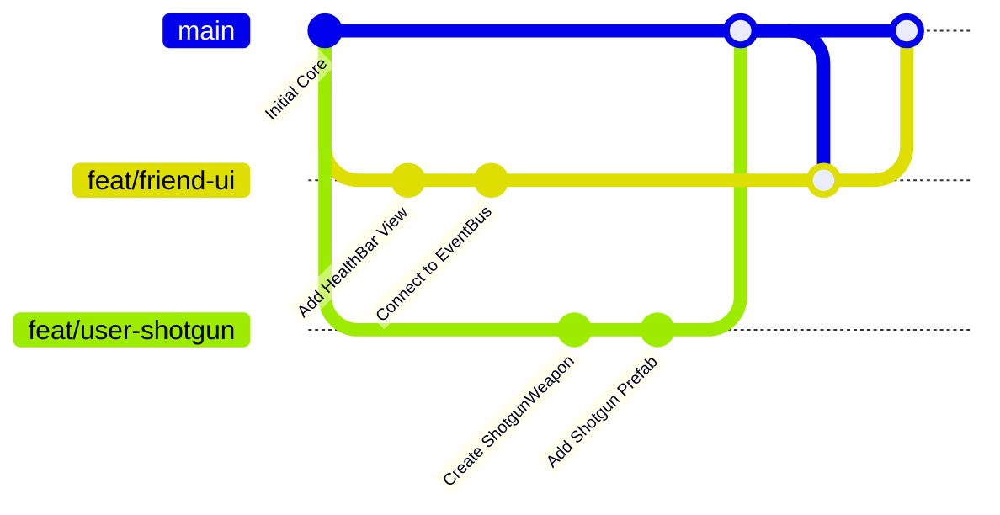

# CollaborationAndGitWorkflow (İki Kişilik Ekip ve AI İşbirliği Protokolü)

> [!important] ÇAKIŞMASIZ (CONFLICT-FREE) VE SPAGETTİSİZ GELİŞTİRME PROTOKOLÜ
> İki geliştiricinin ve onların kullandığı yapay zekâ asistanlarının aynı projede birbirlerinin kodunu bozmadan, sahne çakışması (Merge Conflict) yaşamadan ve spagetti kod üretmeden çalışmasını sağlayan katı kurallar bütünü.

---

## 1. SORUMLULUK ALANLARI VE KLASÖR İZOLASYONU

| Geliştirici | Birincil Sorumluluk Alanı | İzin Verilen Klasörler | Dokunulmaması Gereken Klasörler |
| :--- | :--- | :--- | :--- |
| **Geliştirici 1 (Sen)** | 3D Modelleme, Düşman Tasarımı, Silah Fiziği, Seviye Tasarımı | `Assets/_Project/Models/`<br>`Assets/_Project/Prefabs/Enemies/`<br>`Assets/_Project/Scripts/Combat/`<br>`Assets/_Project/Scripts/Player/` | Arkadaşının geliştirdiği UI veya Ses sistemlerinin iç sınıfları |
| **Geliştirici 2 (Arkadaşın)** | UI Tasarımı, Ses Mimarisi, Ekstra Oyun Modları veya Bölüm Akışı | `Assets/_Project/Scripts/UI/`<br>`Assets/_Project/Audio/`<br>`Assets/_Project/Prefabs/UI/`<br>`Assets/_Project/Scenes/Friend_Sandbox.unity` | Düşman FSM sınıfları (`BasicEnemyAI`), Silah çekirdeği (`WeaponBase`), Oyuncu hareket fiziği |

---

## 2. UNITY SAHNE (.UNITY) ÇATIŞMALARINA KARŞI 3 ALTIN KURAL

Unity'de iki kişi aynı anda `SampleScene.unity` dosyasını değiştirirse Git bunu otomatik birleştiremez ve sahne bozulur. Bunu önlemek için:

1. **Ortak Sahneye Dokunma Yasağı:**
   - Ana sahne (`SampleScene.unity` veya `MainTower.unity`) bir kişinin kontrolünde olmalıdır.
   - Her geliştirici kendi sandbox sahnesinde çalışır:
     * `Assets/Scenes/Dev_User_Sandbox.unity`
     * `Assets/Scenes/Dev_Friend_Sandbox.unity`
2. **Her Şey Prefab'dır (Prefab-First Workflow):**
   - Sahnede yeni bir düşman, yeni bir tuzak, yeni bir kapı veya yeni bir UI tasarladığınızda, onu sahnede bırakmayın; `Assets/_Project/Prefabs/` altına **Prefab** olarak kaydedin.
   - Ana sahneye sadece tamamlanmış prefab'lar sürüklenip bırakılır.
3. **Prefab Değişikliklerinde Nested Prefab ve Variant:**
   - Bir prefab'ın ana yapısını bozmamak için üzerine sağ tıklayıp `Create > Prefab Variant` kullanın.

---

## 3. SPAGETTİ KODA KARŞI: ASSEMBLY DEFINITIONS (.ASMDEF)

Kodların birbirine doğrudan bağlanmasını ve başka bir AI'ın rastgele `GetComponent` atmasını engellemek için kod tabanını Assembly Definition'lar ile fiziksel olarak sınırlandırın:

- `RetroFPS.Core.asmdef` ➔ Arayüzler (`IDamageable`, `IStunnable`, `IEncounterEnemy`)
- `RetroFPS.Player.asmdef` ➔ Oyuncu hareket, kamera, parry
- `RetroFPS.Combat.asmdef` ➔ Düşman AI, sürü alarmı, mermiler
- `RetroFPS.Weapons.asmdef` ➔ Silah tabanı, viewmodel
- `RetroFPS.UI.asmdef` ➔ HUD, menüler

> [!tip] ASMDEF GÜCÜ
> UI klasöründeki bir script veya AI, `RetroFPS.Combat` referansı eklenmediği sürece doğrudan `BasicEnemyAI` sınıfını çağıramaz; proje derlenmez! Bu durum hem arkadaşınızı hem de onun AI'ını **Event-Driven (Olay Güdümlü)** çalışmaya zorlar.

---

## 4. GIT BRANCH VE PULL REQUEST (PR) AKIŞI



1. **Asla Doğrudan `main` Branch'ine Push Yapmayın:**
   - Her yeni özellik ayrı bir branch'te geliştirilir:
     * `git checkout -b feat/arkadas-ui-hud`
     * `git checkout -b feat/sen-yeni-dusman-boss`
2. **Birleştirmeden Önce Kontrol Listesi (Pre-Merge Checklist):**
   - [ ] Unity Console'da sıfır hata ve sıfır derleme uyarısı var mı?
   - [ ] `Update()` / `FixedUpdate()` içinde `GetComponent`, `Find` veya string concatenation yapılmış mı? (Sıfır GC kuralı)
   - [ ] Yeni kod mevcut sistemleri bozmadan arayüz (`IDamageable`) üzerinden mi konuşuyor?
   - [ ] Değişiklikler sadece ilgili prefab'a mı uygulandı, yoksa ortak sahne dosyası da yanlışlıkla değiştirildi mi?

---

## 5. BAŞKA BİR AI KULLANIRKEN VERİLMESİ GEREKEN PROMPT ŞABLONU
Arkadaşınız kendi AI'ına (Cursor, Claude, Copilot vb.) bir görev verirken şu şablonu kullanmalıdır:

```markdown
Bu projede Unity 6, URP ve New Input System kullanılmaktadır.
Lütfen kod yazmadan önce:
1. 'START_HERE_AI_CONSTITUTION.md' dosyasındaki Zero-GC ve encapsulation kurallarına uy.
2. 'CodebaseDependencyGraph.md' dosyasındaki bağımlılıkları incele.
3. Diğer geliştiricinin kodlarına doğrudan GetComponent ile bağlanma; 'CombatAndDamageInterfaces.md' arayüzlerini ve C# Action delegelerini kullan.
4. Hot path'lerde (Update) bellek tahsisi yapma.
```

---

## İlişkiler (Sinaptik Ağ Bağlantıları)
- [[START_HERE_AI_CONSTITUTION]] ➔ `governed_by_constitution`
- [[CodebaseDependencyGraph]] ➔ `protects_graph`
- ⬅️ [[ProjectOverview]] ➔ `defines_collaboration` *(gelen)*
