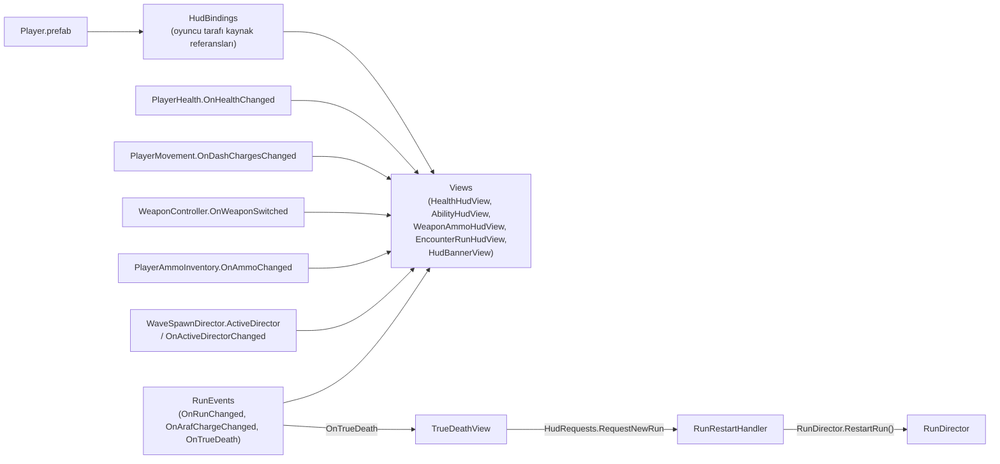

# CombatHudArchitecture (Savaş HUD Mimarisi)

> [!abstract] KAN VE KEMİK SAVAŞ HUD'U, UGUI
> Savaş HUD'u UGUI ve `RetroFPS.HUD` assembly'sinde kuruludur. HUD yalnızca gösterir ve istek gönderir. Oyun durumunu (can, dalga, Araf, run) oyun sistemleri sahiplenir.
> - **Spec:** `design/ux/hud.md`
> - **Erişilebilirlik:** Standart seviye
> - **Son Güncelleme:** 2026-11-12

---

## 1. GENEL BAKIŞ
- **Teknoloji:** UGUI (Canvas, TextMeshPro, `RetroFPS.HUD` asmdef, kök namespace `RetroFPS.UI.HUD`). Yeni Input System kullanılır.
- **Görsel yön:** "Kan ve Kemik". Koyu, %90 opak plakalar, `HudTheme` paleti ve yazı referansları. Ana menü ile aynı tema ve metin tablosu kullanılır.
- **Köşe düzeni:**
  - Sol alt: can, atılma/savuşturma, kanca.
  - Sağ alt: silah ve cephane.
  - Sağ üst: dalga ve Araf bilgisi.
  - Üst orta: duyuru (banner).
- **OnGUI'de kalanlar:** nişangah, hasar sayıları, vinyet. Bu öğeler UGUI'ye taşınmamıştır.

## 2. MİMARİ AKIŞ

- **Bağlama:** `CombatHud.prefab`, `Player.prefab`'ın iç çocuğudur. `HudBindings` oyuncu kaynaklarını HUD'a enjekte eder.
- **Yaşam döngüsü:** Awake önbellek ve doğrulama, OnEnable abonelik, OnDisable abonelik iptali. Start ve yeniden etkinleştirmede tam anlık görüntü alınır.
- **Sahne:** HUD yalnızca oyuncu bulunan kule sahnelerinde (`TestLevel_Gauntlet`, `SampleScene`) yaşar. Araf'a ayrı bir HUD eklenmez, ana menüde HUD yoktur.

## 3. BİLEŞEN TABLOSU

| Katman | Dosya | Sorumluluk |
|---|---|---|
| Core/Presentation | `HudRequests.cs` | HUD'dan oyuna giden istekler. Örn. `NewRunRequested`. |
| Core/Presentation | `HudConfig.cs` | Yalnızca skaler sunum ayarları. `lowHealthPercent = 0.30`. Gameplay ve HUD aynı asset'i paylaşır. |
| Core/Presentation | `HudLowStateRules.cs` | Düşük can kuralı. `PlayerDamageFeedback` de aynı kuralı okur. |
| Core/Presentation | `HudNumberCache.cs` | Sayı stringlerinin önbelleği. Sıfır GC için. |
| HUD/Logic | `HealthDisplayModel.cs` | Can gösterimi için POCO model. |
| HUD/Logic | `CooldownDisplayCache.cs` | Bekleme süresi değerlerinin önbelleği. |
| HUD/Logic | `HudBannerQueue.cs` | Üst orta duyuru kuyruğu. |
| HUD/Logic | `TrueDeathGate.cs` | Gerçek Ölüm kartının açılma koşulu. |
| HUD/Data | `HudTheme.cs` | ScriptableObject. Renk, font ve tema belirteçleri. |
| HUD/Views | `HudBindings.cs` | Oyuncu kaynaklarını (PlayerHealth, PlayerMovement, PlayerParryController, WeaponController, PlayerAmmoInventory) ve paylaşılan config'i tutar. Abonelikleri yönetir. |
| HUD/Views | `HudLayout.cs` | Köşe ve konum düzeni. |
| HUD/Views | `HealthHudView.cs` | Sol alt can göstergesi. |
| HUD/Views | `AbilityHudView.cs` | Atılma, savuşturma ve kanca göstergeleri. |
| HUD/Views | `WeaponAmmoHudView.cs` | Sağ alt silah ve cephane. |
| HUD/Views | `EncounterRunHudView.cs` | Sağ üst dalga ve Araf bilgisi. |
| HUD/Views | `HudBannerView.cs` | Üst orta duyuru gösterimi. |
| HUD/Views | `TrueDeathView.cs` | Gerçek Ölüm kartı. Onay sonrası `NewRunRequested` gönderir. |
| HUD/Views | `HudEventSystemGuard.cs` | Sahnede tek etkin EventSystem olmasını sağlar. |
| Gameplay | `RunRestartHandler` | `HudRequests.NewRunRequested` olayını dinler ve `RunDirector.RestartRun()` çağırır. |

## 4. KURALLAR
- **HUD oyun durumunu sahiplenmez.** Yalnızca olay dinler ve istek gönderir. Run, can ve sahne durumunu değiştirmez.
- **Sıfır GC.** Önbellekli sayı stringleri, char buffer ve `SetCharArray` kullanılır. Güncelleme döngülerinde tahsis yok.
- **Tek düşük can eşiği.** `HudConfig.lowHealthPercent = 0.30`. HUD ve `PlayerDamageFeedback` aynı değeri kullanır.
- **Ölüm kartı yalnızca Gerçek Ölüm'de açılır** (`RunEvents.OnTrueDeath`). `PlayerHealth.OnDied`, FallingToAraf ve InAraf kartı açmaz.
- **Araf'ta dalga bloğu gizlidir** ve duyuru kuyruğu temizlenir.
- **Yeniden başlatma tek yoldan.** HUD `NewRunRequested` gönderir, `RunRestartHandler` `RunDirector.RestartRun()` çağırır. Kaydedilmiş kule sahnesi yüklenir. Gerçek Ölüm için `RetryInterceptor` kullanılmaz.
- **Eski HUD'lar.** `AmmoHUD` ve `RunHUD` `[Obsolete]` işaretlidir. `mert_level` hâlâ bunları kullandığı için silinmedi.
- **Debug HUD.** `PlayerDebugHUD` varsayılan olarak kapalıdır. F2 ile açılır ve seed, kat ve süreyi gösterir.

## 5. YENİDEN ÜRETME
- Unity Editor menüsü: **`RetroFPS/Build Combat HUD`**.
- Builder idempotenttir. Player ve RunDirector prefablarını ve `SampleScene`'i HUD'a bağlar.

## 6. BİLİNEN EKSİKLER
- **UI ölçekleme ertelendi.**
- **Renk körlüğü paleti yok.**
- **Ruh cevheri, lanet eşyası ve boss barı HUD'u yok.**
- **Yer tutucu font ve sanat.**
- **TMP metin kutuları:** Ellipsis modunda satır yüksekliği font boyutunun 1.2 katından küçükse metin boş görünür. `CombatHudTextFitTests` bunu korur.

## İlişkiler (Sinaptik Ağ Bağlantıları)
- [[ProjectOverview]] ➔ `features_ui` *(gelen)*
- [[MainMenuAndSettings]] ➔ `shares_theme_and_strings`
- [[CoreLoopAndPurgatory]] ➔ `reads_run_phase`
- [[WaveAndEncounterArchitecture]] ➔ `observes_director`
- [[PlayerSubsystemArchitecture]] ➔ `binds_player_sources`
- [[DualLoadoutAndWeapons]] ➔ `displays_weapons`
