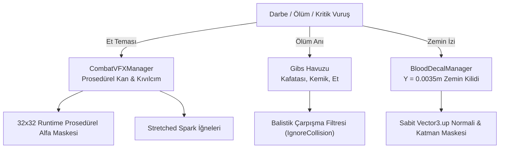

# CombatVFXAndDecalSystem (Görsel Efekt, Kan ve Parçalanma Motoru)

> [!abstract] PERFORMANS ODAKLI RETRO GORE VE PARÇACIK MİMARİSİ
> Dış doku dosyası bağımlılığı olmayan çalışma anı (runtime) prosedürel alfa maskeleri, havuzlanmış anatomik parçalanma fizikleri (gibs), uzayan erimiş kıvılcımlar ve sıfır GC zemin leke projeksiyonu.

---

## 1. MİMARİ BİLEŞENLER VE ÇALIŞMA STANDARDI

---

## 2. KİLİT ALTSİSTEMLER VE TEKNİK ÖZELLİKLER

### 1. Prosedürel Dokulu Partikül Motoru (`CombatVFXManager`)
- **Konum:** `Assets/_Project/Scripts/Combat/CombatVFXManager.cs`
- **Tasarım İlkesi:** Harici PNG/TGA dokularına ihtiyaç duymadan, `Texture2D` üzerinde 32x32 boyutunda matematiksel radyal gradyan ile alfa maskeleri (kan damlası, kor kıvılcım, duman pufu) üretir.
- **Piksel Bozulma Koruması:** Point filter ve düşük çözünürlük ile retro piksel estetiğini korur; pürüzsüzleştirmeyi (bilinear blur) engeller.
- **Erimiş Kıvılcım İğneleri:** `ParticleSystemRenderMode.Stretch` ve hız çarpanı (`velocityScale`) kullanılarak mermi veya kılıç temasında yönlü uzayan parlak kor iğneleri saçar.

### 2. Anatomik Parçalanma Fiziği (Gibs & Dismemberment)
- **Nesne Havuzlama (Object Pooling):** Kafatası, kaburga kemiği ve et parçaları çalışma anında `Instantiate` edilmez; önceden tahsis edilmiş havuzdan çağrılır.
- **Parçacık Balistik Fiziği:** 
  * Fırlatılan uzuv ve kemik parçaları `Physics.IgnoreCollision` ile birbirleriyle çarpışma testinden muaf tutulur. Bu sayede havada karmaşık fizik patlamaları engellenir; parçalar doğrudan zemin ve duvar geometrisiyle gerçekçi şekilde etkileşime girer.
  * Parçalar zemine çarptığında küçük kan sıçraması bırakır ve belirli bir süre sonra otomatik havuza döner.

### 3. Zemin Kan Projeksiyonu (`BloodDecalManager`)
- **Konum:** `Assets/_Project/Scripts/Combat/BloodDecalManager.cs`
- **Hassas Zemin Kilitleme:**
  * Düşman veya mermilerden kaynaklanan kan damlaları zemine ulaştığında raycast ile zemin tespiti yapılır.
  * Raycast filtresinde `Düşman`, `Oyuncu` ve `Mermi` katmanları hariç tutulur (LayerMask).
  * Leke normali matematiksel olarak daima `Vector3.up` yönüne ve `Y = 0.0035m` zemin yüksekliğine kilitlenir. Bu sayede havada asılı kalma (floating) veya dikey duvarlara uzama (stretching) tamamen engellenir.
- **Leke Havuzu ve Döngüsü:** Maksimum leke limitine (örn. 128 adet) ulaşıldığında en eski leke silinerek yeni lekeye yer açılır (FIFO Ring Buffer), bellek ve draw-call sabit kalır.

---

## 3. BAŞKA BİR AI İÇİN ENTEGRASYON KURALLARI
1. Yeni bir silah veya saldırı türü eklendiğinde doğrudan `Instantiate(BloodPrefab)` çağrısı yapmayın.
2. Daima merkezi yöneticileri kullanın:
   - `CombatVFXManager.Instance.SpawnBloodSplash(hitPoint, hitNormal, isCritical);`
   - `BloodDecalManager.Instance.SpawnDecal(hitPoint, hitNormal);`
3. Tüm efektler sıfır GC tahsisli çalışacak şekilde tasarlanmıştır; Update döngülerinde yeni materyal örneği (`new Material()`) oluşturmayın.

---

## İlişkiler (Sinaptik Ağ Bağlantıları)
- [[CodebaseDependencyGraph]] ➔ `implements_vfx_pipeline`
- [[CombatAndDamageInterfaces]] ➔ `triggered_by_damage`
- [[WeaponArsenalArchitecture]] ➔ `triggered_by_weapons`
- [[EnemyAIAndSpawning]] ➔ `triggered_by_enemy_death`
- ⬅️ [[ProjectOverview]] ➔ `utilizes_vfx` *(gelen)*
- ⬅️ [[START_HERE_AI_CONSTITUTION]] ➔ `mandated_by_constitution` *(gelen)*
