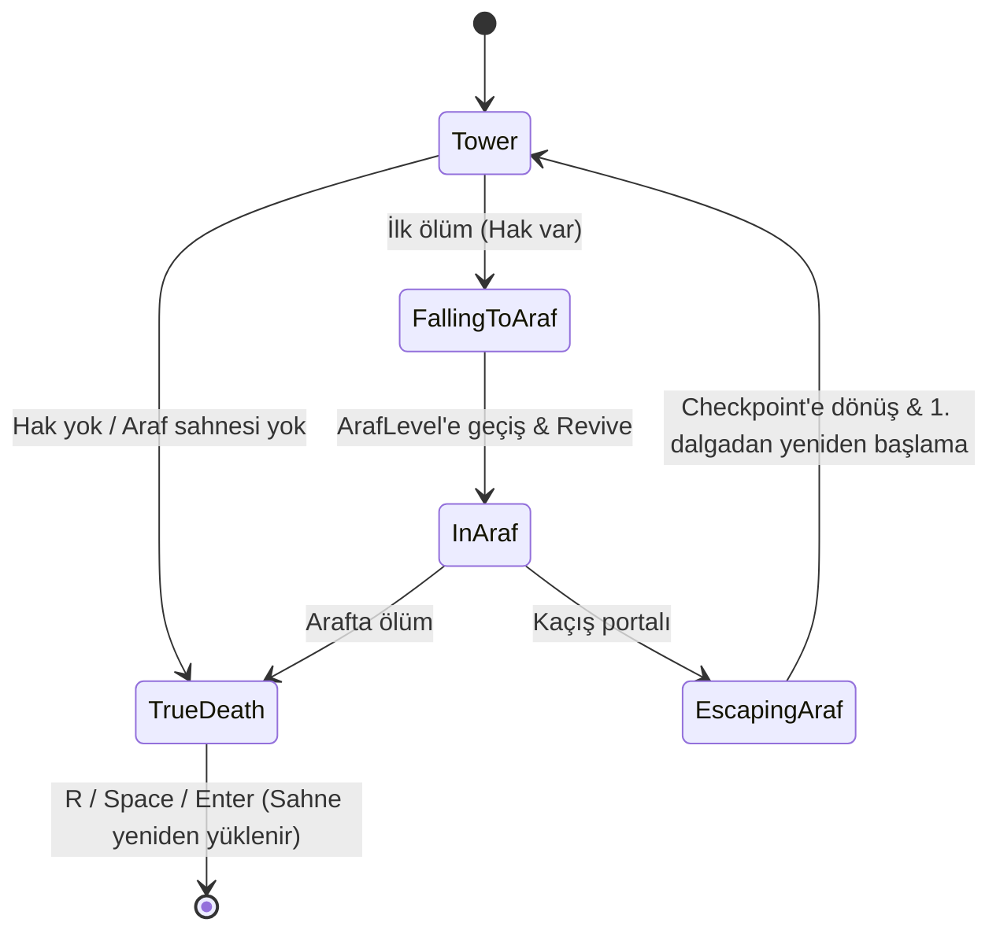

# CoreLoopAndPurgatory (Temel Oyun Döngüsü, Kule Tırmanışı ve Araf Mekaniği)

> [!abstract] ROGUE-LITE İLERLEME VE İKİNCİ ŞANS MEKANİĞİ
> Dikey gotik kule katlarında arena savaşları, lanetli aile üyeleriyle boss arındırma karşılaşmaları, can sıfırlandığında düşülen prosedürel Araf (Purgatory) labirenti ve gerçek kalıcı ölüm (True Permadeath).

---

## 1. DÖNGÜ VE YAŞAM AKIŞI

```mermaid
flowchart TD
    Baslangic["Kule Girişi (Zemin Kat)"] --> Katlar["Kat Tırmanışı & Karşılaşmalar\nEncounterArea / WaveSpawnDirector"]
    Katlar --> Boss["Kat Sonu: Lanetli Aile Üyesi Boss Savaşı"]
    Boss -->|Zafer| SonrakiKat["Sonraki Kat (Kule Zirvesine Doğru)"]
    
    Katlar & Boss -->|Can Sıfırlandı (PlayerHealth <= 0)| ArafGecisi["Araf'a Düşüş (Purgatory Labyrinth)\nİkinci Şans"]
    
    subgraph ARAF_LABIRENTI["Kemik Duvarlı Araf Labirenti"]
        ElitDusmanlar["Yüksek Hasarlı Elit Yaratıklar"]
        CursedLoots["Çift Taraflı Lanetli Eşyalar (Curse/Blessing)"]
        EscapePortal["Araf Kaçış Portalı"]
    end
    
    ArafGecisi --> ARAF_LABIRENTI
    EscapePortal -->|Başarıyla Kaçış| Katlar
    
    ARAF_LABIRENTI -->|Arafta İkinci Ölüm| TrueDeath["Kalıcı Ölüm (True Permadeath)\nTüm Silahlar & Geçici Eşyalar Silinir"]
    TrueDeath --> MetaProg["Kalıcı Pasif Ruh Geliştirmeleri (Meta-Progression)"]
    MetaProg --> Baslangic
```

---

## 2. KİLİT MEKANİK KURALLARI VE DİNAMİKLER

### 1. Dikey Kule Tırmanışı (Tower Ascent)
- **Yapı:** Her kat gotik mimariye sahip bir veya birkaç `EncounterArea` odasından oluşur.
- **Karşılaşma Mantığı:** Oyuncu odaya girdiğinde barikatlar kapanır, `WaveSpawnDirector` dalgaları başlatır; düşmanlar temizlenince kapılar açılır ve kat asansörüne / portalına geçiş verilir.
- **Boss Arındırma Savaşları:** Her bölümün sonunda kuleye hapsedilmiş ve canavara dönüşmüş gotik bir aile ferdiyle arındırma düellosu gerçekleşir.

### 2. Araf (Purgatory / İkinci Şans) Mekaniği
- **Hak Sınırı:** Araf hakkı **run başına bir kez**dir. Araf kullanıldıktan sonra kulede ikinci ölüm de doğrudan Gerçek Ölüm'dür (True Permadeath).
- **Tetiklenme:** Kuledeyken `PlayerHealth` sıfıra ulaştığında oyun anında "Game Over" ekranı vermez; karakter karanlık bir girdapla kemik duvarlı Araf labirentine çekilir.
- **Risk & Ödül:**
  * Düşmanlar kuledekilere göre %40 daha agresiftir ve yüksek hasar verir.
  * Labirentte bulunan eşyalar çift taraflıdır (örn. "+%50 Saldırı Hızı ancak -%30 Maksimum Can").
- **Kuleye Dönüş:** Portaldan kaçan oyuncu **öldüğü odanın başına (encounter checkpoint)** döner ve o karşılaşma 1. dalgadan yeniden başlar. Karşılaşma dışında öldüyse `RunDirector.towerFallbackRespawn` noktasına (yoksa öldüğü yere) döner.

### 3. Gerçek Kalıcı Ölüm (True Permadeath)
- **Koşul:** Oyuncu Araf labirentinde de canını sıfırlarsa ikinci bir şans verilmez.
- **Sıfırlama:** Mevcut koşudaki (run) tüm silahlar, cephaneler ve geçici güçlendirmeler silinir; kule sıfırlanır.
- **Kalıcı İlerleme (Meta-Progression):** Yalnızca kule boyunca toplanan arındırılmış ruh cevherleri korunur; bu cevherlerle kule girişindeki gotik sunakta kalıcı stat geliştirmeleri (Taban Can, Dash Dolum Hızı, Parry Kabul Açısı vb.) açılır.

---

## 3. UYGULAMA MİMARİSİ (Faz 1 — 2026-11-11)

### Sahne Stratejisi (Additive Preload)
- **Sıfır Yükleme Süresi (Ölümde Sahne Yüklenmez):** `Araf` sahnesi run başında `SceneManager.LoadSceneAsync("Araf", LoadSceneMode.Additive)` ile önceden yüklenir; sahne içerik kökü (`ArafLevel.contentRoot`) kapalı tutulur.
- **Geçiş Döngüsü:** Geçiş = fade + `PlayerHealth.Revive(entryPoint)` + `SceneManager.SetActiveScene(araf)` (sis ve ambient ışıklandırma otomatik değişir).
- **Tek Sahne Yüklemesi:** Gerçek Ölüm durumunda `SceneManager.LoadScene(tower, LoadSceneMode.Single)` ile tek sahne yüklemesi yapılır.
- **Uzamsal İzolasyon:** Araf içeriği kule geometrisinden uzakta ve **yukarıda** kurulur (`ArafLevel` kökü Y = +1000). **Negatif Y kullanılmaz:** `PlayerMovement` Y < 0 olduğunda oyuncuyu Y = 0.05'e geri çeker, `FlyingEyeAI` ölüm animasyonu da zemini ~Y = 0 varsayar.

### Temel Dosyalar ve Bileşenler
| Dosya | Rolü / Sorumluluğu |
| :--- | :--- |
| `Run/RunState.cs` | POCO durum nesnesi: `Seed`, `FloorIndex`, `ArafChargeUsed`, `Phase`. |
| `Run/RunEvents.cs` | Statik eventler + `ActiveEncounter` kaydı. |
| `Run/RunDirector.cs` | Durum makinesi, kule/araf yaşam döngüsü ve ölüm sahibi. |
| `Run/ArafTransition.cs` | uGUI fade / durum mesajları / slow-mo efekti (`Awaitable` + unscaled time). |
| `Run/ArafLevel.cs` | Araf sahnesi giriş noktası (`entryPoint`) + içerik kökü (`contentRoot`). |
| `Run/ArafEscapePortal.cs` | Trigger teması ile `RunEvents.RaiseEscapePortalReached` tetikleyen kaçış portalı. |
| `Core/Interfaces/IRetryableEncounter.cs` | `CanResumeAfterDeath`, `SuspendForPurgatory`, `ResumeAfterPurgatory` arayüzü (`WaveSpawnDirector` uygular). |

### Yaşam Döngüsü Durum Makinesi


### Ölüm Sahipliği ve Entegrasyon
- `RunDirector` Awake'te `PlayerHealth.ExternalDeathControl = true` yapar.
- Bu durumda `PlayerHealth`'in R/Space/Enter yeniden başlatması ve `RestartGame()` devre dışıdır.
- `RunDirector` olmayan sahnelerde eski `RetryInterceptor` checkpoint retry davranışı aynen çalışır. (`TestLevel_Gauntlet` artık bir `RunDirector` içerir; orada ölüm Araf akışına girer.)

### Kurulum Kontrol Listesi (Inspector / Scene Setup)
1. **Build Settings:** `Araf` sahnesi Build Settings sahne listesine eklenmelidir.
2. **Araf Sahnesi:** Sahnede `ArafLevel` (`entryPoint` Transform + `contentRoot` GameObject) ve trigger collider'lı `ArafEscapePortal` bileşeni bulunmalıdır. Araf elit düşmanları için Araf sahnesinde normal `WaveSpawnDirector` + `EncounterTriggerVolume` kullanılabilir.
3. **Kule Sahnesi:** Kule sahnesinde bir `RunDirector` prefab'ı (player referansı, opsiyonel `towerFallbackRespawn` Transform) yer almalıdır.

### Otomatik Kurulum: `ArafSceneBuilder` (Editor)
- Menü: **RetroFPS ▸ Build Araf Scene + RunDirector** (`Scripts/Editor/ArafSceneBuilder.cs`, `BuildAll()`; idempotent, tekrar çalıştırılabilir).
- Üretir: `Assets/_Project/Prefabs/Systems/RunDirector.prefab` (RunDirector + ArafTransition), `Assets/_Project/Data/Materials/Araf/` (Bone, Floor, emisif Portal), `Assets/Scenes/Araf.unity` (40×40 kemik duvarlı mini labirent, giriş (-16,-16) → kan portalı (+16,+16), kızıl nokta ışıklar, kızıl sis/ambient, 3 Ghoul + 1 Flying Eye bağımsız yerleştirilmiş), Build Settings kaydı ve `TestLevel_Gauntlet`'e RunDirector örneği.
- Düşmanlar Araf'ta `WaveSpawnDirector` olmadan, kendi idle/patrol durumlarıyla çalışır.
- **Doğrulama (2026-11-11, Play Mode):** İlk ölüm → `InAraf` (Y≈1000, aktif sahne Araf, kızıl sis) → portal → `Tower`; ikinci ölüm → `TrueDeath`. Karşılaşma ortasında ölüm → kaçışta oyuncu odanın `retryCheckpoint`'inde dirilir, karşılaşma 1. dalgadan yeniden başlar ve `RunEvents.ActiveEncounter` olarak yeniden kaydolur.

### Sonraki Fazlar
- **Faz 2:** Seed'li `RunRandom` + `WaveSetPool`.
- **Faz 3:** Lanet/lütuf kartları (`CurseBlessingDefinition`) ve sunak etkileşimi.
- **Midterm Sonrası:** Prosedürel kemik labirenti jeneratörü.

---

## 4. BAŞKA BİR AI İÇİN MİMARİ ENTEGRASYON SÖZLEŞMESİ
1. Ölüm akışını `RunDirector` yönetir; yeni sistemler `RunEvents` olaylarına abone olmalı, `PlayerHealth`'e doğrudan sahne yükleme eklenmemelidir.
2. Araf labirenti mekaniği eklenirken `IEncounterEnemy` arayüzünü uygulayan elit düşmanlar kullanılmalıdır.

---

## İlişkiler (Sinaptik Ağ Bağlantıları)
- [[WaveAndEncounterArchitecture]] ➔ `manages_tower_rooms`
- [[PlayerSubsystemArchitecture]] ➔ `monitors_player_death`
- [[CombatAndDamageInterfaces]] ➔ `evaluates_combat_stakes`
- ⬅️ [[ProjectOverview]] ➔ `features_mechanic` *(gelen)*
- ⬅️ [[START_HERE_AI_CONSTITUTION]] ➔ `mandated_by_constitution` *(gelen)*
