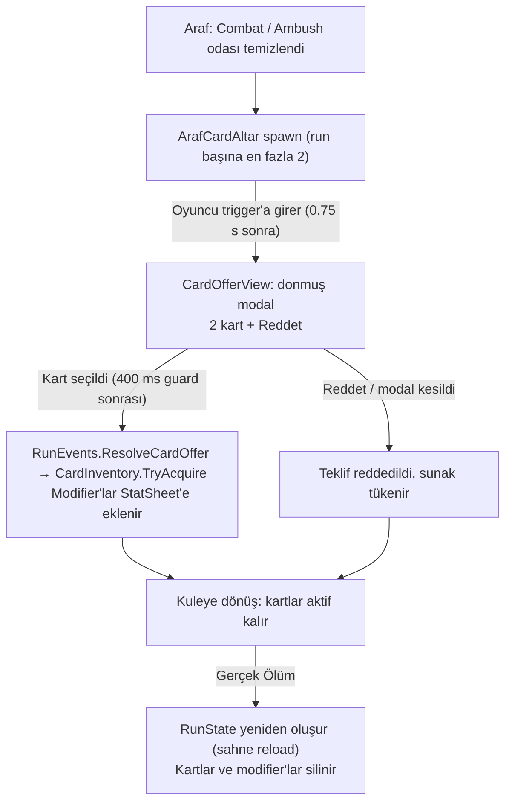

# CurseBlessingCards (Lanet ve Lütuf Kartları, Stat Modifier Katmanı)

> [!abstract] FAZ 3 — ARAF SUNAKLARINDAN ÇIKAN ÇİFT TARAFLI KARTLAR
> Temizlenen Combat ve Ambush odalarındaki sunaklardan iki kart teklif edilir; oyuncu birini seçer veya reddeder. Seçilen kart her biri bir ya da birden fazla stat değiştiren modifier'ları run'ın `StatSheet`'ine ekler. Kartlar yalnızca o run boyunca geçerlidir; Gerçek Ölüm'de silinir.

---

## 1. DÖNGÜ VE YAŞAM AKIŞI



- **Bulma:** Kart yalnızca Araf labirentinde, temizlenmiş bir **Combat** veya **Ambush** odasının içinde spawn olan sunakta bulunur. Kule tarafında kart kaynağı yoktur.
- **Seçme:** `CardOfferView` oyunu dondurur (`Time.timeScale = 0`); seçim, 400 ms'lik bir koruma süresinden sonra aktif olur.
- **Etki:** Seçilen kartın modifier'ları `CardInventory.TryAcquire` ile tek batch içinde `StatSheet`'e eklenir. Kart ve modifier'ları aynı anda ya tamamı ya hiç eklenir.
- **Kuleye dönüş:** Aynı `RunState` kullanıldığı için kartlar Araf'tan kaçıştan sonra da geçerlidir.
- **Silinme:** `RunDirector.Awake` her sahne yüklemesinde yeni bir `RunState` (ve yeni `StatSheet`, `CardInventory`, `CardOfferRoller`) oluşturur. Gerçek Ölüm `SceneManager.LoadScene(tower, Single)` ile sahneyi yeniden yüklediği için kartlar kalıcı olarak silinir.

---

## 2. TASARIM KARARLARI

| Karar | Uygulama |
| :--- | :--- |
| Sunak kaynağı | Yalnızca temizlenen **Combat** ve **Ambush** odaları sunak üretir (`ArafLabyrinthDirector.HandleRoomCleared`). Diğer oda tipleri üretmez. |
| Teklif limiti | Run başına en fazla **2** teklif (`CardOfferRoller.MaxOffersPerVisit = 2`). Sayaç `RunState.CardOffers` üzerindedir; Araf ziyareti başına sıfırlanmaz. |
| Teklif içeriği | Her teklif **2 kart** gösterir; oyuncu birini seçer veya **Reddet** seçeneğini kullanır. Tek kart kalmışsa teklif tek kartla açılabilir. |
| Tekrar | Aynı teklif içinde ve oyuncunun zaten sahip olduğu kartlar tekrar edilmez (`CardOfferRoller`, reservoir sampling ile eşit olasılık). |
| Modal | Donmuş (`timeScale = 0`), exclusive pause servisi ile; açılışta sopa/tuş girdisi bekletilir. |
| Kart kapasitesi | En fazla **16** kart (`CardInventory.MaxCards`). |
| Stat hedefleri | Yalnızca oyuncu statları (`StatId`). Düşman statları katmanda yoktur. |
| Koşullar | `Always`, `HealthBelowHalf` (sağlık oranı 0.5'in kesin altında), `Overhealed` (can maksimumun üstünde). |
| Olay tetikleyicileri | Henüz yok. Koşullar yalnızca anlık can durumuna göre değerlendirilir. |
| MaxHealth kısıtı | `StatId.MaxHealth` için koşullu (`HealthBelowHalf`/`Overhealed`) modifier **reddedilir**: sağlık oranı maksimum cana bağlı olduğu için döngüsel olur. Hem `StatSheet.Add` hem `CardInventory.TryAcquire` bu kuralı uygular. |
| Geçersiz değer | NaN / sonsuz değerli modifier'lar reddedilir. |

---

## 3. STAT KATMANI

Namespace: `RetroFPS.Stats` (`Scripts/Core/Stats/`).

### 3.1 Stat Kimlikleri (`StatId`)

| Değer | Anlam |
| :--- | :--- |
| `DamageDealt` (0) | Verilen hasar |
| `MeleeDamage` (1) | Melee hasarı |
| `FireRate` (2) | Ateş hızı |
| `MoveSpeed` (3) | Hareket hızı |
| `DashRechargeTime` (4) | Dash dolum süresi |
| `MaxHealth` (5) | Maksimum can |
| `DamageTaken` (6) | Alınan hasar |
| `HealReceived` (7) | Alınan iyileşme |
| `HarvestHeal` (8) | Kan Hasadı iyileşmesi |
| `OrbDropChance` (9) | Can küresi düşme olasılığı |
| `AmmoPickupAmount` (10) | Cephane pickup miktarı |
| `OverhealCap` (11) | Fazla can sınırı |

`StatIds.Count = 12` sınır bilgisi olarak tutulur.

### 3.2 Modifier Türleri

- **`StatOp`**
  - `AddFlat`: tabana eklenir (yüzde uygulanmadan önce).
  - `AddPercent`: ortak yüzde toplamına eklenir (fraksiyon: `0.35` = %35).
  - `Multiply`: nihai değeri çarpar.
- **`StatCondition`**: `Always`, `HealthBelowHalf`, `Overhealed` (bkz. Bölüm 2).
- **`StatModifier`**: serileştirilebilir, salt-okunur struct (`stat`, `op`, `value`, `condition`).

### 3.3 Hesaplama Formülü

`StatSheet.Evaluate(stat, baseValue)` koşulu sağlayan modifier'ları üç grupta toplar:

```
flat    = Σ AddFlat
percent = Σ AddPercent
mult    = Π Multiply

sonuç = max(0, (base + flat) × max(0, 1 + percent) × mult)
```

### 3.4 Erişim ve Sıfır GC

- `PlayerStats.Current`: aktif run'ın `StatSheet`'i; run dışında `null`.
- `PlayerStats.Get(stat, base)`: sheet yoksa `base` döner. Böylece sahne run olmadan da çalışır.
- `StatSheet` sabit kapasitelidir (`MaxModifiers = 64`, dizi tabanlı). `Evaluate` ve `Matches` heap tahsisi yapmaz; hot path (`Update`) içinde çağrılabilir.
- Değişiklikler `Version` artırır ve `OnChanged` olayını tetikler; `BeginBatch`/`EndBatch` ile toplu değişiklikte olay bir kez yayınlanır.
- Bağlam (`IStatContext`) `PlayerHealth` tarafından sağlanır: `HealthFraction` ve `IsOverhealed`. Koşullu modifier'lar bu bağlamı okur; bağlam `null` ise koşullu modifier'lar uygulanmaz.

---

## 4. KARTLAR

Tanımlar `CurseCardBuilder.BuildAll()` içinde yazılır; `Assets/_Project/Data/Araf/Cards/` altındaki `Card_<id>.asset` dosyalarına ve `CardCatalog_Default.asset` katalogu.

| id | Ad (TR / EN) | Boon (kazanç) | Curse (bedel) | Modifier'lar |
| :--- | :--- | :--- | :--- | :--- |
| `blood_debt` | Kan Borcu / Blood Debt | Tüm hasar +%35 | Maksimum can -%30 | `DamageDealt` AddPercent +0.35; `MaxHealth` AddPercent -0.30 |
| `starving_steel` | Aç Çelik / Starving Steel | Bıçak hasarı +%50; Kan Hasadı iki kat iyileştirir | Düşmanlar can küresi düşürmez | `MeleeDamage` AddPercent +0.50; `HarvestHeal` Multiply 2; `OrbDropChance` Multiply 0 |
| `last_breath` | Son Nefes / Last Breath | Canın yarısının altındayken hasar +%60, hız +%20 | Tüm iyileşmeler -%50 | `DamageDealt` +0.60 (HealthBelowHalf); `MoveSpeed` +0.20 (HealthBelowHalf); `HealReceived` -0.50 |
| `bone_wings` | Kemik Kanatlar / Bone Wings | Dash %40 hızlı dolar; hız +%15 | Alınan hasar +%25 | `DashRechargeTime` Multiply 0.714; `MoveSpeed` +0.15; `DamageTaken` +0.25 |
| `brimming_chalice` | Dolu Kadeh / Brimming Chalice | Fazla can sınırı +50; fazla candayken ateş hızı +%35 | Canın yarısının altındayken hız -%20 | `OverhealCap` AddFlat +50; `FireRate` +0.35 (Overhealed); `MoveSpeed` -0.20 (HealthBelowHalf) |
| `glutton_barrel` | Obur Namlu / Glutton's Barrel | Ateş hızı +%40 | Toplanan cephane -%50 | `FireRate` +0.40; `AmmoPickupAmount` -0.50 |

Her kartın lokalize anahtarları `hud.card.<id>.name`, `.boon`, `.curse`, `.flavor` biçimindedir; `accentColor` HUD şeridi ve modal başlığında kullanılır.

---

## 5. BİLEŞENLER

| Sınıf / Varlık | Tür / Konum | Sorumluluk |
| :--- | :--- | :--- |
| `StatId`, `StatIds` | enum / `Core/Stats/StatId.cs` | Stabil stat kimlikleri ve sayısı. |
| `StatOp`, `StatCondition`, `StatModifier` | enum / struct / `Core/Stats/StatModifier.cs` | Modifier tanımı ve koşulu. |
| `IStatContext` | arayüz / `Core/Stats/IStatContext.cs` | Koşul bağlamı: `HealthFraction`, `IsOverhealed`. |
| `StatSheet` | sealed POCO / `Core/Stats/StatSheet.cs` | Kaynaklı modifier deposu (64 kapasite), `Evaluate`, batch ve değişiklik olayı. |
| `PlayerStats` | statik / `Core/Stats/PlayerStats.cs` | Aktif sheet; `Get(stat, base)`; `RuntimeInitializeOnLoad` ile sıfırlanır. |
| `CurseBlessingDefinition` | ScriptableObject / `Run/Cards/` | Kartın kimliği, lokalizasyon anahtarları, accent ve modifier listesi. |
| `CardCatalog` | ScriptableObject / `Run/Cards/` | Teklif havuzu. |
| `CardOffer` | readonly struct / `Run/Cards/` | En fazla iki kartlık teklif. |
| `CardOfferRoller` | POCO / `Run/Cards/` | Teklif zarı; `RunStream.ArafCards` ile, tekrar etmeden. |
| `CardInventory` | POCO / `Run/Cards/` | Sahip olunan kartlar (16), `TryAcquire` ile modifier ekleme. |
| `ArafCardAltar` | MonoBehaviour / `Run/Cards/` | Trigger ile teklifi açar; tek kullanımlık. |
| `RunState` | POCO / `Run/RunState.cs` | `Stats`, `Cards`, `CardOffers` üyelerini tutar. |
| `RunDirector` | MonoBehaviour / `Run/RunDirector.cs` | `RunState`'i Awake'te oluşturur, `PlayerStats.SetCurrent` ile bağlar, OnDestroy'da temizler. |
| `RunEvents` | statik / `Run/RunEvents.cs` | Kart olayları ve `ResolveCardOffer`. |
| `ArafLabyrinthDirector` | MonoBehaviour / `Run/Labyrinth/` | Temizlenen Combat/Ambush odasına sunak yerleştirir (`cardCatalog`, `cardAltarPrefab`). |
| `CardOfferView` | MonoBehaviour / `UI/HUD/Views/` | Modal: girdi, geri sayım, dondurma, metin. |
| `CardOfferGate` | POCO / `UI/HUD/Logic/` | 400 ms koruma süresi, seçim (kartlar + Reddet), tek seferlik onay. |
| `CardOfferChoiceView` | MonoBehaviour / `UI/HUD/Views/` | Tek seçenek görünümü ve fare hover. |
| `CardOfferPauseService` | sınıf / `UI/HUD/Logic/` | `IPauseService` uygulayan exclusive pause. |
| `ActiveCardsHudView` | MonoBehaviour / `UI/HUD/Views/` | Aktif kartların listesi (6 önceden oluşturulmuş satır). |
| `CardAcquiredBannerView` + `CardAcquiredBannerModel` | MonoBehaviour + model / `UI/HUD/Views` ve `Logic` | Kazanım bildirimi kuyruğu. |
| `CurseCardBuilder` | Editor / `Scripts/Editor/` | Kartları, kataloğu, altar prefabını ve Araf sahne bağlantısını üretir. |

---

## 6. STAT HOOK NOKTALARI

| StatId | Kullanım yeri |
| :--- | :--- |
| `MaxHealth` | `PlayerHealth.MaxHealth` |
| `DamageTaken` | `PlayerHealth` hasar yolları (`amount` üzerinde) |
| `HealReceived` | `PlayerHealth` iyileşme yolu |
| `OverhealCap` | `PlayerHealth` fazla can sınırı (`Max(effectiveMax, Get(...))`) |
| `MoveSpeed` | `PlayerMovement.WalkSpeed` |
| `DashRechargeTime` | `PlayerMovement` dash dolum eşiği |
| `FireRate` | `GothicShotgunWeapon`, `RepeaterArbalestWeapon` (ateş ve alt ateş cooldown'ları) |
| `DamageDealt` | `GothicShotgunWeapon`, `ExecutionerBladeWeapon`, `RepeaterArbalestWeapon` |
| `MeleeDamage` | `ExecutionerBladeWeapon` |
| `HarvestHeal` | `ExecutionerBladeWeapon` Kan Hasadı iyileşmesi |
| `OrbDropChance` | `HealthOrbManager` düşme olasılığı |
| `AmmoPickupAmount` | `AmmoPickup` miktarı |

`FireRate` silahlarda `Max(0.05, Get(...))` ile bölen olarak kullanılır; değer sıfıra inmez.

---

## 7. OLAYLAR (`RunEvents`)

| Olay | Tetikleyen | Dinleyen |
| :--- | :--- | :--- |
| `OnCardOfferOpened(CardOffer)` | `ArafCardAltar` (`RaiseCardOfferOpened`) | `CardOfferView` |
| `OnCardOfferResolved(CurseBlessingDefinition or null)` | `ResolveCardOffer` | `ArafCardAltar` (sunağı tüketir), `CardOfferView` (kapanır) |
| `OnCardAcquired(CurseBlessingDefinition)` | `ResolveCardOffer`, kart gerçekten eklenince | `ActiveCardsHudView`, `CardAcquiredBannerView` |

- `IsCardOfferOpen` ve `CurrentCardOffer`: aynı anda yalnızca bir teklif açık olabilir (`RaiseCardOfferOpened` çift açılışı reddeder).
- `ResolveCardOffer(chosen)`: `chosen` teklifte değilse `null` kabul edilir (reddetme). Seçilen kart `run.Cards.TryAcquire` ile eklenir; başarılıysa `OnCardAcquired` yayınlanır, sonra `OnCardOfferResolved`.
- `RunEvents` sıfırlanırken (`ResetStatics` benzeri) tüm kart olay abonelikleri ve durum temizlenir.
- Not: `CardInventory` kendi `OnCardAcquired` olayını da yayınlar; HUD tarafı `RunEvents.OnCardAcquired` dinler.

---

## 8. SEED VE LOKALİZASYON

- **Akış:** `RunStream.ArafCards = 7` (`Core/RunRandom.cs`). `RunState` kurucusunda `CardOfferRoller` bu akıştan kurulur. Aynı seed → aynı kart teklifleri (oyuncu kararları dışında).
- **Anahtarlar:** `hud.card.<id>.name|boon|curse|flavor`.
- **Tablo:** `Assets/_Project/Data/UI/StringTable_CombatHud_tr.asset` (Türkçe `value`, İngilizce `en`).
- **Dil anlık değişimi:** Modal, aktif kart listesi ve banner `GameSettings.Changed` dinler ve metni yeniden üretir.

---

## 9. KURULUM

Sıra önemlidir:

1. **RetroFPS ▸ Build Araf Scene + RunDirector** (önce Araf; Bone materyali gerekir).
2. **RetroFPS ▸ Build Curse Cards** (`CurseCardBuilder.BuildAll`): Play Mode dışında çalışmalıdır; URP Lit shader'ı ister.
3. **RetroFPS ▸ Build Combat HUD** (`CombatHudBuilder`): Combat HUD prefabını kurar ve kart görünümlerini (`CardOfferView`, `ActiveCardsHudView`, `CardAcquiredBannerView`) bu HUD'a bağlar.

Üretilen varlıklar:

- `Assets/_Project/Data/Araf/Cards/` — `Card_<id>.asset` (6 adet) ve `CardCatalog_Default.asset`.
- `Assets/_Project/Prefabs/Araf/CardAltar.prefab` — `ArafCardAltar` + `SphereCollider` (trigger, yarıçap 1.6), bone pedestal, aktif kart görünümü ve kırmızı ışık; `armDelay = 0.75`.
- `Assets/_Project/Data/Materials/Araf/Mat_Araf_CardGlow.mat` — emisif kart materyali.
- `Assets/Scenes/Araf.unity` — `ArafLabyrinthDirector` üzerinde `cardCatalog` ve `cardAltarPrefab` atanır (`WireArafScene`).

---

## 10. NASIL EKLENİR

### Yeni kart eklemek
1. `CurseCardBuilder.BuildAll()` içindeki `cards` dizisine yeni bir `Card("<id>", accent, modifier...)` satırı ekle. `id` benzersiz ve küçük harfli snake_case olmalı.
2. Modifier'ları yaz. `StatId.MaxHealth` için koşul `Always` olmalıdır; aksi halde kart reddedilir.
3. `StringTable_CombatHud_tr.asset` içine dört anahtar ekle: `hud.card.<id>.name`, `.boon`, `.curse`, `.flavor` (hem `value` hem `en`).
4. Katalog her çalıştırmada `Configure(cards)` ile yeniden yazıldığı için yeni kartı katalog asset'ine elle eklemek yerine builder'a ekle.
5. **Build Curse Cards** çalıştır, ardından **Build Combat HUD** gerekirse tekrar çalıştır.
6. EditMode testini ve Play Mode'da teklif akışını doğrula (en az bir kez kart seçilip `ActiveCardsHudView` satırının ve banner'ın göründüğünü kontrol et).

### Yeni stat eklemek
1. `StatId` enum'una yeni değer ekle ve `StatIds.Count` sınırını güncelle.
2. Hedef sistemde `PlayerStats.Get(StatId.Yeni, baseValue)` çağır. Hot path içinde `new`, string birleştirme veya `GetComponent` kullanma.
3. Gerekirse `StatSheet.Add` ve `CardInventory.TryAcquire` kurallarını (ör. `MaxHealth` koşul kısıtı) yeni stat için de geçerli kıl.
4. Kartlara modifier olarak ekle (Bölüm 4), lokalizasyon anahtarlarını güncelle.
5. EditMode'da `StatSheet.Evaluate` formülünü (flat → percent → multiply, clamp 0) yeni stat için test et.

---

## 11. DOĞRULAMA (2026-11-15)

- **EditMode:** 560 / 561 geçti. Tek başarısız test bilinen `HudSceneOverrideTests`.
- **Play Mode:** Kart döngüsü (sunak → teklif → seçim → aktif kart ve banner → kuleye dönüş → Gerçek Ölüm sonrası temizlik) script ile sürülen bir run'da doğrulandı.
- **Kanıtlar:** `production/qa/evidence/curse-cards-01..07` (teklif, aktif HUD, kuleye dönüş, Gerçek Ölüm sonrası, dil değişimi, banner, EN şerit).

---

## 12. BİLİNEN EKSİKLER

- Gerçek Esc tuşu basımı modal açıkken doğrulanmadı; yalnızca pause uygunluk yolu (eligibility) test edildi.
- Kan Hasadı iyileşme bonusu (`Starving Steel`) yalnızca stat katmanında doğrulandı; oyun içi iyileşme sayısı ölçülmedi.
- Tam oyun boyunca boşta (idle) GC kontrolü yapılmadı.
- Kart sayıları ilk geçiş ayarıdır (first-pass tuning), dengeleme yapılmadı.
- Kazanım banner'ı kod varsayılanına göre 1.8 s tutulur (`HudConfig.bannerHoldMs = 1800`), üstüne 150 ms giriş ve 300 ms çıkış fade eklenir.
- Kule tarafında kart kaynağı yok; kartlar yalnızca Araf sunaklarından çıkar.
- Düşman statları katmanda yok; düşmanlar `StatSheet`'ten etkilenmez.
- Olay tabanlı tetikleyiciler (ör. "X olduğunda kart etkisi") henüz yok.

---

## İlişkiler (Sinaptik Ağ Bağlantıları)
- [[CoreLoopAndPurgatory]] ➔ `implements_cards`
- [[ArafLabyrinthSystem]] ➔ `spawns_altars_in_rooms`
- [[CombatHudArchitecture]] ➔ `renders_card_hud`
- [[PlayerSubsystemArchitecture]] ➔ `hooks_player_stats`
- [[WeaponArsenalArchitecture]] ➔ `hooks_weapon_stats`
- [[RunRandomness]] ➔ `seeds_card_offers`
- [[PauseMenu]] ➔ `shares_exclusive_pause`
