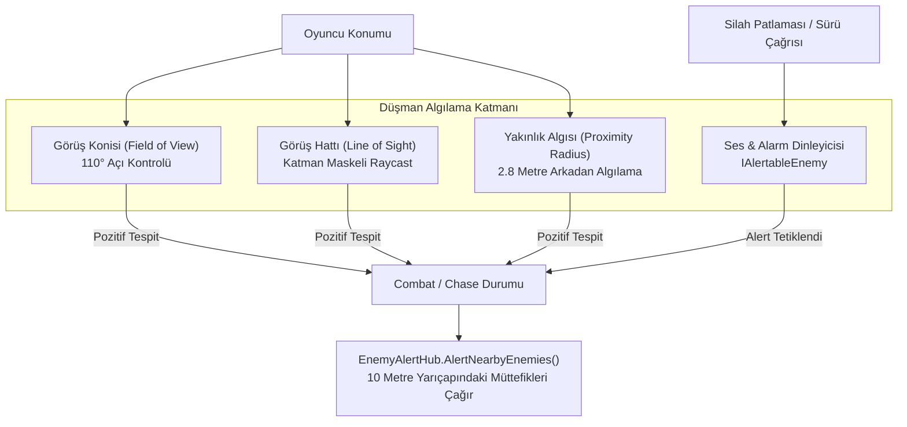

# EnemyAIAndCombatFeel (Düşman Algı Mekanikleri ve Dövüş Hissiyatı)

> [!abstract] YAPAY ZEKÂ DUYULARI, SÜRÜ BİLİNCİ VE TOK VURUŞ HİSSİYATI
> Görüş açısı (LoS/FoV) hesaplamaları, ses ve sürü alarmı yayılımı, vuruş durdurması (Hitstop), tökezleme (Stagger) mekaniği ve doğal ragdoll kinematikleri.

---

## 1. DÜŞMAN ALGI MOTORU (SENSORY SYSTEM)

---

## 2. KİLİT MEKANİKLER VE TEKNİK DEĞERLER

### 1. Görüş ve Algılama Parametreleri
- **Görüş Konisi (FoV):** 110 derecelik ön koni. Oyuncunun düşmanın baktığı yönle olan açısı (`Vector3.Angle`) bu değerin altındaysa kontrol edilir.
- **Doğrudan Görüş Hattı (LoS):** Duvar, sütun ve siperleri hesaba katan `LayerMask` filtreli raycast. Düşman göz yüksekliğinden oyuncunun gövde merkezine atılır.
- **Yakınlık Hissi (Proximity):** 2.8 metre yarıçapındaki dairesel alan. Oyuncu düşmanın arkasından yaklaşsa dahi bu menzile girdiğinde algılanır.
- **Görüş Kaybı ve Arama:** Oyuncu görüşten çıktığında 3.5 saniye boyunca son bilinen konumu araştırır; bulamazsa devriye moduna (`EnemyState.Patrol`) geri döner.

### 2. Sürü Alarmı ve İletişim (`EnemyAlertHub`)
- **Merkezi Alarm Yayılımı:** Bir düşman oyuncuyu doğrudan gördüğünde veya silah sesi duyulduğunda `alertRadius = 10.0f` menzilindeki tüm `IAlertableEnemy` uygulayan müttefiklere hedef koordinatını iletir.
- **Uzak Düşman İzolasyonu:** Haritanın diğer ucundaki düşmanlar gereksiz yere uyarılmaz; arena temposu ve performans dengede tutulur.

### 3. Vuruş Tokluğu: Hitstop ve Tökezleme (Stagger)
- **Hitstop (Mikro Dondurma):**
  * Kritik vuruşlarda (Kafa / Headshot) veya kılıç saplamasında oyun motoru zaman ölçeğini (`Time.timeScale`) 0.04 - 0.08 saniye boyunca 0.05f seviyesine çeker.
  * Oyuncuya vuruşun hedefe derinden oturduğu hissini verir.
- **Tökezleme (Stagger):**
  * Ağır darbe veya parry savuşturması alan düşman mevcut saldırı ve hareketini iptal eder, `EnemyState.Stagger` durumuna geçerek geriye doğru hafifçe itilir (`knockback`).
  * 1.5 - 2.2 saniyelik savunmasız pencere oluşturur.

### 4. Ölüm, Ragdoll Kinematiği ve Parçalanma
- **Ölçek (Scale) Sabitliği:** Düşman öldüğünde `CharacterController` devre dışı bırakılırken `Transform.localScale` mutlak olarak kilitlenir; model boyutunda deformasyon oluşması engellenir.
- **Doğal Ragdoll Sönümlemesi:** Fizik motoru ragdoll eklemlerini devreye alarak darbenin yönüne ve momentumuna uygun doğal savrulma sağlar.
- **Anatomik Parçalanma (Gibs):** Aşırı hasar veya patlamalarda ragdoll yerine kafatası, gövde ve et parçacıkları fırlatılarak hedefin yok edildiği hissi pekiştirilir.

---

## 3. BAŞKA BİR AI İÇİN GELİŞTİRME KURALLARI
1. Yeni bir düşman yazarken algılama mantığını baştan icat etmeyin; `BasicEnemyAI`'de kullanılan `IAlertableEnemy` ve FoV/LoS formüllerini uygulayın.
2. Düşmanın ölüm anında modelin ölçeğini veya hiyerarşisini bozmayın; ragdoll geçişinde bileşenleri `isKinematic = false` yaparak aktif hale getirin.

---

## İlişkiler (Sinaptik Ağ Bağlantıları)
- [[CodebaseDependencyGraph]] ➔ `governs_ai_behavior`
- [[CombatAndDamageInterfaces]] ➔ `implements_IAlertable_and_IStunnable`
- [[EnemyAIAndSpawning]] ➔ `details_enemy_entities`
- [[HitstopAndAudioFeedback]] ➔ `triggers_hitstop`
- [[CombatVFXAndDecalSystem]] ➔ `triggers_gibs_on_death`
- ⬅️ [[ProjectOverview]] ➔ `utilizes_ai` *(gelen)*
- ⬅️ [[START_HERE_AI_CONSTITUTION]] ➔ `mandated_by_constitution` *(gelen)*
