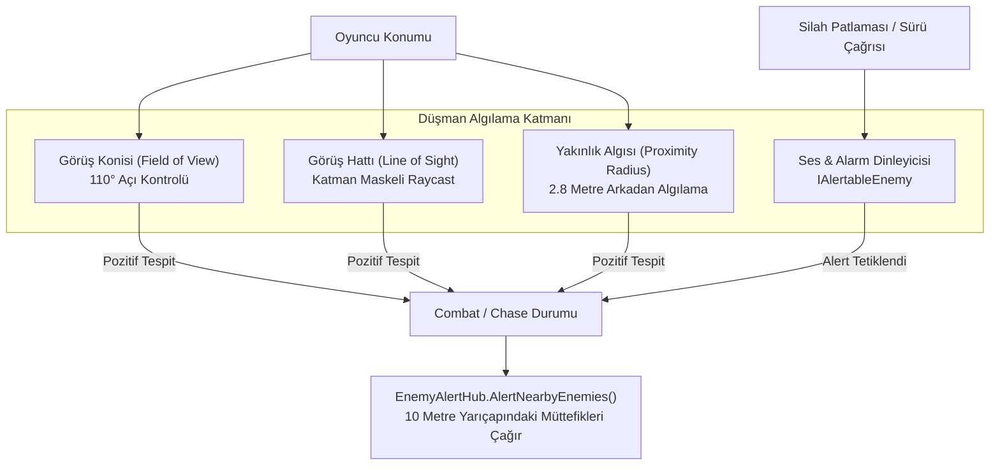

# EnemyAIAndCombatFeel (Düşman Algı Mekanikleri ve Dövüş Hissiyatı)

> [!abstract] YAPAY ZEKÂ DUYULARI, SÜRÜ BİLİNCİ VE TOK VURUŞ HİSSİYATI
> Görüş açısı (LoS/FoV) hesaplamaları, ses ve sürü alarmı yayılımı, vuruş durdurması (Hitstop), tökezleme (Stagger) mekaniği ve doğal ragdoll kinematikleri.

---

## 1. DÜŞMAN ALGI MOTORU (SENSORY SYSTEM)

---

## 2. KİLİT MEKANİKLER VE TEKNİK DEĞERLER

### 1. Görüş ve Algılama Parametreleri
- **Görüş Konisi (FoV):** 110 derecelik ön koni. Oyuncunun düşmanın baktığı yönle olan açısı (`Vector3.Angle`) bu değerin altındaysa kontrol edilir.
- **Doğrudan Görüş Hattı (LoS):** Duvar, sütun ve siperleri hesaba katan `LayerMask` filtreli raycast. Düşman göz yüksekliğinden oyuncunun gövde merkezine atılır.
- **Yakınlık Hissi (Proximity):** 2.8 metre yarıçapındaki dairesel alan. Oyuncu düşmanın arkasından yaklaşsa dahi bu menzile girdiğinde algılanır.
- **Görüş Kaybı ve Arama:** Oyuncu görüşten çıktığında 3.5 saniye boyunca son bilinen konumu araştırır; bulamazsa devriye moduna (`EnemyState.Patrol`) geri döner.

### 2. Sürü Alarmı ve İletişim (`EnemyAlertHub`)
- **Merkezi Alarm Yayılımı:** Bir düşman oyuncuyu doğrudan gördüğünde veya silah sesi duyulduğunda `alertRadius = 10.0f` menzilindeki tüm `IAlertableEnemy` uygulayan müttefiklere hedef koordinatını iletir.
- **Uzak Düşman İzolasyonu:** Haritanın diğer ucundaki düşmanlar gereksiz yere uyarılmaz; arena temposu ve performans dengede tutulur.

### 3. Vuruş Tokluğu: Hitstop ve Tökezleme (Stagger)
- **Hitstop (Mikro Dondurma):**
  * Canlı düşmana kritik vuruşta `TriggerHitstop(0.04s, 0.04)` (Uçan Göz `0.03`), ölümde `0.07s / 0.03`, stun'da `0.08s / 0.02`. Çakışan çağrılar birleşir (en uzun süre, en düşük ölçek).
  * Oyuncuya vuruşun hedefe derinden oturduğu hissini verir.
- **Vuruş Tepkisi (Hit Flash & Et Geri Bildirimi):** Düşman `TakeDamage` içinde HDR beyaz (kritikte altın) hit flash (0.06s / 0.12s, `_EmissionColor` dahil), et darbe VFX'i ve et sesini **kendisi** üretir; silahlar bunları çağırmaz ([[GameFeelArchitecture]]).
- **Tökezleme (Stagger):**
  * Ghoul: Poise kırılması (1.0s pencerede ≥70 hasar) veya kritik vuruşta (Lunging hariç; ClawStrike/Lunging sırasında non-kritik hyper-armor) 0.35s stagger; `-hitNormal` yönünde `clamp(hasar × 0.09, 2.5, 10)` m/s yatay itme (≥60 hasarda hafif dikey sıçrama), 8/s üstel sönüm. Stagger sırasında gelen vuruşlar süreyi uzatır, chase'i yeniden başlatmaz.
  * Uçan Göz: Her vuruşta `clamp(hasar × 0.12, 2, 9)` m/s itme (7/s sönüm); kritik veya ≥30 hasarda 0.30s stagger.
  * Stun / parry (`IStunnable.Stun`): `knockbackDir` yalnızca yön; itme hızı `stunKnockbackSpeed` (Ghoul 5.5, Uçan Göz 24.5 ≈ 3.5 m). 1.2 - 2.2 saniyelik savunmasız pencere oluşturur.
- **Ölüm Olayı:** `Die` → `CombatEvents.RaiseEnemyKilled(pos, wasCritical, wasGibbed)` → `OnEnemyDeath`. Kill confirm UI/ses bu olayı dinler.

### 4. Ölüm, Ragdoll Kinematiği ve Parçalanma
- **Ölçek (Scale) Sabitliği:** Düşman öldüğünde `CharacterController` devre dışı bırakılırken `Transform.localScale` mutlak olarak kilitlenir; model boyutunda deformasyon oluşması engellenir.
- **Doğal Ragdoll Sönümlemesi:** Fizik motoru ragdoll eklemlerini devreye alarak darbenin yönüne ve momentumuna uygun doğal savrulma sağlar.
- **Anatomik Parçalanma (Gibs):** Aşırı hasar veya patlamalarda ragdoll yerine kafatası, gövde ve et parçacıkları fırlatılarak hedefin yok edildiği hissi pekiştirilir.

### 5. Ghoul Stalker Saldırı Döngüsü (`GhoulAttackLoop`)
- **Çözülen Problem:** Oyuncunun 8 m/s geri yürüme (backpedal) hızı, Ghoul'un eski 0.58 saniyelik durağan rüzgarlanma (windup) süresini tamamen boşa çıkarıyor ve oyuncuların sıfır riskle düşmanları geri çekilerek avlamasına yol açıyordu.
- **POCO ve Sürücü Mimarisi:** Karar ve zamanlama mantığı `GhoulAttackLoop` (saf C# POCO) sınıfına; hareket, fizik, eğim (tilt) ve Unity bileşen kontrolleri ise `BasicEnemyAI` sürücüsüne (driver) ayrılmıştır.
- **Faz Akışı (Phase Flow):** `ClawWindup` → `ClawStrike` → `ClawWindup` → `ClawStrike` → `ClawRecover` | `LungeWindup` → `Lunging` → `LungeRecover`
- **Pençe Kombosu (Claw Combo):**
  * 2 savurmalı (swipe) kombo; her savurmanın bağımsız parıltı (`Glint`) uyarısı bulunur.
  * Hasar ölçekleri: 1. vuruş `0.5 × attackDamage`, 2. vuruş `0.7 × attackDamage`.
  * Aktif vuruş pencerelerinde (`clawActiveTime = 0.12s`, `clawHitRange = 2.6m`, `clawHitHalfAngle = 70°`) ileri adım (`clawStrikeStepSpeed = 4.0 m/s`), rüzgarlanma evrelerinde ise ileri süzülme (`clawWindupCreepSpeed = 1.6 m/s`) uygulanır.
  * Kombo sonrasında oyuncuya cezalandırma penceresi tanıyan 0.55s toparlanma (`clawRecover`) süresi vardır.
- **Atılma / Pounce (Lunge):**
  * 3.2–7.5 m menzil aralığı, 0.45s hazırlık (`lungeWindup`, 0.18s glint lead).
  * 15 m/s havada hücum hızı ve 110°/s yönelme (steering): Yana doğru atılma (sideways dash) saldırıyı savuştururken, düz geri yürüme (backpedal) kaçışa yetmez.
  * Iskalama veya duvara çarpma durumunda 0.8s tökezleme (`lungeWhiffRecover`), isabette 0.35s toparlanma (`lungeHitRecover`).
- **Bekleme Süreleri ve Jitter:** Saldırı bekleme sürelerine (cooldown) %±20 rastgele dalgalanma (`cooldownJitter = 0.2`) uygulanır.
- **Depar (Sprint):** Hedef 9 metreden uzaktayken ve görüş hattındayken Ghoul ×1.35 depar hız çarpanı (`sprintSpeedMultiplier = 1.35f`) ile yaklaşır.
- **Saldırı Jetonları (`EnemyAttackTokens`):** Sürülerin oyuncuya yığılmasını önlemek için eşzamanlı en fazla 2 saldırgana izin verilir (`MaxConcurrent = 2`). Jeton alamayan diğer düşmanlar oyuncunun çevresinde 4.5 m mesafede yörüngede kanat hareketi (`flankRadius = 4.5m`, `flankSpeed = 4.2m/s`) yapar.
- **Denge ve Zırh (Poise & Hyper-Armor):**
  * 1.0 saniyelik zaman penceresinde 70 hasar (`poise = 70f`, `poiseWindow = 1.0f`) non-kritik tökezleme (stagger) tetikler.
  * `ClawStrike` ve `Lunging` evrelerinde non-kritik hasara karşı hyper-armor aktiftir.
  * Kritik vuruşlar, tamamen adanmış olan `Lunging` evresi hariç her zaman tökezletir.
  * Başarılı savuşturma (parry) döngüyü her zaman iptal eder (`Cancel`) ve sersemletir (stun).

---

## 3. BAŞKA BİR AI İÇİN GELİŞTİRME KURALLARI
1. Yeni bir düşman yazarken algılama mantığını baştan icat etmeyin; `BasicEnemyAI`'de kullanılan `IAlertableEnemy` ve FoV/LoS formüllerini uygulayın.
2. Düşmanın ölüm anında modelin ölçeğini veya hiyerarşisini bozmayın; ragdoll geçişinde bileşenleri `isKinematic = false` yaparak aktif hale getirin.
3. Yeni düşman `Awake`/`Start`'ta `CombatTargetLookup.RegisterHierarchy(this)` çağırmalı, `TakeDamage` içinde et VFX/sesini kendisi üretmeli ve `Die` içinde `CombatEvents.RaiseEnemyKilled` yayınlamalıdır ([[GameFeelArchitecture]]).

---

## İlişkiler (Sinaptik Ağ Bağlantıları)
- [[CodebaseDependencyGraph]] ➔ `governs_ai_behavior`
- [[CombatAndDamageInterfaces]] ➔ `implements_IAlertable_and_IStunnable`
- [[WaveAndEncounterArchitecture]] ➔ `limits_concurrent_attacks_via_tokens`
- [[EnemyAIAndSpawning]] ➔ `details_enemy_entities`
- [[HitstopAndAudioFeedback]] ➔ `triggers_hitstop`
- [[CombatVFXAndDecalSystem]] ➔ `triggers_gibs_on_death`
- [[GameFeelArchitecture]] ➔ `owns_hit_reactions`
- ⬅️ [[ProjectOverview]] ➔ `utilizes_ai` *(gelen)*
- ⬅️ [[START_HERE_AI_CONSTITUTION]] ➔ `mandated_by_constitution` *(gelen)*
