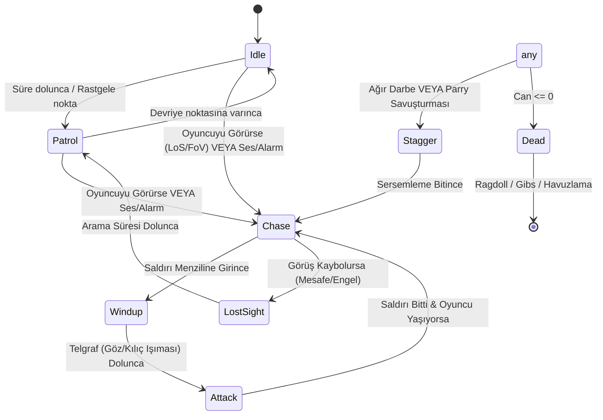

# EnemyAIAndSpawning (Düşman Yapay Zekası, Tipleri ve Mermi Dinamikleri)

> [!abstract] FSM TABANLI DÜŞMAN DAVRANIŞLARI VE SÜRÜ ALARMI
> NavMesh gerektirmeyen, CharacterController tabanlı hafif ve performanslı yapay zekâ durum makineleri, görüş açısı (LoS/FoV) hesaplamaları, saldırı telgrafları ve parçalanma fizikleri.

---

## 1. DÜŞMAN TÜRLERİ VE DURUM MAKİNESİ (FSM)



---

## 2. KİLİT DÜŞMAN SINIFLARI VE ENTITY DETAYLARI

### 1. `BasicEnemyAI.cs` (Ghoul Stalker / Yakın Dövüş Zombisi)
- **Konum:** `Assets/_Project/Scripts/Combat/BasicEnemyAI.cs`
- **Uyguladığı Arayüzler:** `IDamageable`, `IAlertableEnemy`, `IStunnable`, `IEncounterEnemy`
- **Görüş ve Algılama:**
  * Görüş Konisi: 110 derece FoV, 18 metre menzil.
  * Doğrudan Görüş Hattı (LoS): Katman maskeli Raycast (Duvarlar arkasını göremez).
  * Yakınlık Hissi: Arkadan sessizce yaklaşan oyuncuyu 2.8 metrede fark eder.
- **Sürü Alarmı (Pack Mentality):** Bir Ghoul savaşa girdiğinde `EnemyAlertHub` üzerinden 10 metre çapındaki tüm müttefikleri `Alert()` çağrısıyla savaşa davet eder.
- **Saldırı Hazırlığı ve Telgraf (Windup Flash):** Saldırmadan 0.45 saniye önce gözlerinde veya pençelerinde parlak sarı/kırmızı ışık parlar. Bu, oyuncuya **Parry** yapması veya **Dash** ile kaçması için net bir görsel ipucudur.
- **Kafa Vuruşu ve Tökezleme:** Kafaya isabet eden vuruşlar 2x hasar verir ve `Stagger` durumunu tetikler.
- **Ölüm, Ragdoll Kinematiği ve Parçalanma (Gibs):**
  * Ölüm anında `Transform.localScale` kilitlenir ve `CharacterController` devre dışı bırakılır.
  * `CombatVFXManager` aracılığıyla kemik, kafatası ve et parçaları havuzdan fırlatılır; parçalar `Physics.IgnoreCollision` ile birbirini itmeden zeminle balistik etkileşime girer.

### 2. `FlyingEyeAI.cs` (Uçan Göz / Watcher)
- **Konum:** `Assets/_Project/Scripts/Combat/FlyingEyeAI.cs`
- **Uyguladığı Arayüzler:** `IDamageable`, `IAlertableEnemy`, `IStunnable`, `IEncounterEnemy`, `IThreatCost`, `IEliteScalable`, `IStunState`, `IReflectPunishable`
- **Davranış özeti (2026-11-16):** İki saldırılı nişancı. Hafif ok ve ağır "Hüküm Küresi" (L, L, H sırası; ağır saldırı jeton ister), öngörülü nişan, saldırılar arasında yanal strafe ve Reposition patlaması. Ayrıntı: [[FlyingEyeNisanci]].
- **Havada Süzülme ve Mesafe Koruma (Kiting):**
  * Yerçekiminden etkilenmez; zemine göre 1.8-3.6 metre arasında süzülür (hover hedefi rastgele değişir).
  * Oyuncu çok yaklaştığında geriye doğru çekilir (Kite mantığı).
  * **İrtifa zemine görelidir:** `ApplyHoverAltitude` aşağı raycast (`GameLayers.GroundMask`) ile zemini bulur; `hoverHeight`, `minFlyHeight` ve `maxFlyHeight` bu zemin Y'sine eklenir (mutlak dünya Y'si değil). Zemin bulunamazsa son bilinen zemin (`_lastGroundY`) kullanılır; ölüm düşüşü de `_lastGroundY + 0.4` ile biter. *(2026-11-11 düzeltmesi: önceden mutlak Y'ye kilitliydi, Y = +1000'deki Araf'ta gözler yere iniyordu.)*
- **Menzilli Okült Mermisi:**
  * Hafif ok (windup 0.45 sn) ve ağır orb (windup 1.1 sn) `EyeProjectilePool` üzerinden fırlatılır; nişan `ProjectileLead` ile kısmi öngörü yapar.
  * Mermi `PlayerParryController` tarafından geri yansıtılabilir. Geri yansıyan **hafif** ok 45 hasar ile kritik vuruş sayılır (stagger). Geri yansıyan **ağır** orb normal Göz'ü tek darbede öldürür; elit Göz %45 can kaybeder ve 3 sn yerde sersemler (`IReflectPunishable.OnOwnProjectileReflectedHit`).
  * Yansımamış mermiler diğer düşmanların içinden geçer (dost ateşi yok).

### 3. `EnemyProjectile.cs` (Düşman Mermisi)
- **Konum:** `Assets/_Project/Scripts/Combat/EnemyProjectile.cs`
- **Parry Dinamiği:** `Deflect(newDir, speedMultiplier, damageMultiplier)` metodu ile yansıtıldığında düşmanları vuracak şekilde hedef katmanını değiştirir ve elektro mavi parlar. Yansıyan mermi (`OriginalShooter` özelliği ile) kendi atıcısına dönerken hedefe yönelir (reflect homing).

### 4. `EnemyAlertHub.cs` (Merkezi Sürü Uyarısı)
- **Konum:** `Assets/_Project/Scripts/Combat/EnemyAlertHub.cs`
- **İşlevi:** Statik bir merkez olarak çalışır; haritada bir silah patladığında veya bir düşman kükrediğinde menzil içindeki düşmanları uyarır.

### 5. `CombatDummy.cs` (Antrenman Mankeni)
- **Konum:** `Assets/_Project/Scripts/Combat/CombatDummy.cs`
- **Uyguladığı Arayüz:** `IDamageable`
- **Özellik:** Dövüş mekanikleri, DPS hesaplamaları ve vuruş testleri için ölümsüz veya sıfırlanan manken hedefi.

### 6. `PenitentAI.cs` (Kefaretçi / Lahit Taşıyıcı)
- **Konum:** `Assets/_Project/Scripts/Combat/PenitentAI.cs`
- **Uyguladığı Arayüzler:** `IDamageable`, `IAlertableEnemy`, `IStunnable`, `IStunState`, `IEncounterEnemy`, `IThreatCost`, `IEliteScalable`, `IGuardBreakable`
- **Davranış özeti (2026-11-16):** Yavaş ön kalkanlı yakın dövüşçü. Kalkan önden gelen menzilli vuruşları engeller; yüz noktası ve melee dışındaki vuruşlar kalkanı atlar. Kapak darbesi (1.1 sn hazırlık, yönelme kilitli) önündeki sabit 6.5 × 4.5 m'lik bir zemin alanına tek, parry edilebilir 35 hasarlı vuruş yapar; zıplamak kurtarmaz, yana çıkmak ya da parry kurtarır. Parry stun'ı ve yansıyan ağır orb kalkanı kırar.
- Ayrıntı: [[KefaretciPenitent]]

---

## 3. YENİ BİR DÜŞMAN TİPİ EKLEME ADIMLARI (BAŞKA BİR AI İÇİN)
1. `Assets/_Project/Scripts/Combat/` altına `YeniDusmanAI.cs` oluşturun.
2. Sınıf tanımında şu arayüzleri mutlaka uygulayın:
   ```csharp
   public class YeniDusmanAI : MonoBehaviour, IDamageable, IStunnable, IEncounterEnemy
   ```
3. `IEncounterEnemy.OnEnemyDeath` olayını tanımlayın ve canı sıfırlanınca `OnEnemyDeath?.Invoke(this)` çağrısı yapın.
4. Hasar aldığında parçacık ve ses üretimi için `CombatVFXManager` ve `CombatAudio` çağrılarını kullanın.
5. Prefab'ını hazırlayıp `WaveSpawnDirector` dalgalarına ekleyin.

---

## İlişkiler (Sinaptik Ağ Bağlantıları)
- [[CodebaseDependencyGraph]] ➔ `implements_enemy_core`
- [[CombatAndDamageInterfaces]] ➔ `implements_combat_interfaces`
- [[EnemyAIAndCombatFeel]] ➔ `shares_sensory_rules`
- [[WaveAndEncounterArchitecture]] ➔ `controlled_by_wave_director`
- [[CombatVFXAndDecalSystem]] ➔ `spawns_gibs_and_blood`
- [[KefaretciPenitent]] ➔ `details_penitent_enemy`
- ⬅️ [[START_HERE_AI_CONSTITUTION]] ➔ `mandated_by_constitution` *(gelen)*
- ⬅️ [[ProjectOverview]] ➔ `utilizes_ai` *(gelen)*
