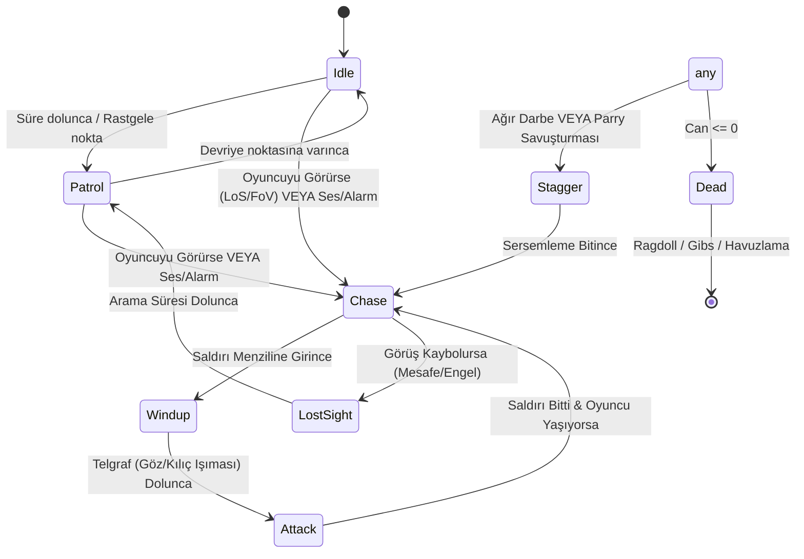

# EnemyAIAndSpawning (Düşman Yapay Zekası, Tipleri ve Mermi Dinamikleri)

> [!abstract] FSM TABANLI DÜŞMAN DAVRANIŞLARI VE SÜRÜ ALARMI
> NavMesh gerektirmeyen, CharacterController tabanlı hafif ve performanslı yapay zekâ durum makineleri, görüş açısı (LoS/FoV) hesaplamaları, saldırı telgrafları ve parçalanma fizikleri.

---

## 1. DÜŞMAN TÜRLERİ VE DURUM MAKİNESİ (FSM)



---

## 2. KİLİT DÜŞMAN SINIFLARI VE ENTITY DETAYLARI

### 1. `BasicEnemyAI.cs` (Ghoul Stalker / Yakın Dövüş Zombisi)
- **Konum:** `Assets/_Project/Scripts/Combat/BasicEnemyAI.cs`
- **Uyguladığı Arayüzler:** `IDamageable`, `IAlertableEnemy`, `IStunnable`, `IEncounterEnemy`
- **Görüş ve Algılama:**
  * Görüş Konisi: 110 derece FoV, 18 metre menzil.
  * Doğrudan Görüş Hattı (LoS): Katman maskeli Raycast (Duvarlar arkasını göremez).
  * Yakınlık Hissi: Arkadan sessizce yaklaşan oyuncuyu 2.8 metrede fark eder.
- **Sürü Alarmı (Pack Mentality):** Bir Ghoul savaşa girdiğinde `EnemyAlertHub` üzerinden 10 metre çapındaki tüm müttefikleri `Alert()` çağrısıyla savaşa davet eder.
- **Saldırı Hazırlığı ve Telgraf (Windup Flash):** Saldırmadan 0.45 saniye önce gözlerinde veya pençelerinde parlak sarı/kırmızı ışık parlar. Bu, oyuncuya **Parry** yapması veya **Dash** ile kaçması için net bir görsel ipucudur.
- **Kafa Vuruşu ve Tökezleme:** Kafaya isabet eden vuruşlar 2x hasar verir ve `Stagger` durumunu tetikler.
- **Ölüm, Ragdoll Kinematiği ve Parçalanma (Gibs):**
  * Ölüm anında `Transform.localScale` kilitlenir ve `CharacterController` devre dışı bırakılır.
  * `CombatVFXManager` aracılığıyla kemik, kafatası ve et parçaları havuzdan fırlatılır; parçalar `Physics.IgnoreCollision` ile birbirini itmeden zeminle balistik etkileşime girer.

### 2. `FlyingEyeAI.cs` (Uçan Göz / Watcher)
- **Konum:** `Assets/_Project/Scripts/Combat/FlyingEyeAI.cs`
- **Uyguladığı Arayüzler:** `IDamageable`, `IStunnable`, `IEncounterEnemy`
- **Havada Süzülme ve Mesafe Koruma (Kiting):**
  * Yerçekiminden etkilenmez, oyuncunun 3-6 metre üzerinde süzülür.
  * Oyuncu çok yaklaştığında geriye doğru çekilir (Kite mantığı).
- **Menzilli Okült Plazma Mermisi:**
  * Şarj olma süresi sonrası oyuncunun mevcut konumuna doğru `EnemyProjectile` ateşler.
  * Mermi `PlayerParryController` tarafından geri yansıtılabilir. Geri yansıyan mermi Flying Eye'a çarparsa tek darbede imha edebilir.

### 3. `EnemyProjectile.cs` (Düşman Mermisi)
- **Konum:** `Assets/_Project/Scripts/Combat/EnemyProjectile.cs`
- **Parry Dinamiği:** `Reflect(newDir, speedMultiplier, damageMultiplier)` metodu ile yansıtıldığında düşmanları vuracak şekilde hedef katmanını değiştirir ve elektro mavi parlar.

### 4. `EnemyAlertHub.cs` (Merkezi Sürü Uyarısı)
- **Konum:** `Assets/_Project/Scripts/Combat/EnemyAlertHub.cs`
- **İşlevi:** Statik bir merkez olarak çalışır; haritada bir silah patladığında veya bir düşman kükrediğinde menzil içindeki düşmanları uyarır.

### 5. `CombatDummy.cs` (Antrenman Mankeni)
- **Konum:** `Assets/_Project/Scripts/Combat/CombatDummy.cs`
- **Uyguladığı Arayüz:** `IDamageable`
- **Özellik:** Dövüş mekanikleri, DPS hesaplamaları ve vuruş testleri için ölümsüz veya sıfırlanan manken hedefi.

---

## 3. YENİ BİR DÜŞMAN TİPİ EKLEME ADIMLARI (BAŞKA BİR AI İÇİN)
1. `Assets/_Project/Scripts/Combat/` altına `YeniDusmanAI.cs` oluşturun.
2. Sınıf tanımında şu arayüzleri mutlaka uygulayın:
   ```csharp
   public class YeniDusmanAI : MonoBehaviour, IDamageable, IStunnable, IEncounterEnemy
   ```
3. `IEncounterEnemy.OnEnemyDeath` olayını tanımlayın ve canı sıfırlanınca `OnEnemyDeath?.Invoke(this)` çağrısı yapın.
4. Hasar aldığında parçacık ve ses üretimi için `CombatVFXManager` ve `CombatAudio` çağrılarını kullanın.
5. Prefab'ını hazırlayıp `WaveSpawnDirector` dalgalarına ekleyin.

---

## İlişkiler (Sinaptik Ağ Bağlantıları)
- [[CodebaseDependencyGraph]] ➔ `implements_enemy_core`
- [[CombatAndDamageInterfaces]] ➔ `implements_combat_interfaces`
- [[EnemyAIAndCombatFeel]] ➔ `shares_sensory_rules`
- [[WaveAndEncounterArchitecture]] ➔ `controlled_by_wave_director`
- [[CombatVFXAndDecalSystem]] ➔ `spawns_gibs_and_blood`
- ⬅️ [[START_HERE_AI_CONSTITUTION]] ➔ `mandated_by_constitution` *(gelen)*
- ⬅️ [[ProjectOverview]] ➔ `utilizes_ai` *(gelen)*
