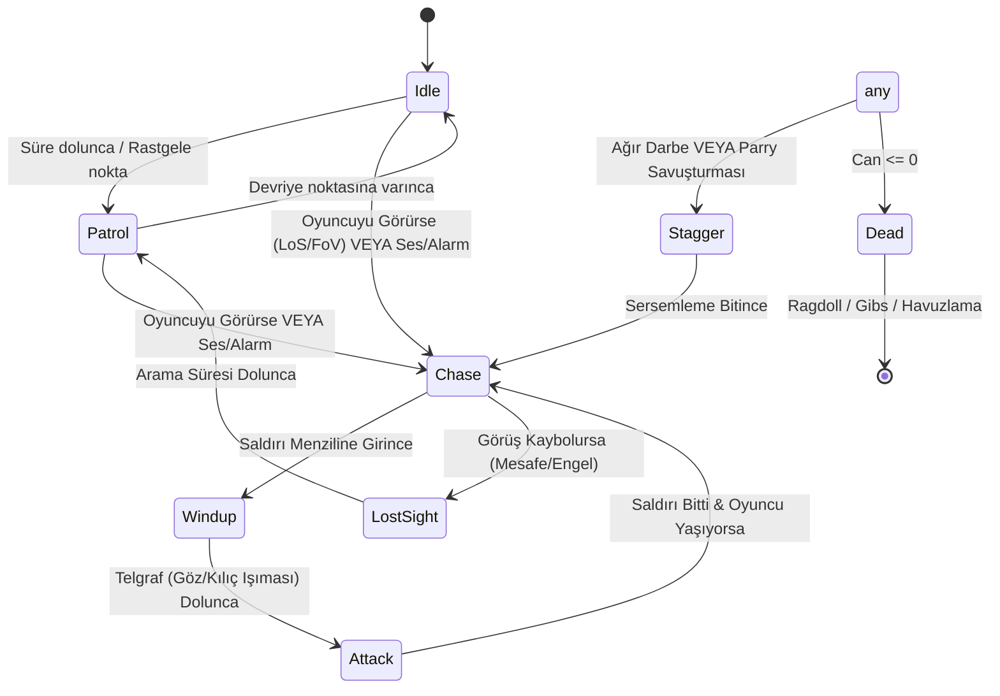

# EnemyAIAndSpawning (Düşman Yapay Zekası, Tipleri ve Mermi Dinamikleri)

> [!abstract] FSM TABANLI DÜŞMAN DAVRANIŞLARI VE SÜRÜ ALARMI
> Hareket CharacterController ile, rotalar NavMesh'ten (com.unity.ai.navigation 2.0.14); NavMesh olmayan sahnede eski düz takibe düşer. Görüş açısı (LoS/FoV) hesaplamaları, saldırı telgrafları ve parçalanma fizikleri.

---

## 1. DÜŞMAN TÜRLERİ VE DURUM MAKİNESİ (FSM)



---

## 2. KİLİT DÜŞMAN SINIFLARI VE ENTITY DETAYLARI

### 1. `BasicEnemyAI.cs` (Ghoul Stalker / Yakın Dövüş Zombisi)
- **Konum:** `Assets/_Project/Scripts/Combat/BasicEnemyAI.cs`
- **Uyguladığı Arayüzler:** `IDamageable`, `IAlertableEnemy`, `IStunnable`, `IEncounterEnemy`, `IThreatCost`, `IEliteScalable`, `IStunState`, `IHuntableEnemy`
- **Görüş ve Algılama:**
  * Görüş Konisi: 110 derece FoV, 18 metre menzil.
  * Doğrudan Görüş Hattı (LoS): Katman maskeli Raycast (Duvarlar arkasını göremez).
  * Yakınlık Hissi: Arkadan sessizce yaklaşan oyuncuyu 2.8 metrede fark eder.
- **NavMesh Yol Takibi ve Dikey Erişim:** Chase, Patrol ve LostSight durumlarında NavMesh yol köşelerini izler (`EnemyNavigator`). Dikey erişim sınırı (`ReachableHeightTolerance` 1.6 m) bulunur — oyuncu daha yüksekteyse saldırı seçmez ve isabet vermez; ulaşılamayan hedefte Karma politika (`MeleeUnreachableResponse`) uygulanır.
- **Kuşatma ve Yörünge (Surround Ring):** Eski `flankRadius` (4.5 m) tekil yörünge mekaniği yerini 8 yuvalı `MeleeSurroundSlots` halkasına (`surroundRadiusMin/Max` 3.0–3.5 m) bıraktı. Saldırı jetonu alamayan Ghoul'lar oyuncunun çevresine dinamik yuvalanır.
- **Sürü Alarmı (Pack Mentality):** Bir Ghoul savaşa girdiğinde `EnemyAlertHub` üzerinden 10 metre çapındaki tüm müttefikleri `Alert()` çağrısıyla savaşa davet eder.
- **Saldırı Hazırlığı ve Telgraf (Windup Flash):** Saldırmadan 0.45 saniye önce gözlerinde veya pençelerinde parlak sarı/kırmızı ışık parlar. Bu, oyuncuya **Parry** yapması veya **Dash** ile kaçması için net bir görsel ipucudur.
- **Kafa Vuruşu ve Tökezleme:** Kafaya isabet eden vuruşlar 2x hasar verir ve `Stagger` durumunu tetikler.
- **Ölüm, Ragdoll Kinematiği ve Parçalanma (Gibs):**
  * Ölüm anında `Transform.localScale` kilitlenir ve `CharacterController` devre dışı bırakılır.
  * `CombatVFXManager` aracılığıyla kemik, kafatası ve et parçaları havuzdan fırlatılır; parçalar `Physics.IgnoreCollision` ile birbirini itmeden zeminle balistik etkileşime girer.

### 2. `FlyingEyeAI.cs` (Uçan Göz / Watcher)
- **Konum:** `Assets/_Project/Scripts/Combat/FlyingEyeAI.cs`
- **Uyguladığı Arayüzler:** `IDamageable`, `IAlertableEnemy`, `IStunnable`, `IEncounterEnemy`, `IThreatCost`, `IEliteScalable`, `IStunState`, `IReflectPunishable`, `IHuntableEnemy`
- **Davranış özeti (2026-11-16):** İki saldırılı nişancı. Hafif ok ve ağır "Hüküm Küresi" (L, L, H sırası; ağır saldırı bağımsız `RangedHeavy` jetonu ister, Melee jetonunu bloke etmez), öngörülü nişan, saldırılar arasında yanal strafe ve Reposition patlaması. Ayrıntı: [[FlyingEyeNisanci]].
- **NavMesh ve Görüş Arama (LoS Search):** Oyuncuya doğrudan görüş hattı (LoS) yokken yer yolunun XZ izini takip eder ve görüş arar (`losSearchDuration` 6 sn); oyuncuyu görünce eski havada süzülme ve kiting davranışına döner.
- **Havada Süzülme ve Mesafe Koruma (Kiting):**
  * Yerçekiminden etkilenmez; zemine göre 1.8-3.6 metre arasında süzülür (hover hedefi rastgele değişir).
  * Oyuncu çok yaklaştığında geriye doğru çekilir (Kite mantığı).
  * **İrtifa zemine görelidir:** `ApplyHoverAltitude` zemin tespiti için `FlyingEyeAltitude.ResolveGround` kullanır; ani boşluk ve çukurlarda (`voidDropThreshold` 2.5 m) son sağlam irtifa (`_lastGroundY`) korunur, alçak zemin sadece `acceptLowerAfter` (2.0 s) sonra kabul edilir. Prefab irtifası kulede 2.6 m, Araf av modunda profille 3.0 m'dir.
- **Menzilli Okült Mermisi:**
  * Hafif ok (windup 0.45 sn) ve ağır orb (windup 1.1 sn) `EyeProjectilePool` üzerinden fırlatılır; nişan `ProjectileLead` ile kısmi öngörü yapar.
  * Mermi `PlayerParryController` tarafından geri yansıtılabilir. Geri yansıyan **hafif** ok 45 hasar ile kritik vuruş sayılır (stagger). Geri yansıyan **ağır** orb normal Göz'ü tek darbede öldürür; elit Göz %45 can kaybeder ve 3 sn yerde sersemler (`IReflectPunishable.OnOwnProjectileReflectedHit`).
  * Yansımamış mermiler diğer düşmanların içinden geçer (dost ateşi yok).

### 3. `EnemyProjectile.cs` (Düşman Mermisi)
- **Konum:** `Assets/_Project/Scripts/Combat/EnemyProjectile.cs`
- **Parry Dinamiği:** `Deflect(newDir, speedMultiplier, damageMultiplier)` metodu ile yansıtıldığında düşmanları vuracak şekilde hedef katmanını değiştirir ve elektro mavi parlar. Yansıyan mermi (`OriginalShooter` özelliği ile) kendi atıcısına dönerken hedefe yönelir (reflect homing).

### 4. `EnemyAlertHub.cs` (Merkezi Sürü Uyarısı)
- **Konum:** `Assets/_Project/Scripts/Combat/EnemyAlertHub.cs`
- **İşlevi:** Statik bir merkez olarak çalışır; haritada bir silah patladığında veya bir düşman kükrediğinde menzil içindeki düşmanları uyarır.

### 5. `CombatDummy.cs` (Antrenman Mankeni)
- **Konum:** `Assets/_Project/Scripts/Combat/CombatDummy.cs`
- **Uyguladığı Arayüz:** `IDamageable`
- **Özellik:** Dövüş mekanikleri, DPS hesaplamaları ve vuruş testleri için ölümsüz veya sıfırlanan manken hedefi.

### 6. `PenitentAI.cs` (Kefaretçi / Lahit Taşıyıcı)
- **Konum:** `Assets/_Project/Scripts/Combat/PenitentAI.cs`
- **Uyguladığı Arayüzler:** `IDamageable`, `IAlertableEnemy`, `IStunnable`, `IStunState`, `IEncounterEnemy`, `IThreatCost`, `IEliteScalable`, `IGuardBreakable`, `IHuntableEnemy`
- **Davranış özeti (2026-11-16):** Yavaş ön kalkanlı yakın dövüşçü. Kalkan önden gelen menzilli vuruşları engeller; yüz noktası ve melee dışındaki vuruşlar kalkanı atlar. Kapak darbesi (1.1 sn hazırlık, yönelme kilitli) önündeki sabit 6.5 × 4.5 m'lik bir zemin alanına tek, parry edilebilir 35 hasarlı vuruş yapar; zıplamak kurtarmaz, yana çıkmak ya da parry kurtarır. Vuruş hasar verirse oyuncu havaya ve Penitent'ten uzağa fırlatılır (hitstop, kamera sarsıntısı); parry fırlatmayı iptal eder. Parry stun'ı ve yansıyan ağır orb kalkanı kırar. Kapak darbesi bağımsız `AttackTokenChannel.Slam` jetonu harcar (Melee jetonunu engellemez). Kenar koruması (`LedgeProbe`) sayesinde hem yürürken hem kalkan kırılması knockback'inde uçurumlardan düşmez.
- **NavMesh Yol Takibi ve Dikey Erişim:** Yürüyüş yönü NavMesh yol köşelerinden belirlenir (`EnemyNavigator`); kapak darbesi (slam) aynı dikey erişim kapısından geçer (`ReachableHeightTolerance` 1.6 m) ve hedef ulaşılamaz olduğunda aynı Karma politika uygulanır.
- Ayrıntı: [[KefaretciPenitent]]

---

## 3. YENİ BİR DÜŞMAN TİPİ EKLEME ADIMLARI (BAŞKA BİR AI İÇİN)
1. `Assets/_Project/Scripts/Combat/` altına `YeniDusmanAI.cs` oluşturun.
2. Sınıf tanımında şu arayüzleri mutlaka uygulayın:
   ```csharp
   public class YeniDusmanAI : MonoBehaviour, IDamageable, IStunnable, IEncounterEnemy
   ```
3. `IEncounterEnemy.OnEnemyDeath` olayını tanımlayın ve canı sıfırlanınca `OnEnemyDeath?.Invoke(this)` çağrısı yapın.
4. Yol bulma entegrasyonu için `EnemyNavigator` bileşenini bağlayın; melee için `MeleeUnreachableResponse` veya düşman türüne özgü `IUnreachableTargetResponse` politikasını atayın.
5. Hasar aldığında parçacık ve ses üretimi için `CombatVFXManager` ve `CombatAudio` çağrılarını kullanın.
6. Prefab'ını hazırlayıp `WaveSpawnDirector` dalgalarına ekleyin.

---

## 4. YOL BULMA (NAVMESH) MİMARİSİ

- **Klasör:** `Assets/_Project/Scripts/Combat/Navigation/` (namespace `RetroFPS.Combat.Navigation`):
  * `INavMeshQuery`: Test edilebilir sorgu arayüzü.
  * `UnityNavMeshQuery`: Tek `NavMeshPath` ve `GetCornersNonAlloc` ile sıfır GC çalışan NavMesh köprüsü.
  * `EnemyNavSettings`: `[Serializable]` ayarlar (`repathInterval` 0.4 s, `targetMoveThreshold` 1.5 m, `cornerReachDistance` 0.6 m, `sampleMaxDistance` 2.5 m, `targetSampleMaxDistance` 6 m, `reachableHeightTolerance` 1.6 m, `partialEndAttackRadius` 2.2 m; pusu yarıçapı Ghoul prefabında 3–4.5 m, genel varsayılan 5–7 m / 8 örnek / 3 m yenileme).
  * `EnemyNavigator`: POCO sınıfı; yeniden planlama zamanlayıcı ya da hedef eşiği ile tetiklenir (her karede değil), köşe takibi yürütür; durumlar (`Status`: `NoNavMesh`, `Complete`, `Partial`, `Unreachable`), niyetler (`Intent`: `Direct`, `Pursue`, `Ambush`); `Update`'te sıfır GC.
  * `IUnreachableTargetResponse` & `MeleeUnreachableResponse`: Karma politika — kısmi yolun sonu oyuncuya 2.2 m yakın ve dikey fark <= 1.6 m ise oraya git ve dövüş; değilse oyuncunun 5-7 m (Ghoul için 3–4.5 m) çevresinde ulaşılabilir pusu noktasına çekil, bekle, oyuncu 3 m kayınca konumu yenile.
  * `RuntimeNavMeshBaker`: Bir kök `Transform` altını `NavMeshSurface.BuildNavMesh` ile fizik collider'larından runtime'da bake eder (`Bake()`, `Bake(Transform)`, `Clear()`, `Baked` olayı; Araf labirenti (Y=+1000) ileride bunu kullanacak, bağlantı ayrı oturumda).
- **NavMesh Ajanı:** Humanoid (yarıçap 0.5, yükseklik 2, eğim 45, basamak 0.4 — Ghoul `CharacterController.stepOffset` ile aynı).
- **TestLevel_Gauntlet:** `Geometry` kökünde `NavMeshSurface` (fizik collider, editörde bake); kapılar `NavMeshModifier` ile bake dışı; `TestLevelBuilder` da surface ekleyip bake eder.
- **Yeni Düşman Tipi Eklerken:** `EnemyNavigator` + gerekirse kendi `IUnreachableTargetResponse` uygulaması bağlanır.
- **Testler:** `Tests/EditMode/Navigation/` (`EnemyNavigatorTests`, `RuntimeNavMeshBakerTests`).

---

## 2026-11-26 AI yeniden tasarımı (kule korunur, Araf av modu)

- **Kök Neden ve Ölçüm (Root Cause):** Savaş analizlerinde oyuncuyu kovalayan Ghoul'ların %42'sinin 3–8 metre mesafede boşta (idle) beklediği ölçüldü. Sebepleri: tekil paylaşımlı 2 jetonluk havuzun kilitlenmesi, eski yörüngenin (`flankRadius` 4.5 m) oyuncudan uzaklığı ve pusu mesafesinin (5–7 m) kopukluğuydu.
- **Kanallı Jeton Havuzu (`AttackTokenChannel` & `EnemyAttackTokens`):** Tekil global jeton yerine 3 bağımsız kanal tanımlandı:
  * `Melee = 0` (varsayılan sınır 2): Ghoul pençe ve sıçrama saldırıları.
  * `Slam = 1` (varsayılan sınır 1): Penitent lahit kapak çarpması.
  * `RangedHeavy = 2` (varsayılan sınır 2): Uçan Göz ağır Hüküm Küresi.
  * `EnemyAttackTokens.TryAcquire(channel, limit)` çağrısında çağıran taraf (düşman veya profil) kendi limitini iletebilir; limit <= 0 ise kanal varsayılanı (`MaxOf`) geçerlidir. Böylece global durum bozulmadan düşman/profil bazlı eşzamanlı kota artırılabilir.
- **Jeton Bekleme Mandalı ve 8 Yuvalı Kuşatma Halkası (`MeleeSurroundSlots`):**
  * Ghoul saldırı seçtiğinde jeton reddedilirse (veya av modunda saldırılar beklemedeyken ve mesafe < `surroundEngageDistance` 7.0 m ise) `_waitingForToken` mandalı en az `tokenWaitMinTime` (0.6 s) boyunca kilitlenir.
  * Ghoul `MeleeSurroundSlots.Shared` üzerinden oyuncunun etrafındaki 8 yuvadan (45° açılı) kendine en yakın boş slotu rezerve eder (`Claim`). Halka yarıçapı 2.8–3.5 m (Ghoul varsayılanı 3.0–3.5 m).
  * Slota varıldığında (`slotArriveDistance` 0.6 m) teğetsel yavaş strafe yapılır; tüm slotlar doluysa yörüngede dolanılır. Ghoul her kare saldırı ve jeton denemeye devam eder (halkadan >= 3.2 m mesafede lunge tetiklenebilir).
- **Arena Av Sözleşmesi (`IHuntableEnemy`):**
  * Arayüz: `void BeginHunt(Transform target, EnemyAggressionProfile profile)` ve `bool IsHunting { get; }`.
  * Yaşam döngüsü: Spawn anında önce `IEncounterEnemy.OnSpawnFromDirector` ➔ elit ise `IEliteScalable.ApplyEliteScaling` ➔ ardından `IHuntableEnemy.BeginHunt` çağrılır. Avın sonlanması ve temizliği ölüm (`OnEnemyDeath`), `OnDespawnToDirector` veya `Respawn` ile gerçekleşir.
  * Av modunda oyuncu konumu sürekli bilinir (LoS kaybı mesafesi ve sayaçları yoksayılır), düşman asla Idle/Patrol durumuna dönmez; başlangıçta `huntStartDelay` (0.35 s) ısınma payı tanınır.
  * Araf oturumunda düşmanların av modunu `ArafArenaEnemyActivator.cs` bağlar (Ayrıntı: [[ArafLabyrinthSystem]]).
- **Saldırganlık Profili (`EnemyAggressionProfile`):**
  * ScriptableObject alanları: `huntStartDelay` (0.35 s), `meleeTokenLimit` (3), `slamTokenLimit` (1), `rangedHeavyTokenLimit` (2), `releaseMeleeTokenOnRecover` (true — Ghoul recover evresine girince melee jetonunu erken bırakır), `surroundRadiusMin/Max` (2.8–3.5 m), `feintChancePerSecond` (0.35), `feintDuration` (0.22 s), `feintSpeed` (5.5 m/s aldatmaca adımı), `moveSpeedMultiplier` (1.15), `turnSpeedMultiplier` (1.45), `attackCooldownMultiplier` (0.8), `eyeHoverHeight` (3.0 m), `eyeMinFlyHeight` (2.0 m), `eyeMaxFlyHeight` (4.0 m).
  * Araf zorluk kademeleri için kademeli `AggressionProfile_Araf_U0..U3` (Uyanış U0-U3) profilleri tanımlandı.
- **Kenar Koruması (`LedgeProbe`):**
  * Kendi kendine hareket edilen adımlarda (`MoveAlongPath`, `MoveDirect`, slot yaklaşması, lunge hücumu) ayak ucunun önünde zemin taranır (`lookAhead`, `maxDrop`). Zemin yoksa yatay hız sıfırlanır.
  * Ghoul kendi adımlarında düşmez; ancak oyuncunun geri itmesi/stagger darbeleri korunmaz (oyuncu Ghoul'ları uçurumdan boşluğa itebilir).
  * Kefaretçi (`PenitentAI`) hem normal yürüyüşünde hem de kalkan kırılması (guard-broken) geri itmesinde kenar korumalıdır; uçurumdan asla düşmez.
- **Uçan Göz Boşluk Tutuşu (`FlyingEyeAltitude`):**
  * `ApplyHoverAltitude`, zeminin derin bir boşluğa düştüğü anlarda (`voidDropThreshold` > 2.5 m) veya raycast vurmadığında son sağlam zemini (`lastSolidY`) korur. Yalnızca alçak zemin kesintisiz `acceptLowerAfter` (2.0 s) sürerse yeni zemin yüksekliği kabul edilir.
- **Sıfır GC Optimizasyonu (`RaycastHit.transform` Ayırma Düzeltmesi):**
  * `LedgeProbe` içinde zemin taraması yapılırken düşmanın kendi collider'larını hariç tutmak için `RaycastHit.transform` çağrılması heap GC tahsisi üretiyordu. Bunun yerine doğrudan `ReferenceEquals(ownColliders[i], hit.collider)` referans karşılaştırması kullanılarak sıfır GC kuralı sağlandı.
- **Kulede Ne Aynı Kaldı / Ne Değişti:**
  * Profil atanmadığında kule (overworld) düşmanlarının hareket hızları, devriye/kovalama süreleri, can ve hasar değerleri birebir aynı kaldı.
  * Kuledeki davranış değişiklikleri (yalnızca hata düzeltmeleri): jetonsuz Ghoul 3–8 m'de donmak yerine 3–3.5 m kuşatma halkasında yan çizip tekrar dener; Ghoul pusu yarıçapı 5–7 m → 3–4.5 m; Penitent Slam ve Uçan Göz Ağır Küre artık Melee jeton havuzunu tıkamaz (her aile kendi kanalından beslenir); görüşü kaybeden Ghoul son bilinen noktaya `lastKnownArriveDistance` (1 m) kadar yaklaşınca noktayı oyuncunun güncel konumuyla yeniler, orada `loseSightDuration` dolana kadar dikilmez.
  * Ölçüm (Gauntlet, oyuncu sabitlenmeden): 3–8 m'de yavaş kovalayan Ghoul oranı %42 → %18–23.5. Kalan duraklamaların çoğu hiçbir dalda hızı sıfırlamıyor (muhtemelen kalabalık/çarpışma), oyuncu navmesh dışındayken pusu bekleyişi tasarım gereğidir. Kanıt: `production/qa/evidence/enemy-ai-before-after.md`.
  * Ayırma düzeltmesi ayrıca `PenitentAI.CanSeePlayer`, `PenitentView.BeginSlamTelegraph`, `FlyingEyeAI.ApplyHoverAltitude` ve `BasicEnemyAI.CanSeePlayer` içinde yapıldı (oyuncu/kendi collider'ları önbelleğe alınır, isabetler referansla karşılaştırılır).

---

## İlişkiler (Sinaptik Ağ Bağlantıları)
- [[CodebaseDependencyGraph]] ➔ `implements_enemy_core`
- [[CombatAndDamageInterfaces]] ➔ `implements_combat_interfaces`
- [[EnemyAIAndCombatFeel]] ➔ `shares_sensory_rules`
- [[WaveAndEncounterArchitecture]] ➔ `controlled_by_wave_director`
- [[ArafLabyrinthSystem]] ➔ `runtime_navmesh_bake_target` *(runtime bake ve av modu bağlantısı)*
- [[CombatVFXAndDecalSystem]] ➔ `spawns_gibs_and_blood`
- [[KefaretciPenitent]] ➔ `details_penitent_enemy`
- ⬅️ [[START_HERE_AI_CONSTITUTION]] ➔ `mandated_by_constitution` *(gelen)*
- ⬅️ [[ProjectOverview]] ➔ `utilizes_ai` *(gelen)*
