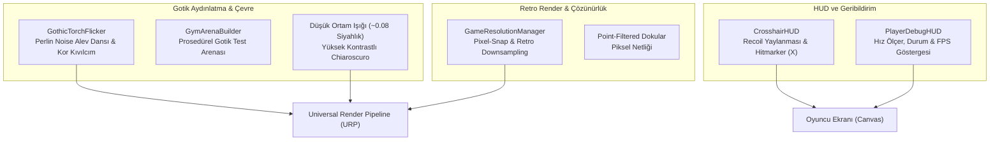

# EnvironmentAndAudioAtmosphere (Çevre, Aydınlatma, Atmosfer ve HUD Mimarisi)

> [!abstract] KARANLIK GOTİK ESTETİK, DİNAMİK IŞIK VE RETRO SUNUM
> Düşük ambient gotik aydınlatma, Perlin noise tabanlı organik meşale alevi dansı, retro çözünürlük ölçekleyici ve dinamik nişangah (HUD) mimarisi.

---

## 1. GÖRSEL VE İŞİTSEL ATMOSFER MİMARİSİ

---

## 2. KİLİT MEKANİKLER VE TEKNİK AYRINTILAR

### 1. Gotik Meşale Titremesi (`GothicTorchFlicker`)
- **Konum:** `Assets/_Project/Scripts/Environment/GothicTorchFlicker.cs`
- **Algoritma:** Basit rastgele titreme (Random.Range) yerine 1D Perlin Noise (`Mathf.PerlinNoise1D`) kullanır. Bu sayede alev ışığı organik, yumuşak ve rüzgarda dalgalanan bir his verir.
- **Işık ve Renk Parametreleri:**
  * Taban yoğunluk (`baseIntensity = 2.4f`), dalgalanma genliği (`flickerAmplitude = 0.65f`).
  * Renk gradyanı: Sıcak kehribar (#FF8C2A) ile koyu kan turuncusu (#D8450F) arasında yumuşakça gezinir.
- **Partikül Entegrasyonu:** Meşale tepe noktasından yukarıya doğru yavaşça süzülen ince kor kıvılcım ve duman partikülleri üretir.

### 2. Prosedürel Test Arenası (`GymArenaBuilder`)
- **Konum:** `Assets/_Project/Scripts/Environment/GymArenaBuilder.cs`
- **İşlevi:** Gotik taş zeminler, çevre duvarları, yükseltilmiş balkonlar ve atlama platformlarını çalışma anında veya Editörde matematiksel olarak kurar.
- **Karşılaşma Entegrasyonu:** `EncounterArea` ve `EncounterSpawnPoint` yerleşimleri için optimize edilmiş net görüş hatları ve Quake strafe-jumping koridorları sunar.

### 3. Retro Çözünürlük ve Render Yöneticisi (`GameResolutionManager`)
- **Konum:** `Assets/_Project/Scripts/Core/GameResolutionManager.cs`
- **Özellik:** Modern yüksek çözünürlüklü ekranlarda klasik 90'lar yazılım render hissini (320x240, 480x360 veya 640x480) pikselleştirme ve render texture ölçeklemesiyle simüle eder.
- **Point Filtering:** Düşük çözünürlüklü dokularda ve render çıktısında piksel yumuşatmayı (bilinear filtering) kapatarak keskin pikseller sağlar.

### 4. Dinamik Nişangah Arayüzü (`CrosshairHUD`)
- **Konum:** `Assets/_Project/Scripts/UI/CrosshairHUD.cs`
- **Silah Duyarlılığı:** 
  * Repeater Arbalest aktifken geri tepme yaylanmasını (`Recoil bloom`) dinamik olarak nişangah çizgilerini dışa açarak gösterir.
  * Executioner Blade aktifken daha geniş, yakın dövüş savurma açısını temsil eden gotik parantezler çizer.
- **Hitmarker (X İmzası):** Hedefe başarılı bir darbe vurulduğunda merkezde anlık beyaz "X", kritik (Headshot) vuruş yapıldığında büyük kırmızı "X" yanıp söner ve hafif klik sesi tetiklenir.

---

## 3. BAŞKA BİR AI İÇİN SEVİYE VE ATMOSFER KURALLARI
1. Sahnede genel aydınlatmayı asla aşırı parlak yapmayın; oyun atmosferi yüksek kontrastlı, koyu gotik gölgeler ve meşale ışıklarının dansı üzerine kuruludur.
2. UI elemanlarında sıfır GC kuralına uyun; her karede `string` birleştiren text güncellemeleri yerine olay bazlı (`Action`) güncellemeler yapın.

---

## İlişkiler (Sinaptik Ağ Bağlantıları)
- [[CodebaseDependencyGraph]] ➔ `implements_environment_pipeline`
- [[HitstopAndAudioFeedback]] ➔ `complements_audio_feedback`
- [[WaveAndEncounterArchitecture]] ➔ `provides_arena_geometry`
- ⬅️ [[ProjectOverview]] ➔ `utilizes_atmosphere` *(gelen)*
- ⬅️ [[START_HERE_AI_CONSTITUTION]] ➔ `mandated_by_constitution` *(gelen)*
