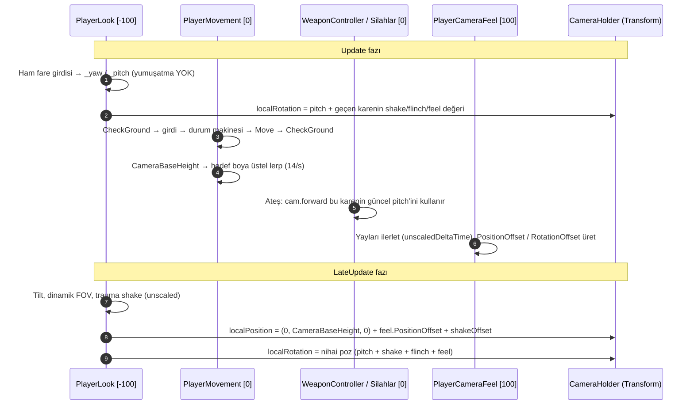

# GameFeelArchitecture (Oyun Hissi / Game Feel Mimarisi)

> [!abstract] KAMERA KOMPOZİSYONU, YAY (SPRING) TABANLI HİS VE TEK SAHİPLİ VURUŞ GERİ BİLDİRİMİ
> `feat/game-feel-pass` ile gelen katman: tek yazarlı kamera pozu, tahsissiz `Spring` osilatörü, `PlayerCameraFeel` (view punch, iniş çökmesi, head bob, dash roll, ayak sesleri), hareket olayları ve `AddImpulse`, yay tabanlı viewmodel recoil, birleşen (merge) hitstop, `CombatEvents.OnEnemyKilled` kill confirm, düşman knockback'i, havuzlu `CombatAudio` sesleri ve `CombatTargetLookup` collider önbelleği.
> Tüm değerler kodla doğrulanmıştır (2026-11-11). Kod değişirse bu nottaki tablo da güncellenmelidir.

---

## 1. KAMERA KOMPOZİSYONU (Kim, Neyi, Ne Zaman Yazar?)

- **Tek yazar kuralı:** `CameraHolder.localPosition` ve `localRotation` değerlerini **yalnızca `PlayerLook`** yazar. `PlayerMovement` artık kamerayı doğrudan taşımaz; slide/çömelme boyu `ApplyCameraHeight()` ile yalnızca hedef boyu (`_cameraTargetHeight`) değiştirir, `CameraBaseHeight` getter'ı yumuşatılmış değeri yayınlar (`cameraHeightLerpSpeed = 14`).
- **Update vs LateUpdate:** `PlayerLook.Update` pitch'i hemen uygular ki aynı karede `Update` içinde ateşleyen silahlar güncel bakış yönünü kullansın. Nihai poz (`LateUpdate`) hareket ve `PlayerCameraFeel` güncellendikten sonra yazılır.
- **İşaret konvansiyonu:** `RotationOffset.x` pitch'ten **çıkarılır**; yani pozitif view punch kamerayı yukarı tepir, negatif punch aşağı vurur.
- **Execution order:** `PlayerLook` `[DefaultExecutionOrder(-100)]`, `PlayerCameraFeel` `[DefaultExecutionOrder(100)]`. `PlayerLook.Awake` bileşen yoksa `PlayerCameraFeel`'i otomatik ekler.
- **Zaman ölçeği:** Kamera shake, flinch toparlanması, FOV lerp ve kamera yayları `Time.unscaledDeltaTime` kullanır (hitstop sırasında da akar). Viewmodel yayları ise `Time.deltaTime` kullanır (hitstop'ta donar).
- `ResetView(yaw)` (teleport/respawn) shake, flinch, FOV kick ve feel ofsetlerini sıfırlar, FOV'u `baseFOV`'a, holder pozisyonunu `CameraBaseHeight`'a çeker.

### PlayerLook Değişiklikleri
- **Mouse smoothing kaldırıldı:** `smoothLook` / `smoothSpeed` alanları silindi; bakış ham girdi × `mouseSensitivity` ile 1:1.
- **Tilt hız tabanlı:** Hedef eğim = `clamp(-lateralVelocity / WalkSpeed × tiltAngle, ±1.5 × tiltAngle)`; slide sırasında `+slideTilt (4°)`.
- **FOV kick birleşmesi:** `DoFovKick(amount)` aynı işaretli kick'lerde büyük olanı tutar (üst üste binmez), sonuç `[-12, 22]` aralığına kıstırılır ve 6/s üstel sönümle sıfıra iner.
- **Shake pozisyonu:** Trauma artık rotasyona ek olarak `maxShakeOffset = 0.045` m pozisyon sarsıntısı da üretir.
- **Yeni API:** `AddViewPunch(pitchDegrees, yawDegrees)` → `PlayerCameraFeel.AddViewPunch` delegesi.

---

## 2. `Spring` ve `PlayerCameraFeel`

### 2.1 `Spring` (`Player/Feel/Spring.cs`)
- Tahsissiz `struct` sönümlü osilatör. `Step(target, frequencyHz, dampingRatio, dt)`, `AddVelocity(v)`, `internal SetValue(v)`; `Value` / `Velocity` getter'ları.
- `dt` 0.05 s'ye kıstırılır; integrasyon en fazla `1/480` s'lik alt adımlarla (yüksek frekansta daha da küçük) yapılır → impuls tepe değerleri FPS'den bağımsızdır.
- Ses/ağ/allocation yoktur; hem kamera hissi hem viewmodel recoil için ortak yapı taşıdır.

### 2.2 `PlayerCameraFeel` (`Player/Feel/PlayerCameraFeel.cs`)
- `[RequireComponent(typeof(PlayerMovement))]`, `[DisallowMultipleComponent]`. Pitch/yaw/roll (punch) ve dikey (iniş) olmak üzere 4 yay tutar; çıktı `PositionOffset` / `RotationOffset` olarak `PlayerLook`'a okunur.
- **View punch:** `AddViewPunch(pitch, yaw)` istenen dereceyi **tepe yer değiştirme** olarak üretir (impuls ölçeği `punchFrequency`/`punchDamping`'den analitik hesaplanır). Gösterim sınırları: pitch ±9°, yaw ±5°.
- **İniş (landing dip):** `PlayerMovement.OnLanded(impactSpeed)` → `impact > minLandImpact (4 m/s)` ise `t = InverseLerp(4, 22, impact)`; dikey çökme `maxLandDip × t` (±0.22 m sınırı), aşağı punch `landPitchDown × t`, `CombatAudio.PlayLand(t)`; `t > 0.55` ise `AddTrauma(0.12 × t)`.
- **Zıplama:** `OnJumped` → `jumpRise = 0.03` m yukarı tepme + `PlayJump()`.
- **Slide:** `OnSlideStarted` → `slideDip = 0.04` m çökme + `PlaySlideStart()`.
- **Dash roll:** `OnDashStarted` → dash yönünün yanal bileşenine göre `dashRollKick = 3°` roll impulsu + `PlayDash()`.
- **Head bob ve ayak sesi:** Yalnızca zeminde, slide dışında ve yatay hız > 1 m/s iken. Faz kat edilen mesafeyle ilerler (`bobStrideLength = 2.6` m, teleport sıçramaları hız × dt ile kırpılır). Her adımda iki ayak sesi (faz 0.25 ve 0.75 geçişleri) → `CombatAudio.PlayFootstep()`. Dikey bob `0.022` m (adım başına 2 dalga), yanal `0.012` m; ağırlık `speed / WalkSpeed` ile ölçeklenip `bobFadeSpeed = 10` ile yumuşatılır.
- Hareket veya bakış bileşeni devre dışıysa ofsetler sıfırlanır (`ResetOffsets`).

---

## 3. HAREKET OLAYLARI VE FİZİK DEĞİŞİKLİKLERİ (`PlayerMovement`)

### 3.1 Yeni Olaylar ve API
| Üye | Açıklama |
| :--- | :--- |
| `event Action OnJumped` | Normal/slide zıplaması ve grapple slingshot fırlatması |
| `event Action<float> OnLanded` | Havadan zemine geçişte; parametre en düşük dikey hızın mutlak değeri (m/s) |
| `event Action OnDashStarted` / `OnSlideStarted` / `OnSlideEnded` | Durum geçişleri |
| `Vector3 Velocity`, `float WalkSpeed`, `float CameraBaseHeight` | Read-only getter'lar |
| `AddImpulse(Vector3 worldVelocity)` | Dış kuvvet (ör. pompalı geri tepmesi) |

- **`AddImpulse` kuralları:** Dash, grapple, lunge ve meteor slam sırasında **yok sayılır**. Zemindeyken yukarı bileşenli impuls zemine yapışma hızını (negatif y) sıfırlar, oyuncuyu havaya alır, coyote süresini iptal eder ve slide'ı bitirir.
- **Zemin kontrolü:** `CheckGround()` hem karenin başında hem `Move` sonrasında çalışır; `velocity.y > 0` iken zemin kabul edilmez (fırlatma sırasında sahte temas engellenir).

### 3.2 Hareket Değişiklikleri
- **Slide-Jump:** Slide artık zıplamayı **kilitlemez**. Slide sırasında zıplama slide'ı bitirir ve yatay hıza `min(slideJumpSpeedBonus = 1.5, max(0, maxAirSpeed + 4 − hız))` kadar bonus ekler (bonus toplam hızı ~15.5 m/s'nin üstüne itemez).
- **İniş sürtünme muafiyeti:** Gerçek bir inişten sonra (`impact > 3 m/s` veya hava süresi > 0.1 s) `landingFrictionGrace = 0.08` s boyunca zemin sürtünmesi uygulanmaz → bunny-hop zincirinde hız kaybı olmaz. Merdiven/rampa titremeleri muafiyet vermez.
- **Yumuşak hava tavanı:** Hız zaten `maxAirSpeed (11.5) × boost` üstündeyse ani kırpma yerine `airOverspeedDecay = 2.5` m/s² ile tavana iner; air-strafe girdisi aşırı hızı **artıramaz**. Tavan altındaysa sert tavan geçerlidir.
- **Düşüş yerçekimi:** Havada ve `velocity.y < 0` iken yerçekimi `fallGravityMultiplier = 1.3` ile çarpılır (25 → 32.5).
- `TeleportTo` slide'ı bitirir, iniş/hava sayaçlarını ve kamera boyunu sıfırlar.

---

## 4. VİEWMODEL: YAY TABANLI RECOIL VE EQUIP (`ProceduralViewmodel`)

- **Poz kompozisyonu:** Sway/bob ve melee savurma animasyonları artık doğrudan `transform`'a değil `_posePosition` / `_poseRotation`'a yazar. `ComposePose()` üzerine recoil, dikey atalet, iniş ve equip ofsetlerini ekleyip transform'u **tek seferde** yazar; ardından yaylar ilerletilir (yeni recoil en az bir kare görünür).
- **Recoil:** `AddRecoil(kickZ, kickPitch, kickYaw)` ve `AddDamageFlinch(intensity)` altı yayın (x, y, z, pitch, yaw, roll) **yer değiştirmesini** (`SetValue`) ekler; yaylar `recoilFrequency = 9 Hz`, `recoilDamping = 0.5` ile hafif overshoot yaparak döner. (Eski `recoilRecoverySpeed` lerp'i kaldırıldı.)
- **Dikey atalet:** Havadayken `-velocity.y × 0.006` (±0.05 m) ofset ve orantılı pitch (en fazla 4°), `inertiaSmooth = 12`. Zemindeyken yapışma hızı ofset üretmez.
- **İniş/zıplama:** `OnLanded` → `landingDip = 0.05` m ve `landingPitch = 5°` (aynı `t = InverseLerp(4, 22, impact)`), `OnJumped` → `jumpDip = 0.012` m.
- **Equip raise:** `WeaponBase.OnEquip()` → `viewmodel.PlayEquip()`; silah `equipDropDistance = 0.28` m aşağıdan ve `equipPitchDown = 35°` eğimle `equipDuration = 0.16` s içinde easeOutBack eğrisiyle kalkar. `WeaponController` gerçek silah değişiminde `CombatAudio.PlayWeaponSwitch()` çalar; aynı slota tekrar geçiş yok sayılır.

---

## 5. HITSTOP BİRLEŞME SEMANTİĞİ (`HitstopManager`)

- `TriggerHitstop(duration = 0.05f, timeScale = 0.03f)`; aktif değilse mevcut `Time.timeScale` ve `Time.fixedDeltaTime` **saklanır** (sabit 1.0 / 0.02'ye dönülmez).
- Üst üste çağrılar **birleşir:** süre `max(kalan, yeni)`, zaman ölçeği `min(mevcut, yeni)`; `fixedDeltaTime` orana göre ölçeklenir (en az `1e-6`).
- Süre `unscaledDeltaTime` ile düşer; bitişte, `OnDisable` ve `OnDestroy`'da saklanan değerlere geri dönülür. `IsActive` getter'ı vardır.
- Kopya singleton artık `Destroy(this)` yapar (eskiden `Destroy(gameObject)` ile tüm `CombatSystems` objesini silebiliyordu). `HitstopManager` lazy oluşturulmaz; sahnede `CombatSystems` prefab'ı bulunmalıdır.
- **Çağrı noktaları:** Canlı düşmana kritik vuruş `0.04 s` (Ghoul `0.04` ölçek, Uçan Göz `0.03`); düşman ölümü `0.07 s / 0.03`; stun `0.08 / 0.02`; kılıç finisher `0.08 / 0.02`; parry `0.10 / 0.02`.

---

## 6. ÖLÜM OLAYI VE KILL CONFIRM

- **`CombatEvents`** (`Core/CombatEvents.cs`, assembly `RetroFPS.Core`, namespace `RetroFPS.Combat`): `static event Action<Vector3 position, bool wasCritical, bool wasGibbed> OnEnemyKilled` ve `RaiseEnemyKilled(...)`. Statikler `SubsystemRegistration`'da sıfırlanır (Domain Reload kapalıyken sızıntı yok).
- `BasicEnemyAI.Die` / `FlyingEyeAI.Die` sırası: `IsAlive` koruması → drop'lar → ölüm görseli → `TriggerHitstop(0.07, 0.03)` → `CombatEvents.RaiseEnemyKilled` → `OnEnemyDeath` (encounter takibi, [[WaveAndEncounterArchitecture]]).
- **`CrosshairHUD`** `OnEnable/OnDisable`'da abone olur: 0.32 s (unscaled) kalın X kill marker (normal kırmızı, kritik soluk altın), aktifken normal hitmarker gizlenir; `CombatAudio.PlayKillConfirm(wasCritical)` çalar.
- Yeni dinleyiciler (skor, combo, stil sayacı) `CombatEvents.OnEnemyKilled`'e abone olmalıdır; düşman sınıflarına UI/skor referansı eklenmez.

---

## 7. TEK SAHİPLİ VURUŞ GERİ BİLDİRİMİ (Single-Owner Hit Feedback)

> [!important] KURAL
> **Hasar alan varlık** (`IDamageable.TakeDamage` uygulayan sınıf) kendi et/kan darbe VFX'ini (`CombatVFXManager.SpawnHitImpact(..., isFlesh: true)`) ve et sesini (`CombatAudio.PlayFleshImpact`) üretir. Silahlar bunları **çağırmaz**.

| Sorumluluk | Sahibi |
| :--- | :--- |
| Et darbe VFX + et sesi, hit flash, knockback, kritik hitstop | Hasar alan varlık (`BasicEnemyAI`, `FlyingEyeAI`, `CombatDummy`) |
| Hasar sayısı (`DamageNumberSystem`), `NotifyHit` (hitmarker), duvar kıvılcımı (`isFlesh: false`), tracer, muzzle flash, kamera/viewmodel tepkisi | Silah |
| Kılıç kesik lekesi | `SpawnBladeSlashImpact` (artık yalnızca decal; et parçacığı eklemez) |

- **Hit flash:** HDR beyaz `(2.2, 2.2, 2.2)` / kritik `(3.2, 2.8, 0.35)`, süre `0.06 s` / `0.12 s`; malzeme destekliyorsa `_EmissionColor`'a da yazılır (MaterialPropertyBlock).
- **Ses kısıtlaması:** `PlayFleshImpact` 30 ms, `PlayHitmarker` 45 ms, `PlayGibBounce` 50 ms içinde tekrarları yutar (pompalının 18 saçması tek ses üretir).

### Pompalı Atış Başı Toplama (Per-Blast Aggregation)
- Önce tüm saçma ışınları çözülür (`CombatRaycast.Nearest`), sonra hedef başına **tek** `TakeDamage` uygulanır. Toplama anahtarı `IDamageable` referansıdır (Hitbox varsa **Hitbox başına**: kafa + gövde = iki çağrı).
- Ham hasar toplamı gönderilir (Hitbox çarpanı tam bir kez uygulanır); hasar sayısı çarpanlı toplamı gösterir; kritik bayrağı OR'lanır; ilk isabetin nokta/normali kullanılır.
- Kapasite 12 hedef; taşan hedefler saçma başına anında uygulanır. Atış başına tek `NotifyHit`, en fazla 6 duvar darbe efekti, her 3. saçmada bir tracer.
- Havadayken geri tepme: varsa grapple bırakılır, ardından `AddImpulse(-camForward × airborneKnockback (6.5))`.

---

## 8. DÜŞMAN KNOCKBACK'İ

- **`BasicEnemyAI`:** Kritik veya `amount ≥ 40` → Stagger (0.35 s; zaten stagger'daysa süre `max(kalan, 0.35)` ve chase yeniden başlatılmaz). Yatay impuls `-hitNormal` yönünde `clamp(amount × 0.09, 2.5, 10)` m/s, `amount ≥ 60` ise `y = 1.5`. Stagger boyunca `CharacterController.Move` + 8/s üstel sönüm. Oyuncu henüz bulunamasa bile stagger işlenir.
- **`FlyingEyeAI`:** Her vuruşta `_knockbackVelocity = -hitNormal × clamp(amount × 0.12, 2, 9)`, `KnockbackDecay = 7`/s. Kritik veya `amount ≥ 30` → 0.30 s stagger.
- **`IStunnable.Stun(duration, knockbackDir)`:** `knockbackDir` artık **yalnızca yön**dür; büyüklük düşmanın `stunKnockbackSpeed` alanından gelir (Ghoul `5.5` m/s, Uçan Göz `24.5` m/s ≈ 3.5 m toplam kayma). Sıfır vektör = knockback yok.
- Kılıç finisher artık `binding.Stunnable.Stun(1.2f, forward × 12)` çağırır; meteor slam hasar normali düzeltildi (`-knockDir`).

---

## 9. `CombatAudio` SES HAVUZU VE YENİ KLİPLER

- **Havuz:** 6 adet 2D, 12 adet 3D `AudioSource` (child objeler; 3D: `spatialBlend 1`, logaritmik rolloff 1–500 m, doppler 0). Boştaki ilk ses seçilir, hepsi doluysa halka sırasıyla **voice stealing**. `AudioSource.PlayClipAtPoint` (her çağrıda GameObject tahsisi) kaldırıldı → `PlayClipAt(clip, pos, volume, pitch)` (parry clang ve düşman glint dahil).
- **Pitch:** `pitchVariation` aralığı `0–0.06` (varsayılan 0.06); silah ateşleri `0.94–1.06` rastgele pitch.
- **Yeni sentetik klipler** (`PrewarmSynthesizedClips` içinde Awake'te üretilir): `PlayJump` (0.55 ses), `PlayLand(intensity01)` (ses 0.25→0.95, pitch 1.15→0.75), `PlayDash` (0.75), `PlaySlideStart` (0.65), `PlayFootstep` (0.25, ±%6 pitch), `PlayWeaponSwitch` (0.60), `PlayKillConfirm(wasCrit)` (0.85; 1320 Hz, kritikte 1760 Hz + overtone).
- **Lazy singleton:** `CombatAudio`, `CombatVFXManager`, `DamageNumberSystem` `Instance` erişiminde ve her `sceneLoaded`'da kendini garanti eder (`EnsureInstance`), uygulama kapanırken yeniden oluşmaz; statikler `SubsystemRegistration`'da sıfırlanır. `PlayerCameraFeel.Awake` sıcak yoldan önce `CombatAudio.Instance`'ı ısıtır.
- **VFX ekleri:** `CombatVFXManager` havuzlu additive muzzle burst parçacıkları (4–6 adet) ve enemy glint/stun için `internal SpawnSignalBurst` (eski `ParryVFX.SpawnGlint/SpawnStunEffect` çağrılarının yerine). `DamageNumberSystem` 0–4095 arası etiketleri önbelleğe alır, daha büyük sayıları rakam parçalarıyla tahsissiz çizer.

---

## 10. `CombatTargetLookup` COLLIDER ÖNBELLEĞİ

- **Konum:** `Weapons/WeaponBase.cs` dosyasının altında, `namespace RetroFPS.Combat`, `internal static class` (yalnız `RetroFPS.Gameplay` assembly'si). Aynı dosyada `CombatRaycast.Nearest(origin, dir, dist, mask, buffer, out hit)`: `RaycastNonAlloc` + en yakın sonucu açıkça seçer (`QueryTriggerInteraction.Ignore`); tüm silahlar ve düşman görüş/engel ışınları bunu kullanır.
- **`Binding`:** `Hitbox`, `Damageable` (Hitbox varsa Hitbox, yoksa ebeveyndeki `IDamageable`), `Stunnable`, `Enemy` (`IEncounterEnemy`), `Entity` (= `Hitbox.Target ?? Damageable`).
- **Doldurma:** Her `sceneLoaded`'da sahnedeki tüm collider'lar (inaktifler dahil) kaydedilir; `Single` yüklemede önbellek önce temizlenir, additive'de korunur. `BasicEnemyAI`, `FlyingEyeAI`, `CombatDummy` `Awake` ve `Start`'ta `RegisterHierarchy(this)` çağırır.
- **`Get(collider)`:** Önbellek isabeti = sözlük araması + yok edilmiş referans kontrolü (tahsissiz). Iska (veya yok edilmiş referanslı kayıt) → `GetComponentInParent` ile çözülür ve sonuç **boş binding dahil** önbelleğe yazılır.

> [!warning] KURAL
> Çalışma anında doğan (`Instantiate`, havuz) veya collider hiyerarşisi değişen her `IDamageable`, doğuşta `CombatTargetLookup.RegisterHierarchy(this)` çağırmalıdır. Aksi halde ilk isabet `GetComponentInParent` geri dönüşüne düşer; daha kötüsü, varlık bağlanmadan önce o collider'a vurulmuşsa önbellekteki **boş binding** bir sonraki `Single` sahne yüklemesine kadar kalır ve hedef hasar almaz.

---

## 11. AYAR TABLOSU (Kodda Serileştirilmiş Varsayılanlar)

| Bileşen | Alan | Varsayılan |
| :--- | :--- | :--- |
| `PlayerLook` | `mouseSensitivity` / `tiltAngle` / `tiltSpeed` / `slideTilt` | 0.10 / 2° / 10 / 4° |
| `PlayerLook` | `baseFOV` / `maxFOV` / `fovStartSpeed` / `fovMaxSpeed` / `fovLerpSpeed` | 65 / 78 / 11 / 24 / 8 |
| `PlayerLook` | `maxShakeAngle` / `shakeFrequency` / `traumaDecay` / `maxShakeOffset` | 3.5° / 24 / 3.5 / 0.045 m |
| `PlayerCameraFeel` | `punchFrequency` / `punchDamping` | 6.5 Hz / 0.55 |
| `PlayerCameraFeel` | `minLandImpact` / `landFrequency` / `landDamping` / `maxLandDip` | 4 m/s / 4.5 Hz / 0.6 / 0.22 m |
| `PlayerCameraFeel` | `jumpRise` / `landPitchDown` / `slideDip` / `dashRollKick` | 0.03 m / 2.5° / 0.04 m / 3° |
| `PlayerCameraFeel` | `bobStrideLength` / `bobVertical` / `bobLateral` / `bobFadeSpeed` | 2.6 m / 0.022 / 0.012 / 10 |
| `PlayerMovement` | `walkSpeed` / `groundAcceleration` / `groundFriction` / `landingFrictionGrace` | 8 / 18 / 8.5 / 0.08 s |
| `PlayerMovement` | `airAcceleration` / `airWishSpeed` / `maxAirSpeed` / `airOverspeedDecay` | 4 / 3.5 / 11.5 / 2.5 |
| `PlayerMovement` | `jumpForce` / `gravity` / `fallGravityMultiplier` | 7.2 / 25 / 1.3 |
| `PlayerMovement` | `slideBoost` / `slideFriction` / `slideJumpSpeedBonus` / `cameraHeightLerpSpeed` | 13 / 3.2 / 1.5 / 14 |
| `PlayerMovement` | `normalCameraY` / `slideCameraY` | 1.55 / 0.65 |
| `ProceduralViewmodel` | `recoilFrequency` / `recoilDamping` | 9 Hz / 0.5 |
| `ProceduralViewmodel` | `verticalInertiaScale` / `maxVerticalInertia` / `maxInertiaPitch` / `inertiaSmooth` | 0.006 / 0.05 / 4° / 12 |
| `ProceduralViewmodel` | `landingDip` / `landingPitch` / `jumpDip` | 0.05 / 5° / 0.012 |
| `ProceduralViewmodel` | `equipDropDistance` / `equipDuration` / `equipPitchDown` | 0.28 m / 0.16 s / 35° |
| `GothicShotgunWeapon` | `airborneKnockback`; ateş: recoil `(0.24, 16, 4)`, trauma 0.35, punch 4.2° (yaw ±1.1) | 6.5 |
| `RepeaterArbalestWeapon` | `maxBloomSpread` / `bloomPerShot` / `bloomRecovery`; ateş: punch 0.55° (alt: 2.4°) | 2.2 / 0.22 / 4.5 |
| `ExecutionerBladeWeapon` | Kombo punch: vuruş 1–2 `-0.6°` (yaw ∓1.2), finisher `-2.2°`; meteor iniş `-3°` | — |
| `BasicEnemyAI` / `FlyingEyeAI` | `stunKnockbackSpeed` | 5.5 / 24.5 |
| `CombatAudio` | `pitchVariation`; havuz 2D / 3D | 0.06; 6 / 12 |
| `CrosshairHUD` | Kill marker süresi (sabit) | 0.32 s |

---

## 12. GELECEK DEĞİŞİKLİKLER İÇİN KURALLAR (BAŞKA BİR AI İÇİN)
1. `CameraHolder` transform'unu `PlayerLook` dışında **yazmayın**. Yeni kamera efekti gerekiyorsa `PlayerCameraFeel` içine yay olarak ekleyin veya `PlayerLook.AddViewPunch` / `AddTrauma` / `DoFovKick` kullanın.
2. Yeni hareket tepkileri için `PlayerMovement`'a görsel/ses kodu eklemeyin; `OnJumped`, `OnLanded`, `OnDashStarted`, `OnSlideStarted`, `OnSlideEnded` olaylarına abone olun (OnEnable/OnDisable'da abonelik eşleşmeli).
3. Oyuncuya dış kuvvet yalnızca `PlayerMovement.AddImpulse` ile verilir; `CharacterController.Move`'u silahtan doğrudan çağırmayın.
4. Yeni yay tabanlı efektlerde `Spring` struct'ını kullanın; `Update` içinde `new`, LINQ, string birleştirme yok.
5. Et/kan VFX ve et sesi **hasar alan varlığın** `TakeDamage` içindedir; silah yalnızca hasar sayısı, `NotifyHit`, duvar efekti ve kendi tepkisini üretir. Çok ışınlı silahlar pompalı gibi hedef başına toplamalıdır.
6. Hitstop'u doğrudan `Time.timeScale` ile değil `HitstopManager.TriggerHitstop` ile tetikleyin (birleşme semantiği zaman ölçeğini korur).
7. Ölüm tepkileri (UI, skor, ses) `CombatEvents.OnEnemyKilled` üzerinden; yeni düşmanlar `Die` içinde `RaiseEnemyKilled` çağırmalıdır.
8. Ses çalmak için `CombatAudio` havuz API'lerini (`PlayClipAt`, `Play*`) kullanın; `AudioSource.PlayClipAtPoint` kullanmayın.
9. Yeni `IDamageable` / `IStunnable` varlıkları doğuşta `CombatTargetLookup.RegisterHierarchy(this)` çağırmalı; isabet çözümlemesi `CombatTargetLookup.Get(collider)` ve `CombatRaycast.Nearest` ile yapılmalıdır.
10. `IStunnable.Stun`'a gönderilen `knockbackDir` bir yöndür; itme gücü düşmanın kendi `stunKnockbackSpeed` alanında ayarlanır.

---

## İlişkiler (Sinaptik Ağ Bağlantıları)
- [[PlayerMovementArchitecture]] ➔ `consumes_movement_events`
- [[PlayerSubsystemArchitecture]] ➔ `composes_player_camera`
- [[WeaponArsenalArchitecture]] ➔ `drives_viewmodel_and_weapon_feedback`
- [[HitstopAndAudioFeedback]] ➔ `extends_hitstop_and_audio`
- [[EnemyAIAndCombatFeel]] ➔ `defines_enemy_hit_reactions`
- [[CombatAndDamageInterfaces]] ➔ `caches_interface_lookups`
- [[CombatVFXAndDecalSystem]] ➔ `routes_flesh_vfx_ownership`
- [[CodebaseDependencyGraph]] ➔ `mapped_in_graph`
- ⬅️ [[START_HERE_AI_CONSTITUTION]] ➔ `mandated_by_constitution` *(gelen)*
- ⬅️ [[ProjectOverview]] ➔ `utilizes_game_feel` *(gelen)*
