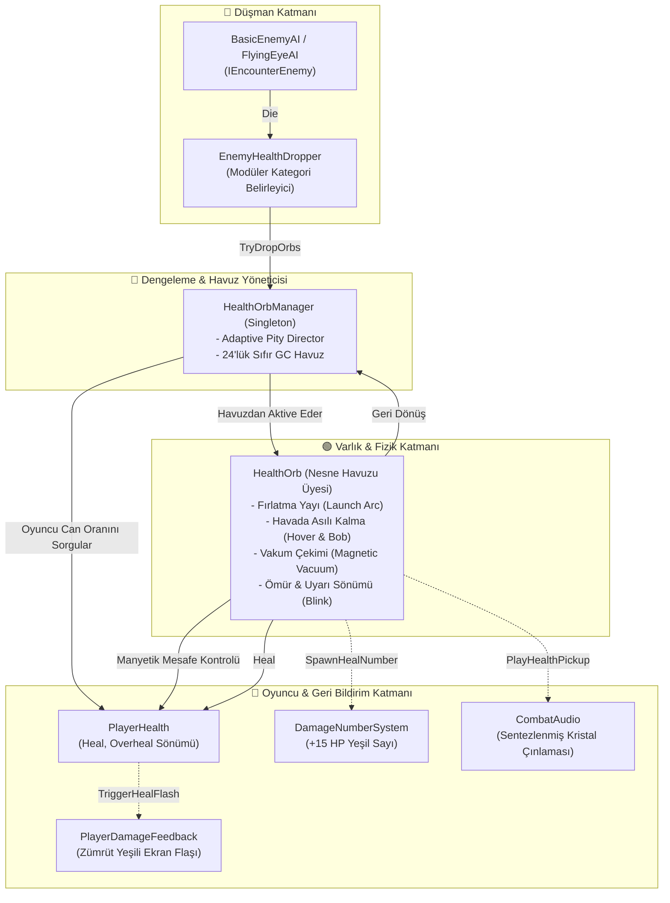

# HealthOrbAndDropSystem (Can Küresi ve Düşüş Sistemi)

> [!abstract] DOOM ETERNAL & ULTRAKILL STANDARDI PUSH-FORWARD SAVAŞ DENGELEMESİ
> Oyuncunun köşeye saklanıp can yenilenmesini beklemesini engelleyen, agresif savaşı ödüllendiren, adaptif direktör kontrollü ve sıfır GC tahsisli can küresi düşüş mimarisi.

---

## 1. YÜKSEK SEVİYELİ MİMARİ VE ÇAĞRI AKIŞI

---

## 2. KAYNAK EKONOMİSİ: KITLIK DENGESİ (2026-11-11 REVİZYONU)

> [!important] Tasarım İlkesi — "Yaşamak için savaş"
> Silahla öldürmek kaynakları **net olarak eritir**; can ve cephane asıl olarak **infaz (Executioner Blade)** ile kazanılır. Bu, Doom Eternal'ın Glory Kill (can) / Chainsaw (cephane) döngüsünün karşılığıdır. Klasik Doom'daki gibi rastgele düşüşler bir can simidi değil, nadir bir bonustur.

### 2.1 Düzeltilen Hatalar (bolluğun asıl nedeni)
1. **Çift zar:** Düşman `Die()` içinde dropper'ı doğrudan çağırıyor, dropper ayrıca `OnEnemyDeath`'e abone olup bir kez daha düşürüyordu. Artık dropper'lar event'e abone **olmaz**, tek çağrı yolu düşman sınıfının `Die()` metodudur.
2. **Sahte melee:** "İnfaz" bilgisi `killingDamage >= 40/35` ile tahmin ediliyordu. Pompalı tek atışta ~324 hasar verdiği için her pompalı öldürmesi infaz sayılıyor ve garantili, bonuslu düşüş üretiyordu. Artık kaynak `MeleeDamageScope` (Core, sıfır GC statik bağlam) ile belirleniyor: `ExecutionerBladeWeapon` tüm `TakeDamage` çağrılarını `Begin/End` arasına alır, düşman `MeleeDamageScope.IsActive` okur.

### 2.2 Can Küresi Direktörü (`HealthOrbManager`, CombatSystems.prefab)
| Parametre | Eski | Yeni |
|---|---|---|
| baseDropChance | 0.50 | **0.12** |
| lowHealthThreshold / Bonus | 0.35 / +0.45 | **0.30 / +0.18** |
| highHealthThreshold / Ceza | 0.80 / −0.25 | 0.80 / **−0.12** (→ %0) |
| critKillBonusChance | +0.25 | **+0.08** |
| meleeKillBonusChance | +0.35 | **+0.55** |
| Pity | 2 boş ölüm, +0.20/adım | **4 boş ölüm, +0.08/adım** |
| Clamp | 0.10 – 0.98 | **0.00 – 0.90** |
| standard / heavy heal | 15 / 30 | **10 / 20** |
| Ekstra küre | kritik veya melee | **yalnızca melee** (T1 %50, T2 her zaman 2) |
| Küre ömrü / uyarı | 16 s / 4 s | **10 s / 3 s** |

**Beklenen can/öldürme (Ghoul, orta HP):** silah ≈ **1.2 HP**, headshot ≈ 2 HP, infaz ≈ **~10 HP**. Kritik HP'de silah ≈ 3 HP.
Eski sistemde (çift zar ve sahte melee ile) pompalı öldürmesi başına ≈ 25+ HP düşüyordu. Bir düşman mermisi 18 hasar verir, yani artık yalnızca ateş ederek can toplamak mümkün değil.

### 2.3 Cephane (`EnemyAmmoDropper`, düşman prefabları)
| Parametre | Eski | Yeni |
|---|---|---|
| dropChance (silahla) | 0.65, kritik/“melee” garantili | **0.35**, yalnızca gerçek infaz garantili |
| Silahla miktar (Shells / Bolts) | 4 / 15 (bonus 6 / 25) | **2 / 6** |
| İnfazla miktar (Shells / Bolts) | — | **6 / 20** |
| Pickup ömrü | 25 s | **15 s** |

**Kaynak Geri Dönüş Oranı (RRR = beklenen kazanç / öldürme maliyeti):**
- Pompalı öldürme (2 fişek): 0.35 × 2 = 0.7 fişek → **%35**
- Arbalet öldürme (Ghoul ~7 ok): 0.35 × 6 = 2.1 ok → **%30**
- İnfaz: 6 fişek = 3 pompalı öldürmesi, 20 ok = ~3 Ghoul. Döngüyü bu besler.
- Hedef: Yalnızca silahla oynayan oyuncu başlangıç cephanesiyle (60 ok / 16 fişek) yaklaşık 20-25 öldürmede kurur. Her 3-4 öldürmede bir infaz yapan oyuncu ise cephanesini sürdürebilir.

> [!note] Otomatik can yenilenmesi kapalı
> `PlayerHealth.enableAutoHeal = false`. Saklanıp beklemek can kazandırmaz. Yukarıdaki can/öldürme hesapları oyuncunun **tek** can kaynağını tanımlar.

### 2.4 Ayar Kolları (öncelik sırası)
1. Oyun çok sert gelirse önce `meleeKillBonusChance` ile `meleeKill*` miktarlarını artır. Silah düşüşlerine dokunma, yoksa kıtlık kaybolur.
2. Yeni oyuncu için ayar gerekiyorsa `lowHealthBonusChance` tek kaldıraçtır.
3. Seviyeye elle yerleştirilen can ve cephane paketleri (klasik Doom tarzı) ayrı bir ekonomi katmanıdır, [[WaveAndEncounterArchitecture]] ile birlikte planlanmalı.

---

## 3. MANYETİK VAKUM VE AKILLI TOPLAMA KURALLARI

1. **İsraf Önleme (Full HP Protection):**
   - Oyuncunun canı %100 ise ve `allowOverheal` kapalıysa küre oyuncuya çekilmez ve harcanmaz. Yerde taktiksel bir depo olarak havada asılı kalır; oyuncu hasar aldıktan sonra alabilir.
2. **Fırlatma ve Zemin Tespiti (Launch Arc):**
   - Düşman parçalandığında küre doğrudan düşmanın içinde kalmaz; yukarı ve hafif yatay bir yay çizerek fırlar, Raycast ile zemini bulur ve zemin üzerinde (0.55m) hover moduna geçer.
3. **Dinamik Vakum (Magnetic Acceleration):**
   - Oyuncu 6.0m yaklaştığında küre katlanarak artan bir ivmeyle oyuncunun göğsüne doğru uçar.
   - Oyuncu **Dash** atarken algılama yarıçapı 1.6x genişler (9.6m).
4. **Görsel Ömür ve Yanıp Sönme (Telegraphing):**
   - Küreler sahnede 10 saniye kalır; savaş ortasında alınmazsa kaybolur.
   - Son 3 saniyede yanıp sönme frekansı artarak oyuncuyu uyarır.

---

## 4. BİLEŞENLER VE API SÖZLEŞMESİ

### `HealthOrb.cs`
- **Konum:** `Assets/_Project/Scripts/Combat/HealthOrb.cs`
- **Sorumluluk:** Havuzlanabilir varlık; fırlama, salınım, vakum takibi, can verme ve geri dönüş.
- **Görsel:** Projede harici prefab olmasa dahi URP Lit zümrüt emisyonlu küre modelini prosedürel olarak üretir.

### `HealthOrbManager.cs`
- **Konum:** `Assets/_Project/Scripts/Combat/HealthOrbManager.cs`
- **Sorumluluk:** Tekil havuz orkestratörü (`Instance`), dinamik dengeleme hesabı.
- **Metotlar:** `TryDropOrbs(position, tier, isCritical, isMelee)`, `SpawnOrb(position, amount)`.

### `EnemyHealthDropper.cs`
- **Konum:** `Assets/_Project/Scripts/Combat/EnemyHealthDropper.cs`
- **Sorumluluk:** Düşman prefablarına eklenen modüler tetikleyici. Düşman `Die()` içinde `TriggerDrop(isCritical, MeleeDamageScope.IsActive)` ile **tek kez** çağırır; `OnEnemyDeath`'e abone olmaz.

### `EnemyAmmoDropper.cs`
- **Konum:** `Assets/_Project/Scripts/Combat/EnemyAmmoDropper.cs`
- **Sorumluluk:** Cephane düşüşü. Silahla öldürmede şansa bağlıdır, infazda garantili ve bol düşer. En düşük orandaki cephane türünü seçer.

### `MeleeDamageScope.cs`
- **Konum:** `Assets/_Project/Scripts/Core/MeleeDamageScope.cs`
- **Sorumluluk:** `IDamageable` imzasını değiştirmeden hasarın yakın dövüşten gelip gelmediğini bildiren sıfır GC statik bağlam. Yeni yakın dövüş silahları da `TakeDamage` çağrısını `Begin/End` (try/finally) arasına almalıdır.

---

## İlişkiler (Sinaptik Ağ Bağlantıları)
- [[CodebaseDependencyGraph]] ➔ `integrates_with_combat_graph`
- [[PlayerSubsystemArchitecture]] ➔ `feeds_player_health`
- [[EnemyAIAndCombatFeel]] ➔ `rewards_enemy_defeat`
- [[HitstopAndAudioFeedback]] ➔ `triggers_audio_and_popups`
