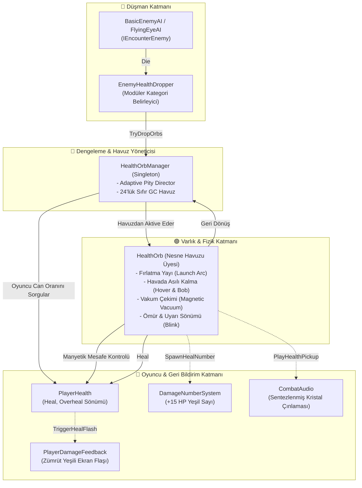

# HealthOrbAndDropSystem (Can Küresi ve Düşüş Sistemi)

> [!abstract] DOOM ETERNAL & ULTRAKILL STANDARDI PUSH-FORWARD SAVAŞ DENGELEMESİ
> Oyuncunun köşeye saklanıp can yenilenmesini beklemesini engelleyen, agresif savaşı ödüllendiren, adaptif direktör kontrollü ve sıfır GC tahsisli can küresi düşüş mimarisi.

---

## 1. YÜKSEK SEVİYELİ MİMARİ VE ÇAĞRI AKIŞI

---

## 2. DİNAMİK ADAPTİF DÜŞÜŞ MANTIĞI (ADAPTIVE PITY DIRECTOR)

Boomer shooter türünün kalbinde "Risk & Reward" yatar. Statik RNG yerine modern retro FPS sektör standardı direktör algoritması devrededir:

1. **Oyuncu Canı Orantılı Şans (Dynamic Life-Line):**
   - **Kritik Can (< %35 HP):** Düşüş olasılığı `baseDropChance (0.50)` + `%45` eklenerek neredeyse **garantili (%95)** can küresi sağlar. Oyuncu ölümün kıyısındayken agresifleşerek hayatta kalır (DOOM Push-Forward Combat).
   - **Dengeli Can (%35 - %80 HP):** Standart `%50` düşme olasılığı devrededir.
   - **Yüksek Can (> %80 HP):** Olasılık `%25`'e çekilir; arenanın gereksiz küre çöplüğüne dönmesi önlenir ve gerilim korunur.
2. **Beceri & Risk Çarpanları (Skill Multipliers):**
   - **Kritik Vuruş (Headshot):** +%25 olasılık bonusu veya fazladan 1 küçük küre parçası sıçratır.
   - **İnfaz Kılıcı (Melee Execution):** +%35 olasılık bonusu; yakın mesafe riskine giren oyuncuyu anında ödüllendirir.
3. **Kötü Şans Koruması (Pity Counter):**
   - Arka arkaya 2 düşmandan küre düşmezse sonraki her düşmanda şans kademeli olarak artar; şanssızlık serileri kırılır.
4. **Düşman Kademeleri (Enemy Tiers):**
   - *Tier 1 (Ghoul Stalker):* 15 HP standart can küresi.
   - *Tier 2 (Flying Eye Watcher / Ağır):* 30 HP büyük can küresi (Kritik/Melee öldürülürse 2 küre).

---

## 3. MANYETİK VAKUM VE AKILLI TOPLAMA KURALLARI

1. **İsraf Önleme (Full HP Protection):**
   - Oyuncunun canı %100 ise ve `allowOverheal` kapalıysa küre oyuncuya çekilmez ve harcanmaz. Yerde taktiksel bir depo olarak havada asılı kalır; oyuncu hasar aldıktan sonra alabilir.
2. **Fırlatma ve Zemin Tespiti (Launch Arc):**
   - Düşman parçalandığında küre doğrudan düşmanın içinde kalmaz; yukarı ve hafif yatay bir yay çizerek fırlar, Raycast ile zemini bulur ve zemin üzerinde (0.55m) hover moduna geçer.
3. **Dinamik Vakum (Magnetic Acceleration):**
   - Oyuncu 6.0m yaklaştığında küre katlanarak artan bir ivmeyle oyuncunun göğsüne doğru uçar.
   - Oyuncu **Dash** atarken algılama yarıçapı 1.6x genişler (9.6m).
4. **Görsel Ömür ve Yanıp Sönme (Telegraphing):**
   - Küreler sahnede 16 saniye kalır.
   - Son 4 saniyede yanıp sönme frekansı artarak oyuncuyu uyarır.

---

## 4. BİLEŞENLER VE API SÖZLEŞMESİ

### `HealthOrb.cs`
- **Konum:** `Assets/_Project/Scripts/Combat/HealthOrb.cs`
- **Sorumluluk:** Havuzlanabilir varlık; fırlama, salınım, vakum takibi, can verme ve geri dönüş.
- **Görsel:** Projede harici prefab olmasa dahi URP Lit zümrüt emisyonlu küre modelini prosedürel olarak üretir.

### `HealthOrbManager.cs`
- **Konum:** `Assets/_Project/Scripts/Combat/HealthOrbManager.cs`
- **Sorumluluk:** Tekil havuz orkestratörü (`Instance`), dinamik dengeleme hesabı.
- **Metotlar:** `TryDropOrbs(position, tier, isCritical, isMelee)`, `SpawnOrb(position, amount)`.

### `EnemyHealthDropper.cs`
- **Konum:** `Assets/_Project/Scripts/Combat/EnemyHealthDropper.cs`
- **Sorumluluk:** Düşman prefablarına eklenen modüler tetikleyici; `IEncounterEnemy.OnEnemyDeath` dinler.

---

## İlişkiler (Sinaptik Ağ Bağlantıları)
- [[CodebaseDependencyGraph]] ➔ `integrates_with_combat_graph`
- [[PlayerSubsystemArchitecture]] ➔ `feeds_player_health`
- [[EnemyAIAndCombatFeel]] ➔ `rewards_enemy_defeat`
- [[HitstopAndAudioFeedback]] ➔ `triggers_audio_and_popups`
