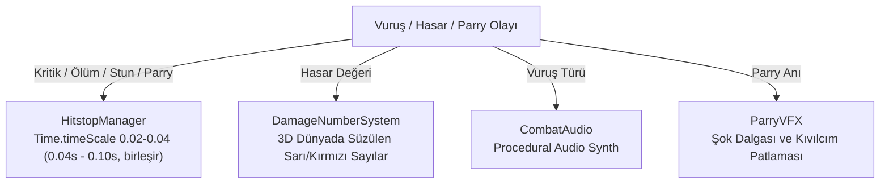

# HitstopAndAudioFeedback (Vuruş Tokluğu, Sentetik Ses ve Sayı Sistemi)

> [!abstract] COMBAT JUICE VE İŞİTSEL GERİ BİLDİRİM MOTORU
> Ağır vuruşların, kritik saplamaların ve kusursuz parry anlarının etkisini katlayan mikro kare dondurması (Hitstop), harici ses dosyası gerektirmeyen sentetik ses sentezleyicisi ve retro 3D hasar sayıları.

---

## 1. BİLEŞENLER VE ÇALIŞMA MEKANİZMİ

---

## 2. KİLİT SİSTEMLER VE DETAYLAR

### 1. `HitstopManager.cs` (Mikro Kare Donması)
- **Konum:** `Assets/_Project/Scripts/Combat/HitstopManager.cs`
- **Çalışma Mantığı:**
  * Kritik kafa vuruşlarında, düşman ölümünde (`0.07s / 0.03`), stun'da, kılıç finisher'ında veya parry başarısında `TriggerHitstop(float duration = 0.05f, float timeScale = 0.03f)` çağrılır.
  * İlk tetiklemede mevcut `Time.timeScale` ve `Time.fixedDeltaTime` saklanır; süre `Time.unscaledDeltaTime` ile düşer ve bitince (veya `OnDisable`/`OnDestroy`'da) **saklanan değerlere** geri dönülür (sabit 1.0'a değil).
  * **Birleşme Kuralı:** Üst üste gelen çağrılarda süre `max(kalan, yeni)`, zaman ölçeği `min(mevcut, yeni)` olur; `fixedDeltaTime` aynı oranla ölçeklenir. Oyun asla kalıcı olarak ağır çekimde asılı kalmaz. `IsActive` getter'ı vardır; kopya singleton yalnızca bileşeni (`Destroy(this)`) siler. Ayrıntı: [[GameFeelArchitecture]].

### 2. `CombatAudio.cs` (Prosedürel Sentetik Ses Motoru)
- **Konum:** `Assets/_Project/Scripts/Combat/CombatAudio.cs`
- **Özellik:** Dışarıdan WAV/MP3 dosyasına ihtiyaç duymadan, runtime anında C# ile ses dalgası (sine/noise/frequency sweep) sentezler.
- **Ses Türleri (örnekler):**
  * `PlayBladeSwing(pitchMult)`: Yüksek frekanslı keskin rüzgar savurma sesi.
  * `PlayBladeThrust()`: Ağır zırh delici saplama sesi.
  * `PlayFleshImpact(pos, isCrit)`: Tok et ezilme ve kemik çatlama sesi (3D). **Yalnızca hasar alan varlık** çağırır; 30 ms içinde tekrarları yutulur.
  * `PlayHitmarker(isCrit)`: Nişangah vuruş geri bildirimi (45 ms kısıtlamalı).
  * Hareket & UI (game feel pass): `PlayJump`, `PlayLand(intensity01)`, `PlayDash`, `PlaySlideStart`, `PlayFootstep`, `PlayWeaponSwitch`, `PlayKillConfirm(wasCrit)`.
  * Parry clang `PlayerParryController` içinde özel/sentetik klip olarak `PlayClipAt` ile çalınır.
- **Ses Havuzu:** 6 adet 2D + 12 adet 3D `AudioSource` (voice stealing). `AudioSource.PlayClipAtPoint` kullanılmaz; 3D sesler `PlayClipAt(clip, pos, volume, pitch)` ile çalınır. `pitchVariation` varsayılanı 0.06 (aralık 0–0.06).
- **Lazy Singleton:** `Instance` erişiminde ve her sahne yüklemesinde kendini garanti eder; kapanışta yeniden oluşmaz. Ayrıntı: [[GameFeelArchitecture]].

### 3. `DamageNumberSystem.cs` (Retro Hasar Sayıları)
- **Konum:** `Assets/_Project/Scripts/Combat/DamageNumberSystem.cs`
- **Özellik:** Vurulan hedefin başının üstünde retro piksel yazı tipiyle hasar miktarını gösterir.
- **Renk ve Boyut:** Normal vuruşlar beyaz/sarı ve standart boyut; kritik vuruşlar büyük kırmızı renkte ve hafif yukarı fırlar.
- **Sıfır GC Havuzlama:** 32 girişlik sabit havuz, `OnGUI` (IMGUI) ile çizilir; çalışma anında `Instantiate` veya `Destroy` yapılmaz. 0–4095 arası etiketler (normal / `CRIT!` / `PARRY` / `+HP`) Awake'te önbelleğe alınır, daha büyük değerler rakam parçalarıyla tahsissiz çizilir.
- **Çağıran:** Hasar sayısını silah üretir; pompalı atış başına hedef başına tek toplam sayı gösterir ([[GameFeelArchitecture]]).

### 3.1 Kill Confirm (`CombatEvents.OnEnemyKilled`)
- Düşman ölümünde `CombatEvents.RaiseEnemyKilled(pos, wasCritical, wasGibbed)` yayınlanır; `CrosshairHUD` 0.32s kalın X kill marker çizer ve `CombatAudio.PlayKillConfirm` çalar.

### 4. `ParryVFX.cs` (Savuşturma Efektleri)
- **Konum:** `Assets/_Project/Scripts/Combat/ParryVFX.cs`
- **Özellik:** Kusursuz parry anında ekranın solunda/önünde parlak elektrik mavisi şok dalgası ve radyal kıvılcımlar saçar.
- **Not:** Düşman parry glint'i ve stun yıldızları artık `ParryVFX` yerine havuzlu `CombatVFXManager.SpawnSignalBurst` ile üretilir.

---

## 3. GELİŞTİRME KURALI
- Hitstop'u doğrudan `Time.timeScale` ile değil, `HitstopManager.TriggerHitstop` ile tetikleyin; birleşme semantiği zaman ölçeğini korur.

---

## İlişkiler (Sinaptik Ağ Bağlantıları)
- [[CodebaseDependencyGraph]] ➔ `supplies_gameplay_juice`
- [[WeaponArsenalArchitecture]] ➔ `called_by_weapons`
- [[PlayerSubsystemArchitecture]] ➔ `called_by_parry`
- [[EnemyAIAndSpawning]] ➔ `called_on_enemy_damage`
- [[GameFeelArchitecture]] ➔ `extended_by_game_feel_pass`
- ⬅️ [[START_HERE_AI_CONSTITUTION]] ➔ `mandated_by_constitution` *(gelen)*
- ⬅️ [[EnvironmentAndAudioAtmosphere]] ➔ `expands_audio_design` *(gelen)*
