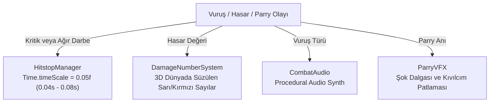

# HitstopAndAudioFeedback (Vuruş Tokluğu, Sentetik Ses ve Sayı Sistemi)

> [!abstract] COMBAT JUICE VE İŞİTSEL GERİ BİLDİRİM MOTORU
> Ağır vuruşların, kritik saplamaların ve kusursuz parry anlarının etkisini katlayan mikro kare dondurması (Hitstop), harici ses dosyası gerektirmeyen sentetik ses sentezleyicisi ve retro 3D hasar sayıları.

---

## 1. BİLEŞENLER VE ÇALIŞMA MEKANİZMİ

---

## 2. KİLİT SİSTEMLER VE DETAYLAR

### 1. `HitstopManager.cs` (Mikro Kare Donması)
- **Konum:** `Assets/_Project/Scripts/Combat/HitstopManager.cs`
- **Çalışma Mantığı:**
  * Kritik kafa vuruşlarında, kılıç saplamasında veya parry başarısında `TriggerHitstop(float duration)` çağrılır.
  * Süre boyunca `Time.timeScale = 0.05f` yapılır. Unity'nin `Time.unscaledDeltaTime` değeri ile geri sayım yapılır ve süre bitince `timeScale = 1.0f` olarak eski haline döner.
  * **Önleme Kuralı:** Üst üste birden fazla darbe gelirse hitstop süresi sıfırlanıp en yüksek süre seçilir; oyun asla kalıcı olarak ağır çekimde asılı kalmaz.

### 2. `CombatAudio.cs` (Prosedürel Sentetik Ses Motoru)
- **Konum:** `Assets/_Project/Scripts/Combat/CombatAudio.cs`
- **Özellik:** Dışarıdan WAV/MP3 dosyasına ihtiyaç duymadan, runtime anında C# ile ses dalgası (sine/noise/frequency sweep) sentezler.
- **Ses Türleri:**
  * `PlayBladeSlash()`: Yüksek frekanslı keskin rüzgar savurma sesi.
  * `PlayBladeThrust()`: Ağır zırh delici saplama sesi.
  * `PlayParryClang()`: Metalik, rezonanslı yüksek çınlama sesi.
  * `PlayFleshHit()`: Tok et ezilme ve kemik çatlama sesi.
  * `PlayHitmarker()`: Nişangah vuruş geri bildirimi (Hafif klik sesi).

### 3. `DamageNumberSystem.cs` (Retro Hasar Sayıları)
- **Konum:** `Assets/_Project/Scripts/Combat/DamageNumberSystem.cs`
- **Özellik:** Vurulan hedefin başının üstünde retro piksel yazı tipiyle hasar miktarını gösterir.
- **Renk ve Boyut:** Normal vuruşlar beyaz/sarı ve standart boyut; kritik vuruşlar büyük kırmızı renkte ve hafif yukarı fırlar.
- **Sıfır GC Havuzlama:** Sayı objeleri havuzdan (Object Pool) çağrılır; çalışma anında `Instantiate` veya `Destroy` yapılmaz.

### 4. `ParryVFX.cs` (Savuşturma Efektleri)
- **Konum:** `Assets/_Project/Scripts/Combat/ParryVFX.cs`
- **Özellik:** Kusursuz parry anında ekranın solunda/önünde parlak elektrik mavisi şok dalgası ve radyal kıvılcımlar saçar.

---

## İlişkiler (Sinaptik Ağ Bağlantıları)
- [[CodebaseDependencyGraph]] ➔ `supplies_gameplay_juice`
- [[WeaponArsenalArchitecture]] ➔ `called_by_weapons`
- [[PlayerSubsystemArchitecture]] ➔ `called_by_parry`
- [[EnemyAIAndSpawning]] ➔ `called_on_enemy_damage`
- ⬅️ [[START_HERE_AI_CONSTITUTION]] ➔ `mandated_by_constitution` *(gelen)*
- ⬅️ [[EnvironmentAndAudioAtmosphere]] ➔ `expands_audio_design` *(gelen)*
