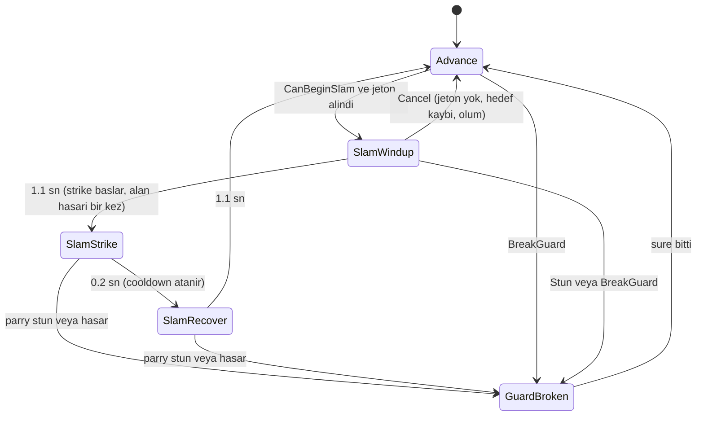

# KefaretciPenitent (Kefaretçi — Lahit Taşıyıcı)

> [!abstract] KALKANIYLA ÖNÜNÜ KAPATAN, YAVAŞ AMA KORUNAKLI DÜŞMAN
> Kefaretçi kendi tabut kapağını ön kalkan olarak taşır. Önden gelen menzilli vuruşları kapak durdurur; oyuncuyu yan açıya dolanmaya ya da parry ile kapağı düşürmeye zorlar. Üçüncü düşman tipidir (Ghoul ve Uçan Göz'den sonra).

---

## 1. ÖZET

- **Tip:** Yavaş, yerde ilerleyen yakın dövüş düşmanı. Tek bir telegrafli alan vuruşu var (League of Legends'taki Sion Q gibi): önündeki sabit bir dikdörtgen zemin alanı, parry edilebilir. Zıplamak alan vuruşundan kurtarmaz.
- **Rol:** Oyuncuyu yanlara dolanmaya ya da parry'ye zorlar. Ayrıca bir hedef önceliği kararı yaratır: önce kalkanlı Kefaretçi mi, yanındaki menzilli düşman mı?
- **Tasarım tarihi:** 2026-11-16. Kavram üç seçenek arasından kullanıcı tarafından seçildi.
- **Kod durumu:** Oynanış, sunum ve builder tamamlandı. Elle oynanış testi bu yazımda henüz yapılmadı.

---

## 2. OYNANIŞ KURALLARI

### 2.1 Ön kalkan
- Kalkan yayı yatay düzlemde, `guardHalfAngle` = 65° yarım açıyla Penitent'in `transform.forward` yönünde ölçülür (toplam 130°).
- Kalkan yalnızca `Advance` ve `SlamWindup` fazlarında açıktır (`IsGuardUp`).
- **Menzilli vuruş:** Vuruş noktası ile Penitent merkezi arasındaki yatay yön kullanılır. Merkeze 0.05 m'den yakın vuruşlarda vuruş normali esas alınır. Yay içindeyse hasar sıfırlanır, yalnızca `BlockHit` geri bildirimi çalışır (en fazla 0.08 sn'de bir).
- **Melee vuruş** (`MeleeDamageScope` aktif): Konum değil, saldırganın yönü (hit normal) kullanılır.
- Engellenen vuruş stagger üretmez.
- Kafa ve arka hitbox'ları da `TakeDamage` üzerinden geçer. Kalkan açıkken ön yaydaki kafa vuruşu da engellenir. **Yalnızca yüz noktası kalkanı atlar.**

### 2.2 Yüz noktası (Hitbox_Face)
- Yarıçapı 0.07 m olan küçük bir küre, yüz hizasında (`PenitentWeakPoint`). Kapak "vizör" biçimindedir: yerden 2.35 m'ye kadar uzanır ve yalnızca 1.9 m yükseklikte 0.22 m genişliğinde, 0.09 m yüksekliğinde bir yarık bırakır. Yüz noktası (yerel `(0, 1.9, 0.35)`) bu yarığın hemen arkasındadır; yarığın açısal boyutu 6 m'de yaklaşık 2.1° × 0.86°'dir. Yarığın üstünden, altından ve yanlarından gelen ön vuruşlar kapak collider'larına çarpar ve engellenir.
- Yalnızca **menzilli** vuruş: `weakPointMultiplier` = 2× ile kritik hasar, kalkanı tamamen atlayarak uygulanır. Bu, kullanıcının kararıdır: tek ve küçük bir zayıf nokta, yalnızca menzilli.
- Melee vuruş normal kalkan kuralına tabidir.

### 2.3 Kafa ve arka
- `Hitbox_Head`: 2× hasar, kritik bölge.
- `Hitbox_Back`: 1.5× hasar, kritik değil. Arkadan gelen vuruş kalkan yayının dışında kaldığı için engellenmez.

### 2.4 Kapak Darbesi (slam)
- **Tetik:** Oyuncu 5.5 m içindeyse (`slamTriggerRange`) ve Penitent'in ileri yönünün 35° yarım açısı içindeyse (`slamTriggerHalfAngle`; dar tutulur, böylece Penitent önce oyuncuya döner), görüş hattı açıksa, bekleme bittiyse ve ortak saldırı jetonu alınmışsa.
- **Hazırlık (SlamWindup, 1.1 sn):** Penitent'in yönelmesi **kilitlenir** (dönüş 0, hareket yok) ve alan, hazırlığın başında Penitent'in konumu ve yönünden bir kez hesaplanıp dünya uzayında sabitlenir. Kalkan başın üstüne kalkar, kapak amber-kırmızıya doğru parlar ve amber ışık yanar. Zemin telgrafı ilk kareden görünür: koyu kırmızı tam dikdörtgen ve parlak kenarlık (`SlamArea_Outline`), yakın kenardan başlayıp hazırlık boyunca 0'dan tam uzunluğa büyüyen parlak kırmızı-turuncu dolgu (`SlamArea_Fill`). Dolgu uzak kenara ulaştığında vuruş iner.
- **Alan:** Penitent merkezinin 0.4 m önünden (`slamAreaStartOffset`) başlayan 6.5 m uzunluğunda (`slamAreaLength`), 4.5 m genişliğinde (`slamAreaWidth`) dikdörtgen. Dikey tolerans ±2.5 m (`slamAreaHeight`): zıplamak kurtarmaz, 3 m üstteki balkondaki oyuncu güvendedir.
- **Vuruş (SlamStrike, 0.2 sn):** Vuruşun başlangıç karesinde tam bir kez: oyuncu önbelleğe alınan dikdörtgenin içindeyse `PlayerHealth.TakeDamage(35, …, attacker)` çağrılır (`slamDamage`, **parry edilebilir yol**). Alan dışındaki oyuncu hasar almaz; Ghoul ve diğer düşmanlar etkilenmez. Oyuncu Counter-Verdict ile parry yaparsa `PlayerParryController.TryParryMelee` devreye girer ve Penitent `Stun(2.2 sn)` alır. Tek savunma: alandan yana çıkmak (yan dash) ya da vuruş anında parry. Vuruş anındaki geri bildirim: `SlamArea_Impact` beyaz-turuncu flaş (yaklaşık 0.25 sn sönüm), `CombatVFXManager.SpawnHitImpact` ve `CombatAudio.PlayBladeSlam`.
  - **Fırlatma (yalnızca hasar gerçekten işlenirse):** `TakeDamage` çağrısı oyuncunun canını düşürdüyse (`CurrentHealth` azaldıysa) oyuncu havaya fırlatılır: `PlayerMovement.AddImpulse` ile yukarı 9 m/sn (`slamLaunchUpSpeed`) ve slam'ın önbelleğe alınan ileri yönünde, yani Penitent'ten uzağa, 5 m/sn (`slamLaunchPushSpeed`). Aynı vuruşta daha güçlü hitstop (0.12 sn, ölçek 0.03), kamera sarsıntısı, view punch ve FOV tekmesi, oyuncunun ayağında `SpawnHitImpact` ve `PlayFleshImpact` çalışır. Ölçülen: duruyorken apex yaklaşık +1.55 m, yatay yaklaşık 4.2 m, havada yaklaşık 0.67 sn, vuruş başına tek impuls.
  - **Fırlatma iptali:** **Parry fırlatmayı iptal eder** (can düşmez, oyuncu yerinde kalır, Penitent stun olur). Dash i-frame, alan dışı ya da ölümcül vuruşta da fırlatma ve geri bildirim yoktur. Dash, kanca, lunge veya meteor slam sırasında impuls uygulanmaz.
  - **Saf hesap:** Hız `PenitentSlamLaunch.Compute(areaForward, upSpeed, pushSpeed)` ile hesaplanır (yatay ileri yön normalize edilir, dejenere yön itme vermez).
- **Kurtarma (SlamRecover, 1.1 sn):** Kalkan düşük, hareket ve dönüş yok. Bekleme 3.5 sn ±%20 olarak bu fazın başında atanır.
- **Parry menzili:** `TryParryMelee` mesafe sınırı koymaz; alanın uzak ucunda (yaklaşık 6 m) yapılan parry de kabul edilir.

### 2.5 Kalkan düşük pencereleri
- **SlamStrike, SlamRecover ve GuardBroken** fazlarında kalkan düşüktür.
- **GuardBroken** üç kaynaktan girilir: parry stun (2.2 sn, `PlayerParryController`), yansıyan ağır Hüküm Küresi (`BreakGuard`, 3 sn) ve hasar.
- **Stagger:** Kalkan düşükken kritik vuruş ya da en az 40 hasar, kırılmayı 0.35 sn uzatır (en fazla 4 sn). Kalkan açıkken hasar stagger yapmaz.
- **Yansıyan ağır Hüküm Küresi** (`EnemyProjectile`) `GetComponentInParent<IGuardBreakable>()` ile `BreakGuard(3)` çağırır. Bu çağrı hasardan önce yapıldığı için aynı vuruş kalkanı açık görmez ve hasar uygular.
- Stun sırasında geri tepme: 3 m/s, üstel sönüm 8/sn.

### 2.6 Dönüş hızları ve yürüme
- `Advance`: 110°/sn. Yürüme 2.6 m/s, `stoppingDistance` 1.2 m'de durur.
- `SlamWindup`, `SlamStrike`, `SlamRecover`, `GuardBroken`: dönüş ve yürüme yok (yönelme hazırlığın başında kilitlenir).

---

## 3. DURUM MAKİNESİ (PenitentAttackLoop)



- `Tick` her karede en fazla bir faz geçişi yapar; `StrikeStartedThisTick` yalnızca vuruş başlangıç karesinde true olur.
- `Reset()` her spawn'da çağrılır ve cooldown'ı sıfırlar.

---

## 4. SİSTEM ENTEGRASYONU

| Alan | Entegrasyon |
| :--- | :--- |
| Dalga / encounter | `IEncounterEnemy` (`OnEnemyDeath`, `IsAlive`). `OnSpawnFromDirector` `autoRespawn`'ı kapatır, aktif eder ve `Respawn()` çağırır. `OnDespawnToDirector` saldırıyı iptal eder ve deaktive eder. |
| Saldırı jetonu | `EnemyAttackTokens` (statik ortak havuz). Alınma: alarmdayken ve `CanBeginSlam` doğruyken. Bırakılma: SlamRecover'a geçişte, stun/kırılmada, stagger'da, ölümde, despawn/respawn/`OnDisable`/`OnDestroy` sırasında. |
| Tehdit maliyeti | `IThreatCost.ThreatCost` = 3 |
| Elit | `IEliteScalable.ApplyEliteScaling(damage, speed, health)`: `maxHealth`, `slamDamage` (35 → 49 çarpan 1.4 ile) ve `walkSpeed` çarpılır. Respawn'da `ResetEliteScaling` ile sıfırlanır. Kalkan açısı ve yüz çarpanı değişmez. |
| Droplar | `EnemyHealthDropper` ve `EnemyAmmoDropper`, builder tarafından Ghoul prefab'ından kopyalanır. Ölümde `TriggerDrop(critical, melee)`. Health dropper yoksa `HealthOrbManager` ile 1 küre düşer. |
| Pause | `PenitentAI.Update`, `MaintainCaches` korutini ve `PenitentView.Update` (hazırlık süresi ve dolgu büyümesi dahil), `GamePause.IsSimulationBlocked` ile durur. |
| Kartlar | Yalnızca oyuncu tarafı. `PlayerHealth.TakeDamage` yolunda (parry edilmeyen alan vuruşu) `StatId.DamageTaken` uygulanır. Penitent kart okumaz. |
| Ölü oyuncu | Oyuncu ölü ya da yoksa görüş hattı "görünmez" sayılır; hazırlık iptal edilir, jeton bırakılır ve ölü oyuncuya slam yapılmaz. |
| Vuruş geri bildirimi | `PenitentView.FlashHit` (normal ve kritik renk), `CombatVFXManager.SpawnHitImpact`, `CombatAudio.PlayFleshImpact`, hitstop (kritik 0.04 sn, stun 0.08 sn, ölüm 0.07 sn). Kalkan: `PlayBlockFeedback` ve `blockSound` yoksa `PlayGrappleHookLatch`. |
| Alarm hub | `EnemyAlertHub.Register`. İlk görüşte 10 m yarıçapla `BroadcastAlert`. `ReceiveAlert` ile diğer düşmanları uyarır. |
| `IStunnable` / `IStunState` | `IsStunned` = GuardBroken fazı. `StunSequence` her yeni kırılmada artar; respawn'da geri sayılmaz. |
| Ölüm | `CombatEvents.RaiseEnemyKilled`, 7 gib. |

---

## 5. MİMARİ (POCO / SÜRÜCÜ / SUNUM AYRIMI)

| Sınıf / Dosya | Tür | Sorumluluk |
| :--- | :--- | :--- |
| `PenitentAttackLoop.cs` | POCO (`PenitentAttackLoop`, `PenitentAttackPhase`, `PenitentAttackSettings`) | Faz, süre ve cooldown. Unity bağımlılığı yok. |
| `PenitentGuard.cs` | Statik POCO | Kalkan yayı kararı (yatay düzlem). |
| `PenitentAI.cs` | MonoBehaviour (sürücü) | Algılama, hareket, jeton, hasar, stun, ölüm, respawn, elit. Arayüzler: `IDamageable`, `IAlertableEnemy`, `IStunnable`, `IStunState`, `IEncounterEnemy`, `IThreatCost`, `IEliteScalable`, `IGuardBreakable`. |
| `PenitentView.cs` | MonoBehaviour (sunum) | Pozlar, tint/glow, alan telegrafı (`BeginSlamTelegraph`, `PlaySlamImpact`, `EndSlamTelegraph`), Animator parametreleri. Oyun durumu tutmaz. |
| `ShieldPlate.cs` | Küçük bileşen | Kalkan collider'larını (her parça) `OnShieldHit`'e yönlendirir. |
| `PenitentWeakPoint.cs` | Küçük bileşen | Yüz collider'ını `OnWeakPointHit`'e yönlendirir. |
| `SocketFollow.cs` | Küçük bileşen (ortak) | Socket veya hitbox'ı model kemiğine taşır. |
| `IGuardBreakable.cs` | Arayüz (`Scripts/Core/Interfaces`) | `BreakGuard(duration)`. `EnemyProjectile` kullanır. |
| `PenitentBuilder.cs` | Editör (`Scripts/Editor`) | Prefab, materyaller, hitbox ve socket kurulumu. Eski `Penitent_Shockwave.prefab` ve `Mat_Penitent_Shockwave/Glint/SlamLine` varlıklarını siler. |
| `Tests/EditMode/Penitent*.cs` | Testler | `PenitentAttackLoopTests`, `PenitentGuardTests`, `PenitentPrefabTests`. Prefab yoksa `PenitentPrefabTests` Ignore döner. |

---

## 6. PREFAB HİYERARŞİSİ

```text
Enemy_Penitent_Kefaretci        (CharacterController, PenitentAI, PenitentView, EnemyHealthDropper, EnemyAmmoDropper)
├─ Visual                       ← sadece sanat; collider ve MonoBehaviour YOK
│   ├─ Placeholder              (placeholder modda üretilir; custom modda kullanıcı deaktive eder)
│   │   ├─ Body, Hood, Head, Face_Mark, Chain_L, Chain_R
│   │   └─ ShieldPivot          (yerelde 0, 0.25, 0.46)
│   │       ├─ Shield_Lid       (ana plaka: yerden yarığın alt kenarına)
│   │       ├─ Shield_Lid_Top   (yarığın üst kenarından 2.35 m'ye)
│   │       └─ Shield_Lid_SideL / Shield_Lid_SideR   (yarığın iki yanını doldurur)
│   └─ Model                    ← kullanıcının modeli (builder oluşturmaz, dokunmaz)
├─ Hitboxes                     ← oynanış collider'ları, sanattan bağımsız
│   ├─ Hitbox_Head              (SphereCollider r 0.22, Hitbox ×2, kritik, SocketFollow)
│   ├─ Hitbox_Back              (BoxCollider 0.7×1.2×0.35, Hitbox ×1.5)
│   ├─ Hitbox_Face              (SphereCollider r 0.07, PenitentWeakPoint, SocketFollow)
│   └─ Hitbox_Shield            (ShieldPlate, SocketFollow; kendi collider'ı yok)
│       ├─ Shield_Lid           (BoxCollider)
│       ├─ Shield_Lid_Top       (BoxCollider)
│       ├─ Shield_Lid_SideL     (BoxCollider)
│       └─ Shield_Lid_SideR     (BoxCollider)
├─ Sockets
│   ├─ Socket_ShieldCenter      (0, 0.9, 0.65)
│   ├─ Socket_SlamImpact        (0, 0.05, 1.6)
│   ├─ Socket_Head              (0, 1.9, 0.1)
│   └─ Socket_DeathFx           (0, 1, 0)
└─ Telegraph
    ├─ TelegraphLight           (Point Light, amber, menzil 6, gölgesiz, başlangıçta kapalı)
    ├─ SlamArea_Outline         (dikdörtgen quad + Near/Far/Left/Right kenarlık quad'ları, başlangıçta kapalı)
    ├─ SlamArea_Fill            (quad, hazırlık boyunca büyür, başlangıçta kapalı)
    └─ SlamArea_Impact          (quad, vuruşta flaş, başlangıçta kapalı)
```

- Alan görselleri, hazırlık başında önbelleğe alınan dünya konum ve yönünden her karede açıkça konumlanır; Penitent'in transformuna bağlı kalmaz. Zemin yüksekliği hazırlık başında bir kez aşağı raycast ile bulunur (`GameLayers.GroundMask`).
- Kapak parçaları: genişlik 1.1 m, alt 0.15 m, üst 2.35 m, derinlik 0.12 m. Vizör: yükseklik 0.09 m, genişlik 0.22 m, merkez yüksekliği 1.9 m (builder'da serileştirilmiş sabitler). Kapağın ileri ofseti 0.46 m.
- Prefab: `Assets/_Project/Prefabs/Enemies/Enemy_Penitent_Kefaretci.prefab`. Dalga prefab'ı yoktur (`Penitent_Shockwave.prefab` kaldırıldı).
- Materyaller: `Assets/_Project/Art/Enemies/Penitent/Placeholder/` (Mat_Penitent_Robe, Skin, Lid, Chain lit; SlamOutline, SlamFill, SlamImpact, Face unlit; SlamOutline, SlamFill ve SlamImpact ayrıca saydamdır)
- Menüler: `RetroFPS/Build Penitent`, `RetroFPS/Penitent/Rebind Visual Renderers`
- Builder, droppers için `Enemy_Ghoul_Stalker.prefab` dosyasını zorunlu tutar.

---

## 7. KENDİ MODELİNİ TAKMA REHBERİ

1. **Prefab'ı aç.** `Enemy_Penitent_Kefaretci.prefab` dosyasını çift tıklayıp Prefab Mode'da aç. Play Mode'da çalışma.
2. **Modeli `Visual/Model` olarak bırak.** Yalnızca mesh renderer'lar olsun; collider ve script eklemeyin (`PenitentPrefabTests` `Visual` altında collider ve MonoBehaviour olmamasını kontrol eder). Model +Z'ye baksın, ayakları y = 0'da olsun, boyu yaklaşık 2 m olsun (CharacterController: height 2, radius 0.45, center y 1).
3. **Placeholder'ı deaktive et, silme.** `Visual/Placeholder` altındaki objeyi `SetActive(false)` yap. Silersen `PenitentPrefabTests` placeholder yollarını bulamaz ve builder `Shield_Lid` referansını kaybeder.
4. **Animator'ı bağla.** Modelin Animator'ını `PenitentView` bileşenindeki `animator` alanına sürükle. Animator atandığında placeholder kalkan tween'i uygulanmaz; pozları Animator yönetir. Root Motion kapalı olmalı, çünkü hareketi `CharacterController` yapar. Kodun sürdüğü parametreler (ad ve tip kodda hash ile tanımlı):
   - `GuardDown` (bool): Kalkan düşük. Kalkanı aşağı indiren poz.
   - `Stunned` (bool): Kırılma sırasında true. Stun pozu.
   - `Windup` (trigger): Hazırlık başlarken. Kapağı başın üstüne kaldıran klip, süresi 1.1 sn olmalı. Telegraf bitince kod trigger'ı sıfırlar.
   - `Slam` (trigger): Vuruş başlarken (0.2 sn). Kapağı aşağı çalan klip. Hasar kapak animasyonuna değil, kodun vuruş karesine bağlıdır.
   - `Hit` (trigger): Kabul edilen her vuruşta. Kısa geri tepme.
   - `Die` (trigger): Ölümde. Kod ölümde `Visual`'ı hemen kapattığı için bu klip görünmez; ölüm animasyonu istersen bu davranışı değiştirmek gerekir.
   - `Speed` (float, 0–1): Yürürken 1, değilken 0. Yürüme döngüsü için blend.
5. **Socket ve hitbox takibini kur.** `SocketFollow.target` alanına ilgili kemiği sürükle. Takip, kemiğin dünya konumunu ve dönüşünü ofset olmadan kopyalar; bu yüzden kemiğin origin'i, socket'in olması gereken noktada olmalı.
   - `Socket_Head`: Görüş başlangıcı (`view` varken `HeadPosition`) ve stun sinyali. **Baş kemiğine bağla.** Görüş hattı buradan çıkar.
   - `Socket_SlamImpact`: Vuruş efekti (kıvılcım ve ses) konumu. Ayakların önündeki zemine yakın bir kemik (y ≈ 0). Alan dikdörtgeni bu socket'e değil, Penitent'in konumuna ve yönüne bağlıdır.
   - `Socket_ShieldCenter`: Kalkan merkezi (blok geri bildirimi konumu). Kalkan merkezine bağla.
   - `Socket_DeathFx`: Ölüm gibi ve efekt konumu. Gövde kemiğine bağla.
   - `Hitbox_Shield` (ShieldPlate + SocketFollow, altında kapak parçası başına bir BoxCollider çocuk): Hedef = kapak kemiği. Kendi kapağını kullanırsan çocuk BoxCollider'ları kendi kapak parçalarının boyutuna göre yeniden boyutlandır ve her parçanın arasında yüz için yalnızca küçük bir yarık bırak. **Tüm** kalkan collider'larını `PenitentView.shieldColliders` dizisine ata: kalkan düşünce (stun, kırılma, slam vuruşu) bu dizideki hepsi kapanır, kalkan kalkınca hepsi açılır. Collider'ların hepsi `Hitbox_Shield` altında kalmalı ki vuruşlar `ShieldPlate`'e ulaşsın. Yüz noktası (`Hitbox_Face`) yarığın hemen arkasında kalmalı; builder, custom modda kalkan collider'ları yoksa yeniden kurar, varsa dokunmaz.
   - `Hitbox_Face` (SocketFollow): Hedef boş bırakılırsa yüz noktası sabit kalır (yerel `(0, 1.9, 0.28)`) ve baş hareketiyle kaymaz. Baş kemiğine bağlarsan, kemiğin origin'i yüz noktasında olmalı; ofset eklenmez. Nokta küçük kalmalı (r 0.07).
   - `Hitbox_Head` (SocketFollow + SphereCollider): Hedef boş bırakılırsa sabit kalır (yerel `(0, 1.9, 0.1)`, yarıçap 0.22). `Hitbox_Face` ile birlikte ikisini de modelin baş kemiğine bağla; böylece kafa ve yüz noktası baş hareketiyle birlikte gider. Kemiğin origin'i kafa merkezinde olmalı; yarıçapı gerekirse elle ayarla (bkz. adım 7). Builder hedefi dolu bir SocketFollow'u üzerine yazmaz.
   - Custom modda `PenitentView.shieldPivot` builder tarafından atanmaz. Kapak mesh'inin üst transform'unu elle bağla. Bu alan boşsa kalkan renderer'ı bulunamaz; kalkan flaşı ve windup tint'i uygulanmaz.
6. **Renderer'ları yeniden bağla.** `RetroFPS/Penitent/Rebind Visual Renderers` menüsünü çalıştır.
   - `tintRenderers`: `Visual` altındaki tüm aktif renderer'lar.
   - `glowRenderers`: Adında `Lid` veya `Shield` geçen renderer'lar (büyük/küçük harf duyarsız). Kapak mesh'ine `Shield_Lid` gibi bir ad ver. Hiçbiri bulunamazsa glow listesi değişmez.
   - Deaktif renderer'lar (placeholder) atlanır.
7. **Yeniden build güvenlidir, ama bazı değerler ezilir.** `RetroFPS/Build Penitent` tekrar çalıştırılabilir. Custom mod: `Visual/Model` var **veya** `animator` atanmış. Korunanlar:
   - `Visual/Model` ve içeriği; `view.animator`.
   - `tintRenderers` ve `glowRenderers` listeleri (custom modda builder bunları yeniden yazmaz).
   - Mevcut `SocketFollow.target` alanları (`Ensure` ile bileşen kalır).
   - `Hitbox_Shield` yerel pozu: yalnızca hedef boşsa sıfırlanır.
   - Custom modda kalkan collider'ları (`shieldColliders` dizisi ve `Hitbox_Shield` çocukları): yalnızca hiç yoksa kurulur; senin boyutladıkların korunur.

   Her çalıştırmada yeniden yazılanlar: `Hitbox_Head/Back/Face` konum ve yarıçapları, socket yerel konumları, `Telegraph` düğümleri, CharacterController ve hitbox çarpanları, tüm referanslar. **Build'den sonra elle ayarladığın hitbox konum ve boyutlarını tekrar gir.**
8. **Play Mode kontrol listesi.**
   - [ ] Önden ateş (kalkan açık): menzilli vuruş engellenir, hasar yok, kıvılcım ve ses çalar.
   - [ ] Yüz noktası: yarıktan gelen menzilli vuruş 2× kritik hasar verir ve kalkanı atlar; yarığın 0.12 m üstü, altı ve yanları engellenir.
   - [ ] Kapak darbesi telgrafı: 1.1 sn, ilk kareden dikdörtgen kenarlık, büyüyen dolgu, kapak parlaması ve amber ışık görünür; yönelme kilitlidir.
   - [ ] Alan vuruşu: parry yoksa alan içinde 35 hasar, tam bir kez. Alanın dışı (2.6 m yanal), uzak kenarın ötesi ve Penitent'in arkası hasar almaz. Zıplamak kurtarmaz; yan dash ile alandan çıkmak kurtarır.
   - [ ] Parry: vuruş anında parry edilince Penitent 2.2 sn stun olur, kalkan düşer, oyuncu hasar almaz.
   - [ ] SlamRecover sırasında kritik vuruş stagger yapar; kalkan açıkken hasar yoktur. Kalkan düşünce tüm kalkan collider'ları kapanır.
   - [ ] Yansıyan ağır Hüküm Küresi kalkanı 3 sn kırar.
   - [ ] Esc ile pause açıldığında hareket, hazırlık süresi ve dolgu büyümesi durur.

> [!warning] Oynanış Visual'ı okumaz
> `Visual` yalnızca sunumdur. Vuruş, görüş, saldırı ve kalkan kararları `PenitentAI`, `PenitentAttackLoop`, `PenitentGuard` ve `Hitboxes` / `Sockets` altındaki collider ve socket'lerden gelir. Modeli değiştirmek oynanışı değiştirmez; yalnızca kemik takibi ve collider konumları modele uyarlanır.

---

## 8. İLK GEÇİŞ SAYILARI

Değerler kod içindeki serileştirilmiş varsayılanlardan alındı. Bunlar ilk geçiş ayarlarıdır; oynanış testinden sonra değişecektir.

| Alan | Değer | Kaynak |
| :--- | :--- | :--- |
| `maxHealth` / `threatCost` / `respawnTime` | 320 / 3 / 4 sn | `PenitentAI` |
| `walkSpeed` / `stoppingDistance` | 2.6 m/s / 1.2 m | `PenitentAI` |
| `turnSpeedAdvance` | 110°/sn (hazırlıkta dönüş yok) | `PenitentAI` |
| `sightRange` / `fieldOfView` / `proximityRange` | 18 m / 110° / 2.8 m | `PenitentAI` |
| `loseSightTime` / `alertRadius` | 3.5 sn / 10 m | `PenitentAI` |
| `guardHalfAngle` | 65° | `PenitentAI` |
| `weakPointMultiplier` (yüz) | 2× | `PenitentAI` |
| Hitbox_Head / Hitbox_Back çarpanı | 2× (kritik) / 1.5× | `PenitentBuilder` |
| `slamTriggerRange` / `slamTriggerHalfAngle` | 5.5 m / 35° | `PenitentAttackSettings` |
| `slamWindup` / `slamStrike` / `slamRecover` | 1.1 / 0.2 / 1.1 sn | `PenitentAttackSettings` |
| `slamCooldown` / `cooldownJitter` | 3.5 sn / ±%20 | `PenitentAttackSettings` |
| `slamAreaLength` / `slamAreaWidth` / `slamAreaStartOffset` | 6.5 m / 4.5 m / 0.4 m | `PenitentAI` |
| `slamAreaHeight` (dikey tolerans) | 2.5 m | `PenitentAI` |
| `slamDamage` (parry edilebilir) | 35 | `PenitentAI` |
| `slamLaunchUpSpeed` / `slamLaunchPushSpeed` | 9 / 5 m/sn (parry ile iptal olur) | `PenitentAI` |
| `slamPlayerHitstopDuration` / `slamPlayerHitstopScale` | 0.12 sn / 0.03 | `PenitentAI` |
| `slamCameraTrauma` / `slamCameraPunch` / `slamCameraFovKick` | 0.3 / (5, 0) / 6 | `PenitentAI` |
| Vizör (builder) | yarık 0.09 × 0.22 m, merkez 1.9 m, kapak ileri ofseti 0.46 m | `PenitentBuilder` |
| Parry melee stun | 2.2 sn | `PlayerParryController` |
| Yansıyan ağır orb kırılması | 3 sn | `EnemyProjectile` |
| `staggerDamageThreshold` / `staggerExtend` / `staggerMaximum` | 40 / 0.35 / 4 sn | `PenitentAI` |
| Stun geri tepme / sönüm | 3 m/s / 8 | `PenitentAI` |
| `deathGibCount` | 7 | `PenitentAI` |
| CharacterController | height 2, radius 0.45 | `PenitentBuilder` |

---

## 9. DALGA YERLEŞİMİ

- `Data/Waves/WaveSet_Room02_Test3Phase.asset` dosyasında faz 2 ve faz 3'e birer adet eklendi; gecikme 2 sn, paralel.
- Sahnede `SampleScene` içindeki `Encounter_Room_02` bu dalga setini kullanır.
- **Gauntlet WaveSet'lerine ve Araf oda prefab'larına eklenmedi.** Bu kullanıcının açık kararıdır.

---

## 10. BİLİNEN SINIRLAR / AÇIK KONULAR

- **Placeholder sanat:** Kapsül gövde ve küp kapak. Gerçek model kullanıcıda.
- **Özel ses yok:** Mevcut `CombatAudio` çağrıları (et darbesi, kalkan latch'i, gib patlaması) kullanılır. `blockSound` boşsa latch sesi çalar. Slam vuruşunda mevcut `CombatAudio.PlayBladeSlam` çalar (özel ses yok).
- **Gauntlet ve Araf:** Henüz yok.
- **Elle oynanış:** Bu yazım anında yapılmadı. Sayılar ilk geçiştir.
- **Ölüm klibi:** `Die` tetiklenir ama `Visual` aynı anda kapandığı için görünmez.

Doğrulama sonuçları: bkz. `production/qa/evidence/` altındaki `penitent-01-silhouette.png`, `penitent-02-guard-block.png`, `penitent-03-slam-telegraph.png`, `penitent-04-slam-impact.png`, `penitent-05-guard-broken.png`, `penitent-06-mixed-wave.png`, `penitent-07-weak-point.png`, `penitent-08-slam-launch.png`.

---

## İlişkiler (Sinaptik Ağ Bağlantıları)
- [[EnemyAIAndSpawning]] ➔ `specialises_enemy_ai`
- [[EnemyAIAndCombatFeel]] ➔ `shares_sensory_rules`
- [[CombatAndDamageInterfaces]] ➔ `implements_guard_and_stun_interfaces`
- [[WaveAndEncounterArchitecture]] ➔ `controlled_by_wave_director`
- [[FlyingEyeNisanci]] ➔ `shares_token_and_reflect_rules`
- [[GameFeelArchitecture]] ➔ `presents_hit_and_telegraph_feedback`
