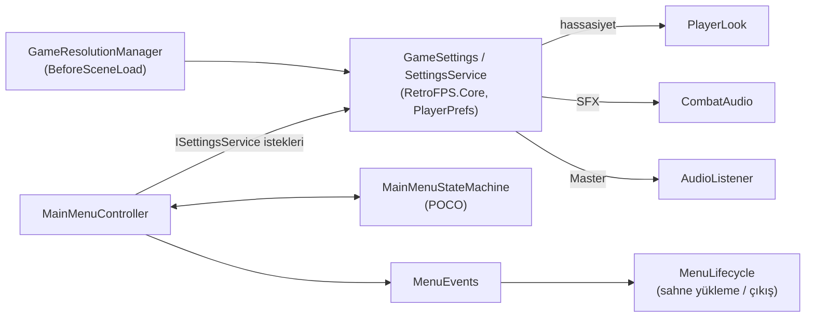

# MainMenuAndSettings (PURGATOR Ana Menü ve Ayarlar Sistemi)

> [!abstract] KAN VE KEMİK ANA MENÜ, KALICI AYARLAR
> PURGATOR ana menüsü (BAŞLA, AYARLAR, ÇIKIŞ) UGUI + TextMeshPro ile kuruludur. Ayarlar POCO servisinde tutulur, UI yalnızca istek gönderir ve olay dinler.
> - **Son Güncelleme:** 2026-11-14

---

## 1. GENEL BAKIŞ
- **Sahne:** `Assets/Scenes/MainMenu.unity`, Build Settings index 0. BAŞLA `TestLevel_Gauntlet` sahnesini asenkron yükler.
- **Menü satırları:** BAŞLA, AYARLAR, ÇIKIŞ (çıkış onay diyaloğu ile). AYARLAR altında ses, hassasiyet, pencere modu, çözünürlük ve hareket azaltma satırları bulunur.
- **Görsel yön:** "Kan ve Kemik". Koyu arka plan (`bg #0C0A0A`), kemik mühürü odak işareti, meşale ışığı, sis ve kıvılcım parçacıkları.
- **Teknoloji:** UGUI (Canvas, EventSystem + `InputSystemUIInputModule`) ve TextMeshPro. Yeni Input System kullanılır.
- **Erişilebilirlik:** Standart seviye (`design/accessibility-requirements.md`).

## 2. MİMARİ AKIŞ

- **Çekirdek ayarlar (`RetroFPS.Core`):** `BeforeSceneLoad` anında yüklenir. Oyun kodu (`PlayerLook`, `CombatAudio`) yalnızca Core'a bağımlıdır, menüye değil. Bu sayede doğrudan `TestLevel_Gauntlet` içinde Play Mode başlatıldığında da kalıcı ayarlar uygulanır.
- **Menü (`RetroFPS.UI.Menu`):** Durum makinesi POCO'dur ve EditMode testlerinde doğrudan çalışır. Controller ve görünüm bileşenleri durumu yalnızca çizer ve girdiyi iletir.

## 2.1 DİL / LOCALIZATION (2026-11-14)
- **Diller:** Türkçe (`tr`) ve English (`en`). Kod değerleri sabittir. `LanguageSetting` `GameSettingsData` içinde özel serileştirilmiş alanla tutulur, dış erişim salt okunur getter ile sağlanır.
- **Varsayılan:** İlk açılışta `Application.systemLanguage == Turkish` ise `tr`, diğer her değer (Unknown dahil) `en`. Kayıtlı geçerli bir kod sistem varsayılanını geçersiz kılar.
- **Kalıcılık:** PlayerPrefs anahtarı `language` (değerler `tr` / `en`). Eksik veya geçersiz kod sistem varsayılanına döner.
- **Yetki:** `ISettingsService.SetLanguage` canlı anlık görüntüyü değiştirir ve `Changed` olayını bir kez yayar. Tek dil yetkilisi `GameSettings.Current.Language`'dir. Aynı dil tekrar seçilirse olay yayılmaz.
- **Metin tablosu:** `StringTable` her anahtar için iki değer tutar: mevcut `value` alanı Türkçe, yeni `en` alanı İngilizce. Varlık adları ve GUID'ler korunur (`StringTable_MainMenu_tr.asset`, `StringTable_CombatHud_tr.asset`); `_tr` soneki artık eski adlandırmadır. `Get(key, language)` açık dil ister, `Get(key)` mevcut ayar diline göre çözer.
- **Canlı yenileme:** `LocalizedText`, `GameSettings.Changed` olayına OnEnable/OnDisable ile abone olur ve dil değişince metni hemen yeniler. Menü ve HUD önbellekleri dil değişiminde bir kez yeniden kurulur.
- **Oyun tarafı sağlayıcısı:** `LocalizationBootstrap` (BeforeSceneLoad) `Resources/Localization/LocalizationCatalog` varlığını yükler ve Core'daki `ILocalizedStringProvider` olarak kaydeder. Doğrudan oyun sahnesi başlatıldığında da çalışır. `DamageNumberSystem` ve `ArafTransition` bu sağlayıcıyı kullanır; Core Menu'ye bağımlı değildir.
- **Ayrıntı:** Mimari ve tablo listesi için `production/ui/localization/plan.md`.

## 3. BİLEŞEN TABLOSU

### 3.1 Core/Settings (`Assets/_Project/Scripts/Core/Settings/`)

| Dosya | Sorumluluk |
|---|---|
| `GameSettingsData.cs` | Ayar değerleri struct'ı, `WindowModeSetting` enum, `Defaults`, `Clamp()`. |
| `SettingsContracts.cs` | `ISettingsService`, `ISettingsStore`, `IDisplayApplier`, `IAudioVolumeApplier` arayüzleri. |
| `SettingsService.cs` | POCO: yükle/sınırla, değişikliği uygula ve kaydet, ekran için beklemede/onayla/geri al, `Changed` olayı. |
| `ResolutionOptions.cs` | POCO: çözünürlük listesini tekilleştirir, 1280x720 altını eler, sıralar, en yakın eşleşmeyi bulur. |
| `SensitivityMapping.cs` | POCO: 0-1 değerini üstel bakış ölçeğine çevirir (0.5 = 1.0). |
| `UnitySettingsAdapters.cs` | `PlayerPrefsSettingsStore`, `ScreenDisplayApplier`, `ListenerVolumeApplier`. İnce motor adaptörleri. |
| `GameSettings.cs` | Statik erişim noktası: `EnsureInitialized()`, `Service`, `Current`, `Changed`, `Save()`. |

### 3.2 Menu/Logic (POCO, `RetroFPS.UI.Menu`)

| Dosya | Sorumluluk |
|---|---|
| `MainMenuStateMachine.cs` | Durumlar (FirstLoad, Root, Settings, RevertPrompt, QuitConfirm, Loading), geçişler, geri kuralları, girdi kilidi. |
| `MenuTween.cs` | Gecikmesiz 0-1 tween, kolaylaştırma eğrileri, hareket azaltma süresi. |
| `RevertCountdown.cs` | 10 sn geri alma sayacı. |
| `HoldAccelerator.cs` | Basılı tutmada adım hızlanması. |
| `UiAudioThrottle.cs` | Aynı UI sesi için 50 ms sınırlama. |
| `MenuEvents.cs` | Statik olaylar: `StartRequested`, `QuitConfirmed`, `PanelChanged`, `UiAudio`, `FadeOutComplete`, `LoadFailed`. |

### 3.3 Menu/Data (ScriptableObject)

| Dosya | Sorumluluk |
|---|---|
| `MenuTheme.cs` | Renk belirteçleri, TMP font referansları, yazı boyutları, zamanlamalar, parçacık parametreleri. |
| `StringTable.cs` | Anahtar-değer tablosu. `Get(key)` eksik anahtarda anahtarın kendisini döner ve uyarı verir. |

### 3.4 Menu/Views (MonoBehaviour)

| Dosya | Sorumluluk |
|---|---|
| `MainMenuController.cs` | Durum makinesini barındırır, CanvasGroup ve seçimi yönetir, olayları yayar. |
| `MenuInputRouter.cs` | Cancel/RightClick ile geri, Tab ile gezinme, odak koruyucu. |
| `MenuFocusVisual.cs` | Seçim görselleri, fare üzerine gelince seçim, basma görseli. |
| `MenuSlider.cs` | `Slider` alt sınıfı, 5% adımlı, basılı tutma hızlanması. |
| `MenuCycleRow.cs` | Sol/sağ ile seçenek döngüsü. |
| `SettingsPanelView.cs` | 9 ayar satırını (dil dahil) `ISettingsService`'e bağlar; yüzde ve mod metinlerini dil değişiminde bir kez yeniden kurar. |
| `ConfirmDialogView.cs` | Genel onay diyaloğu (çıkış ve geri alma). |
| `ScreenFader.cs` | Karartma katmanı, geçiş sırasında raycast engeller. |
| `LocalizedText.cs` | TMP etiketini `StringTable` anahtarından doldurur ve `GameSettings.Changed` ile canlı yeniler. |
| `MenuAmbientMotion.cs` | Meşale ışığı, sis kayması, hareket azaltmada parçacık duraklatma. |
| `MenuAudioPlayer.cs` | `MenuEvents.UiAudio` dinler, `UiVolume` ile çalar. |
| `MenuLifecycle.cs` | Sahneyi asenkron yükler, hata olayı üretir, çıkışta ayarları kaydeder. |

## 4. KURALLAR
- **UI oyun durumunu sahiplenmez.** Olay yayar, durumu değiştirmez.
- **Sıfır GC.** Güncelleme döngülerinde tahsis yok, metin birleştirme yok.
- **Metinler `StringTable` anahtarlarıyla.** Ekranda sabit metin yazılmaz.
- **Ayarlar UI üzerinden değişir.** UI `PlayerPrefs`'e yazmaz, yalnızca `ISettingsService` istekleri gönderir.
- **İlk açılış varsayılanı:** kenarlıksız masaüstü çözünürlüğü.
- **Her çözünürlük veya pencere modu değişiminde 10 sn geri alma sayacı.** Süre dolar, Geri dönülürse veya "Geri al" seçilirse önceki kayıtlı değerler yeniden uygulanır.

## 5. YENİDEN ÜRETME
- Unity Editor menüsü: **`RetroFPS/Build Main Menu`**.
- TMP Essentials yoksa builder önce bunu içe aktarır ve durur. Menü komutu tekrar çalıştırılır.
- Builder idempotenttir: var olan varlıkları yükler veya oluşturur. Play Mode ve kirli sahne kontrolü yapar.

## 6. BİLİNEN EKSİKLER
- **UI ölçekleme ertelendi.** Yalnızca CanvasScaler (1920x1080, yükseklik eşleşmesi) ile çalışır.
- **KONTROLLER ekranı (tuş atama) ayrıdır.** Bu menüde yoktur.
- **Müzik sesi bağlanacak kaynak yok.** Müzik ayarı kaydedilir ama etkisi yoktur.
- **SFX yalnızca `CombatAudio`'ya bağlı.** `EncounterArea`, `WaveSpawnDirector` ve `OccultSpawnTelegraph` kendi AudioSource'larını kullanır, ayar bu kaynaklara uygulanmaz.
- **Yer tutucu font ve sanat.** Görseller `Placeholder` klasöründedir.

## 7. PAYLAŞILAN AYARLAR PANELİ VE OYUN İÇİ DURAKLATMA (2026-11-15)
- Ayarlar paneli artık `Prefabs/UI/Shared/SettingsPanel.prefab` olarak tek asset'tir. Ana menü ve oyun içi duraklatma menüsü aynı prefab'ı iç içe kullanır. Dil satırı her iki menüde de ilk sıradadır.
- `SharedSettingsPanelBuilder` iki builder tarafından ortak kullanılır. Satır üretimi kopyalanmaz.
- `ISettingsPanelHost` (`CanEditSettings`, `CanPreviewDisplay`, `OpenDisplayPrompt`) ve `IMenuInputContext` sözleşmeleri, ana menü ve duraklatma kontrolcüsü tarafından uygulanır.
- Ayar kayıtları yine `GameSettings.Service` ve `ISettingsService` üzerinden yapılır. Duraklatma menüsü ayrı bir ayar modeli kurmaz.
- Ayrıntı: [[PauseMenu]].

## İlişkiler (Sinaptik Ağ Bağlantıları)
- [[CoreLoopAndPurgatory]] ➔ `launches_run`
- [[PauseMenu]] ➔ `shares_settings_panel`
- [[PlayerSubsystemArchitecture]] ➔ `receives_sensitivity`
- [[HitstopAndAudioFeedback]] ➔ `receives_sfx_volume`
- ⬅️ [[ProjectOverview]] ➔ `features_ui` *(gelen)*
- [[CombatHudArchitecture]] ➔ `shares_theme_and_strings`

## P2 video/accessibility settings (2026-11-17)

`GameSettingsData` exposes `PostProcessing` (default true), `Brightness` (-1..1, default 0), and `ScreenEffects` (0..1, default 1) through serialized private fields and read-only getters. `SettingsService` clamps the float settings, preserves them across existing setters and display transactions, stages committed persistence, and publishes `Changed`. Runtime consumers use `GameSettings.Current` and `GameSettings.Changed`.

PlayerPrefs keys are `postProcessing`, `brightness`, and `screenEffects`. Missing keys use the supplied defaults explicitly. `PlayerPrefsSettingsStore` accepts an optional `ISettingsPreferences` backend for deterministic adapter tests; its parameterless constructor uses Unity PlayerPrefs.

`SharedSettingsPanelBuilder.Build()` upserts bilingual strings and upgrades an existing shared prefab in place; `AuthorPanel()` uses the same upgrade helper. After Reduce Motion the shared navigation order is Post-Processing, Brightness, Screen Effects, Back (13 controls total). Both menu hosts resolve Back from the final control rather than a fixed index. Old prefabs without the new serialized row references remain supported by `SettingsPanelView`.

The panel retains its 1040x900 size and 36-unit minimum font size. Vertical content margins become 12 units, controls use 48-unit rows (32 pixels at 720p), and Back uses 56 units. The final button ends at content coordinate 866 within the 876-unit content height, so scrolling is unnecessary. Brightness shows -50..+50 in steps of 5; Screen Effects shows 0..100 percent in steps of 10. Value strings are prewarmed for both languages.

New string keys: `settings.post_processing` (Görüntü İşleme / Post-Processing), `settings.brightness` (Parlaklık / Brightness), `settings.screen_effects` (Ekran Efektleri / Screen Effects). Existing `settings.on` / `settings.off` values are reused. Run the shared settings builder in Unity to materialize the prefab and StringTable upgrade; no prefab/asset YAML is edited by P2.

## Difficulty setting (2026-11-27)

`GameSettingsData.Difficulty` (`DifficultySetting` Easy/Normal/Hard, default Normal), `ISettingsService.SetDifficulty`, PlayerPrefs key `difficulty`. The shared panel now has 14 controls: a `Difficulty` row under Language in the General group; rows and header gaps use a 44-unit pitch and Back ends at 858 of 876. Hosts resolve WindowMode/Resolution/MasterVolume focus from `SettingsPanelView` references instead of fixed indices. Details: [[DifficultySystem]].
