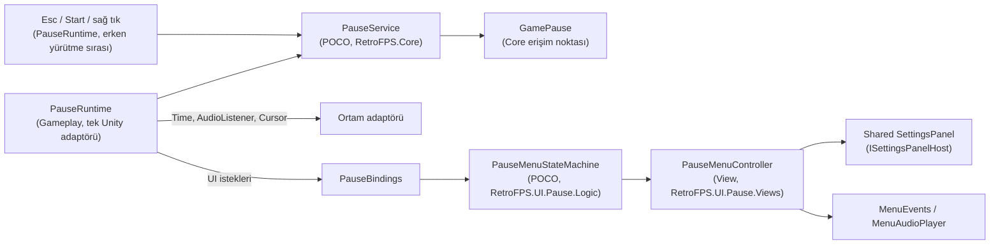

# PauseMenu (PURGATOR Oyun İçi Duraklatma Menüsü)

> [!abstract] KAN VE KEMİK DURAKLATMA, TAM DURAKLATMA
> Esc veya gamepad Start oyunu tamamen durdurur (timeScale 0, sabit adım, imleç ve ses durumu). Menü POCO servislerde tutulan durumu okur, UI yalnızca istek gönderir. Ayarlar ana menüdeki paylaşılan `SettingsPanel` prefab'ını kullanır.
> - **Plan:** `production/ui/pause-menu/plan.md`
> - **Kanıt:** `production/qa/evidence/pause-01..06`
> - **Son Güncelleme:** 2026-11-15

---

## 1. GENEL BAKIŞ
- **Amaç:** Oyuncunun savaş, Araf geçişi veya run sırasında oyunu güvenle durdurup DEVAM, AYARLAR veya ANA MENÜ seçebilmesi. Bu, `design/accessibility-requirements.md` içindeki "Pause anywhere" hedefinin uygulamasıdır.
- **Girdi:** Esc veya gamepad Start açar ve kapatır. Menü içinde Esc, B veya sağ tık tek seviye geri gider. Açılış kuralları aşağıda.
- **Öğeler:** DEVAM (RESUME), AYARLAR (SETTINGS), ANA MENÜ (MAIN MENU). Kök menüde yalnızca bu üç öğe etkileşimlidir.
- **ANA MENÜ:** "İlerleme kaybolur" onay diyaloğu açar. Varsayılan odak HAYIR'dır. EVET, `MainMenu` sahnesini bir kez yükler. Yükleme hatasında yeniden deneme mesajı gösterilir.
- **Teknoloji:** UGUI (Screen Space Overlay, sıralama 200), TextMeshPro, Yeni Input System. Kapsam `RetroFPS.Pause` assembly'sidir.

## 2. MİMARİ AKIŞ

### 2.1 Katmanlar
- **Core/Gameplay (POCO):** `IPauseService` ve `PauseService`. Sorumluluklar: `IsPaused`, `SimulationBlocked`, `GameplayInputBlocked`, `TryPause`, `Resume`, `CancelForExclusiveFlow`, `PrepareSceneLeave`, `Changed`. Saat, ses ve imleç anlık görüntülerini ortam soyutlaması üzerinden alır ve uygular.
- **Core erişim noktası:** `GamePause`. `SubsystemRegistration` ile sıfırlanır ve testte enjekte edilebilir.
- **Gameplay adaptörü:** `PauseRuntime`. Tek Unity sahibidir, `Player` üzerine bir kez eklenir. Girdiyi erken yürütme sırasında okur ve UI isteklerini Core sink sözleşmesi üzerinden iletir.
- **UI durum makinesi (POCO):** `PauseMenuStateMachine`. Durumlar: Closed, Root, Settings, RevertPrompt, ConfirmMainMenu, Leaving.
- **UI görünümü:** `PauseMenuController`. `PauseBindings` ile bağlanır. Ayarlar için `ISettingsPanelHost` uygular.
- **Bağımlılık yönü:** Gameplay → Core, Menu → Core, HUD → Gameplay/Menu/Core, Pause → Gameplay/HUD/Menu/Core. Gameplay hiçbir zaman Pause, Menu veya HUD'a referans vermez. `RunPhase` Core'a taşınmadı.

## 3. AÇILMA VE ENGELLEME KURALLARI
- **Açılabilir durum:** Oyun sahnesi, canlı ve ölü olmayan oyuncu, `TrueDeathView.IsOpen` latch'i yok, sahne yükleme latch'i yok, faz Tower veya InAraf.
- **Engellenen durumlar:** FallingToAraf, EscapingAraf, true death kartı, sahne yükleme ve MainMenu. Engelleme Esc ve Start için geçerlidir.
- **Araf geçişi:** Düşme ve kaçış sırasında istek ArafTransition'a hiçbir şey yapmaz. Fade ve slow motion devam eder.
- **True death:** Mevcut P10 kartı, arming ve odak değişmez.
- **Aynı karede sahiplik çakışması:** Ölüm, geçiş veya dış yükleme başlarsa o sahip kazanır. Bekleyen buton işi iptal edilir, önizleme geri alınır, pause gizlenir. Kaynak imleci yeniden kilitlemez ve ölü oyuncunun kontrollerini açmaz.
- **Basılı tutma:** Bloklanan veya tutulan toggle serbest bırakılıp yeniden basılmadan açılmaz. Esc, Start ve iptal aynı karede gelirse tek komut işlenir.
- **Girdi kilidi:** P2 yaklaşık 80 ms basma kilidi, geçiş sırasında tekrarlar yok sayılır. Gecikmeli işlemlerde uygunluk yeniden denetlenir.

## 4. GİRDİ, SAAT VE SES KURALLARI
- **Saat:** Açılışta `Time.timeScale` ve `Time.fixedDeltaTime` bir kez yakalanır. `timeScale = 0` atanır. Normal devamda yakalanan değerler geri yüklenir. Sabit adım `0.02` değerine sabitlenmez.
- **Ses:** Gameplay kaynakları `AudioListener.pause = true` ile durdurulur. Önceki değer normal devamda geri yüklenir. Ana ses veya `AudioListener.volume` değiştirilmez.
- **UI sesi:** Pause prefab'ındaki `MenuAudioPlayer` kendi `AudioSource`'unda `ignoreListenerPause = true` kullanır. Ses ayarı ve UI sesi throttle akışı çalışmaya devam eder.
- **İmleç:** Açılışta kilit kalkar ve görünür olur. Devamda gameplay sahibi için tekrar kilitlenir ve gizlenir. `PlayerLook` artık Esc ile imleç açıp kapatmaz.
- **Girdi:** Gameplay girdisi kapalıdır. Devam karesinde de kapalı kalır ve basılı tuşların bırakılması beklenir. Ateş, alternatif ateş ve aksiyon düğmeleri bırakılana kadar bastırılır. UI gezinme eylemleri açık kalır. `InputSystem_Actions.inputactions` değiştirilmez.
- **Hitstop:** `HitstopManager`, pause açıkken birimsiz zamanlayıcısını azaltmaz, yeni hitstop isteklerini reddeder ve `timeScale` veya `fixedDeltaTime` değerini pause'un üzerine yazmaz. Kalan hitstop devamda kendi tabanına döner.
- **Birimsiz oyun saati:** `GamePause` içindeki saat `PauseRuntime` tarafından yalnızca pause dışında ilerletilir. RunDirector süresi, HUD sağlık, yetenek ve cephane efektleri, banner zamanlamaları ve hitmarker'lar bu saati kullanır. Menü animasyonları, UI ses throttle'ı ve 10 sn ekran geri alma sayacı gerçek birimsiz zamanı kullanır.
- **OnGUI:** Pause açıkken `DamageNumberSystem`, `CrosshairHUD`, `PlayerDamageFeedback` ve `PlayerDebugHUD` çizimi bastırılır. HUD objeleri aktif kalır.

## 5. ANA MENÜYE DÖNÜŞ
- EVET, ayarları kaydeder ve bekleyen ekran önizlemesini geri alır. Girdi ve oyun durur, siyah fade birimsiz zamanla yürür.
- Fade sonrası `PauseRuntime` yükleme latch'ini tutar, hitstop'u iptal eder, `timeScale = 1` yapar, sabit adımı geri yükler, `AudioListener.pause`'u açıkça kapatır ve imleci açar.
- Tek `SceneManager.LoadSceneAsync("MainMenu", Single)` çağrısı yapılır. Yükleme bitene kadar gameplay Update çalışmaz.
- Doğrulama veya yükleme hatasında pause sahipliği geri kurulur, `pause.main_menu_load_error` gösterilir ve odak ANA MENÜ'ye gider.

## 6. BUILDER VE PREFAB
- **Prefab:** `Prefabs/UI/Pause/PauseMenu.prefab`, `Prefabs/Player/Player.prefab` içinde iç içe (nested) durur.
- **Ayarlar:** `Prefabs/UI/Shared/SettingsPanel.prefab` ana menü ile aynı asset'tir. Dil satırı dahil GENEL bölümü aynıdır. Her iki menü de `SharedSettingsPanelBuilder` kullanır.
- **Yeniden üretme:** Unity Editor menüsü `RetroFPS/Build Pause Menu`. İdempotenttir. Çift iç içe örnekleri kaldırır.
- **Metinler:** `StringTable_MainMenu_tr` içinde 40 giriş. Pause anahtarları: `pause.resume`, `pause.main_menu`, `pause.main_menu_prompt`, `pause.main_menu_load_error`.

## 7. TESTLER
- **EditMode:** `PauseServiceTests`, `PauseHitstopTests`, `PauseInputAndClockTests`, `PauseEligibilityTests`, `PauseMenuStateMachineTests`, `PauseStringTableTests`, `PausePrefabTests`.
- **Son sonuç:** EditMode 478/479 geçti. Tek başarısız test bilinen, pause ile ilgisi olmayan bir sahne override sorunudur.

## 8. KANIT
- `production/qa/evidence/pause-01` ile `pause-06` arasındaki ekran görüntüleri: kök menü, ayarlar, geri alma diyaloğu, ana menü onayı ve hata durumu.

## 9. KURALLAR
- **Sıfır GC:** Update, FixedUpdate ve LateUpdate içinde tahsis yok. Metin birleştirme yok. Önbellek kurulumda yapılır.
- **Kapsülleme:** Yalnızca `[SerializeField] private`. Dış erişim salt okunur getter ile.
- **UI oyun durumunu sahiplenmez.** `Time` ve `AudioListener` değerlerine UI doğrudan yazmaz.
- **Metinler `StringTable` anahtarlarıyla.**

## 10. BİLİNEN EKSİKLER
- **Ayarların ses bağlantısı:** Müzik ayarının bağlı kaynağı yoktur (bkz. [[MainMenuAndSettings]]).
- **Araf geçişi ve true death:** Bilerek engellidir. "Pause anywhere" hedefi tam olarak değil, kısmen karşılanmıştır.

## İlişkiler (Sinaptik Ağ Bağlantıları)
- [[ProjectOverview]] ➔ `features_ui` *(gelen)*
- [[MainMenuAndSettings]] ➔ `shares_settings_panel`
- [[CombatHudArchitecture]] ➔ `pauses_hud_clocks`
- [[CoreLoopAndPurgatory]] ➔ `pauses_run`
