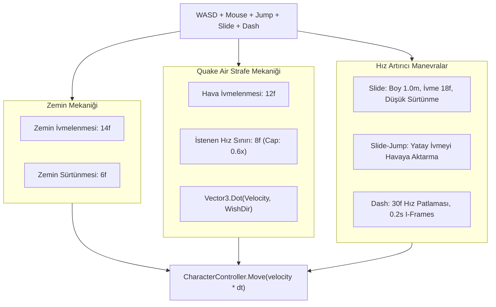

# PlayerMovementArchitecture (Oyuncu Hareket ve Fizik Mimarisi)

> [!abstract] QUAKE VE ULTRAKILL TARZI İLERİ SEVİYE HAREKET FİZİĞİ
> Quake hava yönlendirme (Air Acceleration) formülleri, kesintisiz Bunny-hop ve Strafe-jumping, sürtünmesiz kayma (Slide), atılma (Dash) ve hasar almama pencereleri (I-Frames).

---

## 1. FİZİK VE HAREKET MOTORU FORMÜLLERİ



---

## 2. KİLİT MATEMATİKSEL MODELLER VE FORMÜLLER

### 1. Quake Tarzı Hava Hareketi (Air Acceleration)
- **Problem:** Klasik motorlarda havadayken yön tuşuna basmak yatay hızı doğrudan artırırsa hız kontrolsüz sonsuza uçar; hız tamamen sınırlandırılırsa oyuncu havada dönemez.
- **Quake Çözüm Formülü:**
  ```csharp
  float curSpeed = Vector3.Dot(currentVelocity, wishDir);
  float addSpeed = wishSpeed - curSpeed;
  if (addSpeed > 0)
  {
      float accelSpeed = airAcceleration * wishSpeed * Time.deltaTime;
      if (accelSpeed > addSpeed) accelSpeed = addSpeed;
      currentVelocity += wishDir * accelSpeed;
  }
  ```
- **Sonuç:** Oyuncu `wishDir` doğrultusunda zaten yüksek hızdaysa (`curSpeed >= wishSpeed`), ileriye doğru hız eklenmez; ancak oyuncu kamerasını yana çevirip (`A` veya `D` basarak) teğet yön oluşturduğunda hız vektörünün açısı korunarak döner. Bu sayede kusursuz **Strafe-Jumping** ve **Bunny-Hopping** gerçekleşir.

### 2. Kayma (Slide) ve Slide-Jump
- **Tetiklenme:** Oyuncu koşarken çömelme tuşuna (`C` veya `Sol Ctrl`) bastığında devreye girer.
- **Karakter Boyu:** `CharacterController.height` 1.8m'den anında 1.0m'ye iner.
- **İvme:** Anlık 18f ileri hız patlaması uygulanır; zemin sürtünmesi 1.2f seviyesine düşürülür.
- **Slide-Jump:** Kayma esnasında zıplama (`Space`) yapılırsa yatay hız korunarak havaya fırlatılır; Quake hava ivmelenmesiyle birleştiğinde arenada devasa hız kazanımı sağlar.

### 3. Atılma (Dash) ve Hasar Almama Penceresi (I-Frames)
- **Hız Patlaması:** 0.2 saniye süresince 30f sabit hız patlaması (`DashSpeed = 30f`).
- **Şarj Sistemi:** 3 adet bağımsız dolan şarj (Her şarj 1.4 saniyede yenilenir).
- **I-Frames (Hasar Almamazlık):**
  * Atılma boyunca `PlayerMovement.IsDashing` bayrağı aktiftir.
  * Bu 0.2 saniyelik pencerede oyuncuya gelen mermiler veya yakın dövüş saldırıları `PlayerHealth` tarafından sıfır hasar olarak işlenir. Bu sayede oyuncu düşman saldırılarının içinden geçebilir.

### 4. Dinamik Kamera Fiziği (`PlayerLook`)
- **Dönüş Eğimi (Strafe Tilt):** Yana strafe yaparken kamera Z ekseninde 2.5° organik olarak eğilir (`Mathf.Lerp`).
- **Hıza Bağlı FOV Genişlemesi:** Oyuncu taban hızdan slide veya bunny-hop ile 20f+ hızlara çıktığında kamera FOV'u yumuşakça 90 dereceden 110 dereceye açılır.
- **Trauma Tabanlı Sarsıntı:** Hasar alındığında artan `Trauma` katsayısı karesel sönümlenerek (`trauma^2`) Perlin noise ile sarsıntı üretir.

---

## 3. BAŞKA BİR AI İÇİN FİZİK DEĞİŞTİRME KURALLARI
1. Hava ivmelenmesi formülünü asla standart `Rigidbody.AddForce` veya basit yön toplama ile değiştirmeyin; Quake iç çarpım (`Vector3.Dot`) mimarisini koruyun.
2. Karakter yüksekliği değiştirilirken (Slide / Çömelme) `CharacterController.center` değerini de boyun yarısı (`height / 2`) olarak güncelleyin; aksi halde zemin batma bug'ı oluşur.

---

## İlişkiler (Sinaptik Ağ Bağlantıları)
- [[CodebaseDependencyGraph]] ➔ `implements_physics`
- [[PlayerSubsystemArchitecture]] ➔ `interacts_with_player_core`
- [[DualLoadoutAndWeapons]] ➔ `synergizes_with`
- ⬅️ [[ProjectOverview]] ➔ `utilizes_movement` *(gelen)*
- ⬅️ [[START_HERE_AI_CONSTITUTION]] ➔ `mandated_by_constitution` *(gelen)*
