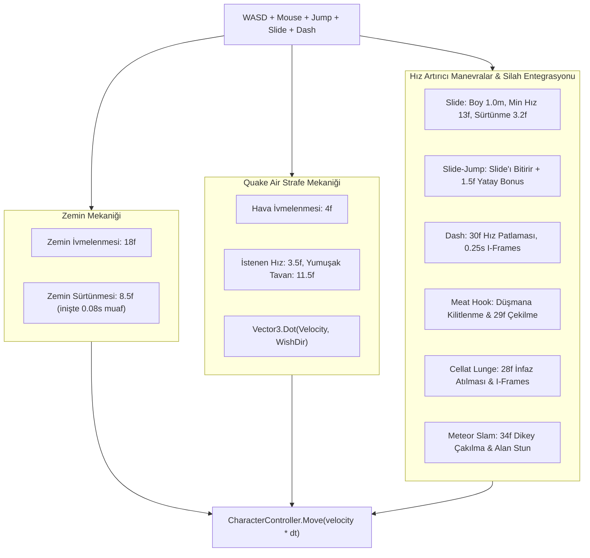

# PlayerMovementArchitecture (Oyuncu Hareket ve Fizik Mimarisi)

> [!abstract] QUAKE VE ULTRAKILL TARZI İLERİ SEVİYE HAREKET FİZİĞİ
> Quake hava yönlendirme (Air Acceleration) formülleri, kesintisiz Bunny-hop ve Strafe-jumping, sürtünmesiz kayma (Slide), atılma (Dash) ve hasar almama pencereleri (I-Frames).

---

## 1. FİZİK VE HAREKET MOTORU FORMÜLLERİ



---

## 2. KİLİT MATEMATİKSEL MODELLER VE FORMÜLLER

### 1. Quake Tarzı Hava Hareketi (Air Acceleration)
- **Problem:** Klasik motorlarda havadayken yön tuşuna basmak yatay hızı doğrudan artırırsa hız kontrolsüz sonsuza uçar; hız tamamen sınırlandırılırsa oyuncu havada dönemez.
- **Quake Çözüm Formülü:**
  ```csharp
  float curSpeed = Vector3.Dot(currentVelocity, wishDir);
  float addSpeed = wishSpeed - curSpeed;
  if (addSpeed > 0)
  {
      float accelSpeed = airAcceleration * wishSpeed * Time.deltaTime;
      if (accelSpeed > addSpeed) accelSpeed = addSpeed;
      currentVelocity += wishDir * accelSpeed;
  }
  ```
- **Sonuç:** Oyuncu `wishDir` doğrultusunda zaten yüksek hızdaysa (`curSpeed >= wishSpeed`), ileriye doğru hız eklenmez; ancak oyuncu kamerasını yana çevirip (`A` veya `D` basarak) teğet yön oluşturduğunda hız vektörünün açısı korunarak döner. Bu sayede kusursuz **Strafe-Jumping** ve **Bunny-Hopping** gerçekleşir.

### 2. Kayma (Slide) ve Slide-Jump
- **Tetiklenme:** Oyuncu koşarken çömelme tuşuna (`C` veya `Sol Ctrl`) bastığında devreye girer.
- **Karakter Boyu:** `CharacterController.height` 2.0m'den (`normalHeight`) anında 1.0m'ye (`slideHeight`) iner; kamera hedef boyu 1.55 → 0.65 olur ve `CameraBaseHeight` üzerinden 14/s ile yumuşakça iner (kamerayı yalnızca `PlayerLook` yazar, bkz. [[GameFeelArchitecture]]).
- **İvme:** Slide hızı `max(mevcut yatay hız, slideBoost = 13f)` olarak ayarlanır; slide sürtünmesi 3.2f'tir.
- **Slide-Jump:** Slide artık zıplamayı kilitlemez. Kayma esnasında zıplama (`Space`) slide'ı bitirir, yatay hızı korur ve `slideJumpSpeedBonus = 1.5f` kadar (toplam hız `maxAirSpeed + 4`'ü aşmayacak şekilde) bonus ekler.

### 2.1 İniş, Hava Tavanı ve Yerçekimi (Game Feel Pass)
- **İniş Sürtünme Muafiyeti:** Gerçek bir inişten sonra (`impact > 3 m/s` veya hava süresi > 0.1s) `landingFrictionGrace = 0.08s` boyunca zemin sürtünmesi uygulanmaz; bunny-hop zincirinde hız kaybolmaz.
- **Yumuşak Hava Tavanı:** Hız `maxAirSpeed (11.5f)` üstündeyse ani kırpılmaz, `airOverspeedDecay = 2.5 m/s²` ile tavana iner; air-strafe girdisi aşırı hızı artıramaz.
- **Düşüş Yerçekimi:** Düşerken yerçekimi `fallGravityMultiplier = 1.3` ile çarpılır (25 → 32.5).
- **Olaylar & Impuls:** `OnJumped`, `OnLanded(impactSpeed)`, `OnDashStarted`, `OnSlideStarted`, `OnSlideEnded` ve `AddImpulse(worldVelocity)` (dash/grapple/lunge/slam sırasında yok sayılır). Ayrıntı: [[GameFeelArchitecture]].

### 3. Atılma (Dash) ve Hasar Almama Penceresi (I-Frames)
- **Hız Patlaması:** 0.25 saniye süresince 30f sabit hız patlaması (`dashSpeed = 30f`, `dashDuration = 0.25f`).
- **Şarj Sistemi:** 3 adet bağımsız dolan şarj (Her şarj 1.2 saniyede yenilenir, `dashRechargeTime`).
- **I-Frames (Hasar Almamazlık):**
  * Atılma boyunca `PlayerMovement.IsDashing` bayrağı aktiftir.
  * Bu 0.25 saniyelik pencerede oyuncuya gelen mermiler veya yakın dövüş saldırıları `PlayerHealth` tarafından sıfır hasar olarak işlenir. Bu sayede oyuncu düşman saldırılarının içinden geçebilir.

### 4. Dinamik Kamera Fiziği (`PlayerLook`)
- **Dönüş Eğimi (Strafe Tilt):** Yanal hıza bağlı olarak kamera Z ekseninde eğilir (`tiltAngle = 2°`, en fazla 1.5x); slide sırasında +4° (`slideTilt`).
- **Hıza Bağlı FOV Genişlemesi:** Yatay hız 11 → 24 m/s aralığında FOV 65'ten (`baseFOV`) 78'e (`maxFOV`) açılır; dash/lunge FOV kick'leri birleşir ve [-12, 22] aralığına kıstırılır.
- **Trauma Tabanlı Sarsıntı:** Hasar alındığında artan `Trauma` katsayısı karesel sönümlenerek (`trauma^2`) Perlin noise ile rotasyon + küçük pozisyon (0.045 m) sarsıntısı üretir.
- **Mouse Smoothing Yok:** Bakış ham girdiyle 1:1'dir (`smoothLook` kaldırıldı). View punch, iniş çökmesi ve head bob `PlayerCameraFeel` üzerinden gelir ([[GameFeelArchitecture]]).

### 5. Düşman Kancası (Meat Hook / Grapple Entegrasyonu)
- **Tetiklenme:** Gotik Pompalı (`GothicShotgunWeapon`) ikincil ateşi düşmana isabet ettiğinde `PlayerMovement.StartGrapple(targetTransform, offset, speed)` çağrılır.
- **Dinamik Takip:** Kanca yalnızca düşman hedeflere tutunur; düşman hareket etse dahi hedef pozisyonu dinamik transform offseti ile canlı takip edilir.
- **Çekilme Hızı & Mesafe:** `GothicShotgunWeapon.hookPullSpeed` (varsayılan 29f; `StartGrapple` en az 16f'e sabitler) hızla hedefe doğru çekilir. Hedefe 2.0m kala veya 1.6s zaman aşımında kanca otomatik sonlanır (`StopGrapple`).

### 6. Cellat Kılıcı Hareket Entegrasyonu (Lunge & Meteor Slam)
- **İnfaz Hücumu (Executioner's Lunge):**
  * `PlayerMovement.StartLunge(direction, speed=28f, duration=0.22f)`: İleriye doğru şimşek hızında fırlatır, 0.22 saniye boyunca I-Frames (hasar almama) sağlar ve FOV Kick (14°) uygular.
  * Tamamlandığında oyuncunun hızını yumuşakça koşu hızının 1.35x katına aktararak momentum kaybını önler.
- **Meteor Çakılması (Meteor Slam):**
  * `PlayerMovement.StartMeteorSlam(downwardSpeed=34f)`: Oyuncu havadayken aşağı daldığında dikey hızı -34f'e kilitler, yatay sapmaları sönümler.
  * Zemine temas anında `_isGrounded` ile inişi yakalar; yatay hızı sıfırlayıp `PlayerLook.AddTrauma(0.42f)` ağır iniş sarsıntısı ve kılıcın alan hasarı/sersemletme callback'ini tetikler.

### 7. Adrenalin Hız Bonusu (`ApplySpeedBoost`)
- **Tetiklenme:** Kılıçla sersemlemiş düşmanı infaz etme veya öldürme anında (`TriggerBloodHarvest`).
- **Etki:** 1.5 saniye boyunca hem yürüme hızını hem de Quake bunny-hop hava hız tavanını (`maxAirSpeed`) 1.35x (%35) çarparak hız zincirlemesine olanak tanır.

---

## 3. BAŞKA BİR AI İÇİN FİZİK DEĞİŞTİRME KURALLARI
1. Hava ivmelenmesi formülünü asla standart `Rigidbody.AddForce` veya basit yön toplama ile değiştirmeyin; Quake iç çarpım (`Vector3.Dot`) mimarisini koruyun.
2. Karakter yüksekliği değiştirilirken (Slide / Çömelme) `CharacterController.center` değerini de boyun yarısı (`height / 2`) olarak güncelleyin; aksi halde zemin batma bug'ı oluşur.
3. `PlayerMovement` kamera transform'unu yazmaz; kamera boyu `ApplyCameraHeight` → `CameraBaseHeight` ile yayınlanır. Dış kuvvetler `AddImpulse`, görsel/ses tepkileri hareket olayları üzerinden eklenir ([[GameFeelArchitecture]]).

---

## İlişkiler (Sinaptik Ağ Bağlantıları)
- [[CodebaseDependencyGraph]] ➔ `implements_physics`
- [[PlayerSubsystemArchitecture]] ➔ `interacts_with_player_core`
- [[DualLoadoutAndWeapons]] ➔ `synergizes_with`
- [[GameFeelArchitecture]] ➔ `publishes_movement_events`
- ⬅️ [[ProjectOverview]] ➔ `utilizes_movement` *(gelen)*
- ⬅️ [[START_HERE_AI_CONSTITUTION]] ➔ `mandated_by_constitution` *(gelen)*
