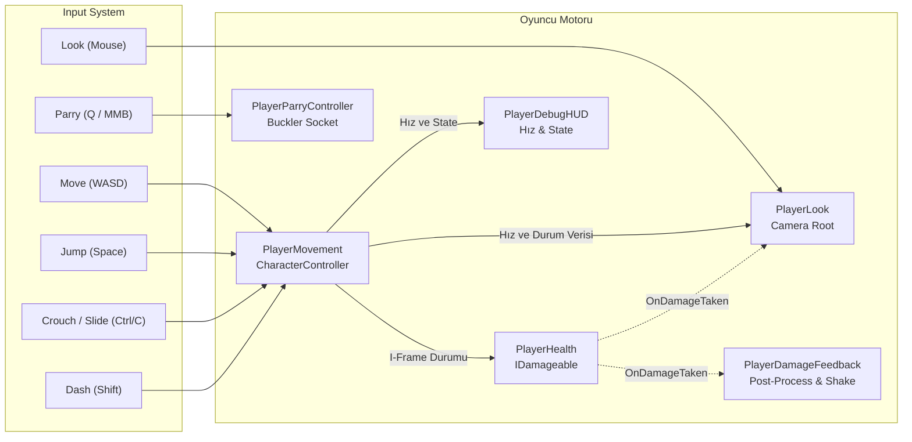

# PlayerSubsystemArchitecture (Oyuncu Alt Sistemleri Mimarisi)

> [!abstract] HIZLI TEMPOLU RETRO HAREKET VE TAKTİKSEL KORUMA
> Quake 1 / ULTRAKILL esintili hava fiziği, dinamik kamera, can ve hasar geribildirimi ile Spiked Buckler (savuşturma kalkanı).

---

## 1. OYUNCU BİLEŞENLERİ VE SORUMLULUKLARI

---

## 2. KİLİT SİSTEMLER VE BİLEŞENLER

### 1. `PlayerHealth.cs` (Can ve Ölüm Sistemi)
- **Konum:** `Assets/_Project/Scripts/Player/PlayerHealth.cs`
- **Uyguladığı Arayüz:** `IDamageable`
- **I-Frame Kontrolü:** `PlayerMovement.IsDashing` aktifse hasar sıfırlanır; oyuncu atılma esnasında hasar almaz.
- **Otomatik Can Yenileme (Regen):** Çatışmadan çıkıp 4.5 saniye hasar alınmadığında saniyede 12 birim can tazeler.
- **Ölüm Durumu:** Can 0 olunca `OnDied` olayını tetikler, kontrolleri ve silahları kilitler, imleci serbest bırakır.

### 2. `PlayerParryController.cs` (Çivili Buckler / Parry Kalkanı)
- **Konum:** `Assets/_Project/Scripts/Player/PlayerParryController.cs`
- **Girdi:** `Q` veya `Fare Orta Tuşu (MMB)`.
- **Aktif Pencere:** 0.35 saniye aktif kabul süresi, 0.20 saniye toparlanma, 0.50 saniye bekleme süresi (Cooldown).
- **Kabul Açısı:** Oyuncunun baktığı yöne doğru 130 derecelik geniş koni.
- **Çift Katmanlı Koruma:**
  1. *Menzilli Mermi Yansıtma (Deflection):* `EnemyProjectile` mermilerini havada yakalar, yönünü crosshair merkezine çevirir, hızını 1.7x ve hasarını 2.5x artırarak hedefe geri fırlatır (mermi elektro maviye döner).
  2. *Yakın Dövüş Savuşturması (Melee Stun):* Düşman darbe anında savuşturulursa darbe %100 bloke edilir; düşman 2.2 saniye sersemler (`IStunnable.Stun`).
- **3D Model Soketi:** 3D modelcinin hazırlayacağı kalkan modeli için `customShieldModel` soketi sunar; model atanmadığında gotik kukla buckler otomatik oluşturulur.

### 3. `PlayerLook.cs` (Kamera ve Sarsıntı Motoru)
- **Konum:** `Assets/_Project/Scripts/Player/PlayerLook.cs`
- **Strafe Dönüş Eğimi (Camera Tilt):** A ve D tuşlarına basarak yana strafe yaparken kamera Z ekseninde 2.5° organik olarak yatar.
- **Hıza Bağlı Dinamik FOV:** Oyuncu taban hızdan slide veya bunny-hop ile 20f+ hızlara çıktığında kamera FOV'u yumuşakça 90 dereceden 110 dereceye açılır.
- **Trauma Tabanlı Sarsıntı:** Hasar alındığında artan `Trauma` katsayısı karesel sönümlenerek (`trauma^2`) Perlin noise ile sarsıntı üretir.

### 4. `PlayerDamageFeedback.cs` (Hasar ve Darbe Algısı)
- **Konum:** `Assets/_Project/Scripts/Player/PlayerDamageFeedback.cs`
- **Kırmızı Vinyet Parlaması:** Darbe anında ekran kenarlarında URP Color Adjustments / Vignette üzerinden anlık kan kırmızısı parlama oluşturur.
- **Darbe Yönü Sarsıntısı:** Hasarın geldiği yönün tersine doğru kameraya küçük bir geri itme darbesi uygular.

### 5. `PlayerDebugHUD.cs` (Performans ve Hız Göstergesi)
- **Konum:** `Assets/_Project/Scripts/Player/PlayerDebugHUD.cs`
- **Anlık Telemetri:** Oyuncunun yatay hızını (u/s), mevcut hareket durumunu (Grounded, Air, Sliding, Dashing) ve anlık FPS değerini sıfır bellek tahsisli pre-cached string'ler ile ekrana yansıtır.

---

## 3. BAŞKA BİR AI İÇİN GELİŞTİRME SÖZLEŞMESİ
1. Oyuncunun canını veya parry özelliklerini değiştirmek için `PlayerHealth` ve `PlayerParryController`'ın public property'lerini kullanın.
2. `PlayerLook` kamerası hiyerarşide daima `PlayerMovement` nesnesinin alt objesi (CameraRoot) olmalıdır.

---

## İlişkiler (Sinaptik Ağ Bağlantıları)
- [[CodebaseDependencyGraph]] ➔ `implements_player_core`
- [[CombatAndDamageInterfaces]] ➔ `implements_IDamageable_and_IStunnable`
- [[PlayerMovementArchitecture]] ➔ `consumes_movement_physics`
- [[WeaponArsenalArchitecture]] ➔ `holds_weapons`
- [[HitstopAndAudioFeedback]] ➔ `receives_damage_feedback`
- ⬅️ [[START_HERE_AI_CONSTITUTION]] ➔ `mandated_by_constitution` *(gelen)*
- ⬅️ [[ProjectOverview]] ➔ `utilizes_player` *(gelen)*
