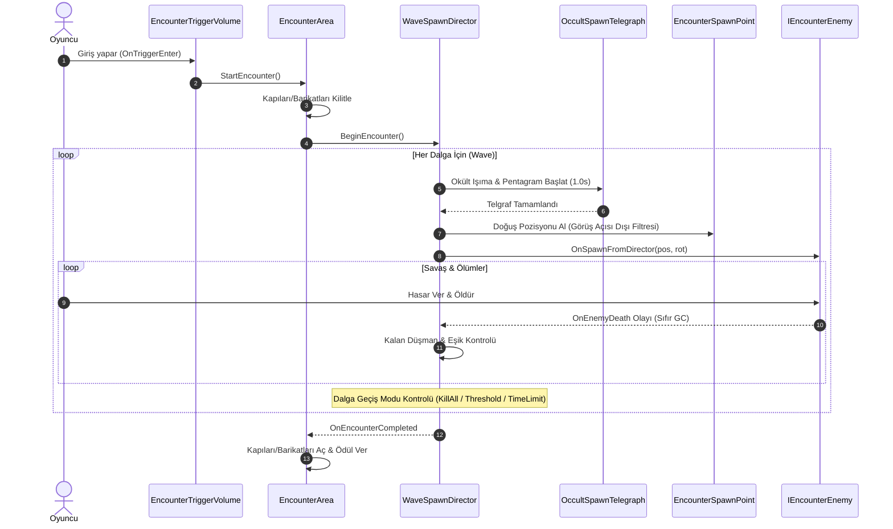

# WaveAndEncounterArchitecture (Karşılaşma ve Dalga Direktörü)

> [!abstract] ARENA VE DALGA ORKESTRASYONU (DOOM / ULTRAKILL PACING)
> Oyuncunun odaya/bölgeye girmesiyle başlayan, kapıların kilitlendiği, okült ışıma telgraflarıyla düşmanların dalgalar halinde doğurulduğu ve arena temizlenince kapıların açıldığı sektör standardı savaş döngüsü.

---

## 1. MİMARİ BİLEŞENLER

---

## 2. KİLİT SCRİPTLER VE SORUMLULUKLARI

### 1. `WaveSpawnDirector.cs`
- **Konum:** `Assets/_Project/Scripts/Combat/WaveSpawnDirector.cs`
- **Özellikler:**
  * DOOM Eternal / Quake tarzı dalga geçiş modları (`WaveTransitionMode`):
    - `StrictKillAll`: Tüm düşmanlar ölene kadar bekle (Boss veya elit dalgalar için).
    - `RemainingEnemyThreshold`: Kalan düşman sayısı belirli eşiğe indiğinde (örn: 2 düşman kalınca) sonraki dalgayı başlatarak tempoyu zirvede tutar.
    - `PercentageKilled`: Düşmanların %70'i öldüğünde yeni dalgayı getir.
    - `TimeLimit`: Maksimum süre aşımı ile tempoyu koruma.
    - `PercentageOrTimeLimit`: DOOM standardı (Hangisi önce biterse).
  * Dinamik Doğuş Noktası Seçimi: Oyuncunun görüş açısı (Camera Frustum) dışındaki noktaları önceliklendirerek oyuncunun gözü önünde aniden belirmeyi engeller.
  * Hava/Kara Ayrımı: `isAirEnemy` filtresi ile uçan düşmanları yüksek hava noktalarında doğurur.

### 2. `EncounterArea.cs`
- **Konum:** `Assets/_Project/Scripts/Combat/EncounterArea.cs`
- **Özellikler:**
  * Arenanın giriş ve çıkış barikatlarını (sis duvarı, gotik demir parmaklık) yönetir.
  * Savaş başlayınca kapıları indirir, tüm dalgalar bitince kapıları açar ve isteğe bağlı ödül sandığı / can paketi spawn eder.

### 3. `EncounterTriggerVolume.cs`
- **Konum:** `Assets/_Project/Scripts/Combat/EncounterTriggerVolume.cs`
- **Özellikler:** Oyuncunun belirlenen alana fiziksel girişini algılayan ve karşılaşmayı bir kez tetikleyen hacim.

### 4. `EncounterSpawnPoint.cs`
- **Konum:** `Assets/_Project/Scripts/Combat/EncounterSpawnPoint.cs`
- **Özellikler:** Sahne üzerine yerleştirilen doğuş noktaları. `isAirSpawn`, `zoneTag` (Örn: 'Balkon', 'Zemin') gibi etiketlerle yönetilir.

### 5. `OccultSpawnTelegraph.cs`
- **Konum:** `Assets/_Project/Scripts/Combat/OccultSpawnTelegraph.cs`
- **Özellikler:** Düşman doğmadan 0.8-1.2 saniye önce zeminde beliren kan kırmızısı parlayan gotik pentagram / partikül sütunu. Oyuncuya arkasında veya yanında belirecek düşmana karşı pozisyon alma fırsatı tanır.

---

## 3. BAŞKA BİR AI İÇİN SEVİYE VE ARENA TASARIM REÇETESİ
Bir AI veya geliştirici yeni bir arena tasarlarken:
1. Sahneye boş bir GameObject oluşturup `EncounterArea` bileşenini ekleyin.
2. Çocuk obje olarak `EncounterTriggerVolume` (Box Collider - IsTrigger) yerleştirin.
3. Arenanın uygun köşelerine `EncounterSpawnPoint` objeleri dağıtın.
4. `WaveSpawnDirector` üzerinde `waves` listesine dalgaları tanımlayın:
   - Wave 1: 4 Ghoul (Yer), Interval 0.5s. Transition: `StrictKillAll`.
   - Wave 2: 6 Ghoul + 2 Flying Eye (Hava). Transition: `RemainingEnemyThreshold` (Eşik = 2).
5. Barikatları `EncounterArea.barriers` alanına sürükleyin.

---

## İlişkiler (Sinaptik Ağ Bağlantıları)
- [[CodebaseDependencyGraph]] ➔ `orchestrates_combat_flow`
- [[CombatAndDamageInterfaces]] ➔ `consumes_IEncounterEnemy`
- [[EnemyAIAndSpawning]] ➔ `spawns_and_manages`
- ⬅️ [[START_HERE_AI_CONSTITUTION]] ➔ `mandated_by_constitution` *(gelen)*
- ⬅️ [[CoreLoopAndPurgatory]] ➔ `powers_tower_encounters` *(gelen)*
