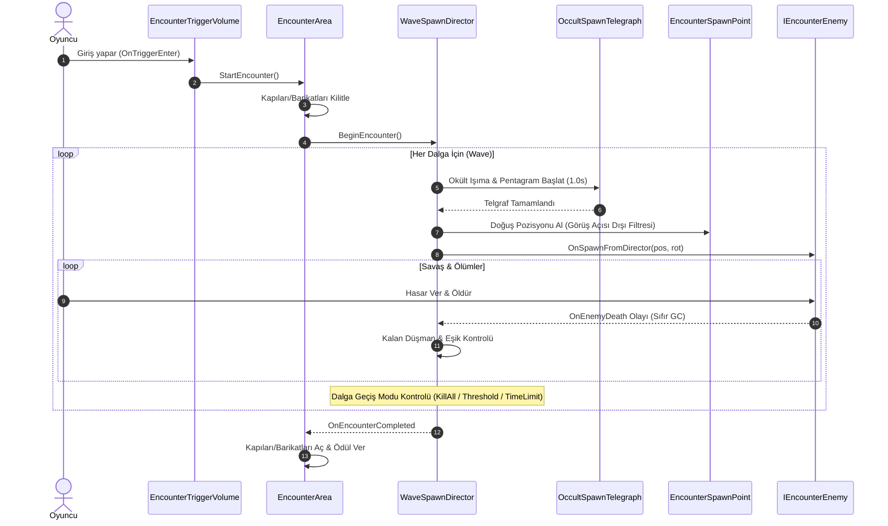

# WaveAndEncounterArchitecture (Karşılaşma ve Dalga Direktörü)

> [!abstract] ARENA VE DALGA ORKESTRASYONU (DOOM / ULTRAKILL PACING)
> Oyuncunun odaya/bölgeye girmesiyle başlayan, kapıların kilitlendiği, okült ışıma telgraflarıyla düşmanların dalgalar halinde doğurulduğu ve arena temizlenince kapıların açıldığı sektör standardı savaş döngüsü.

---

## 1. MİMARİ BİLEŞENLER

---

## 2. KİLİT SCRİPTLER VE SORUMLULUKLARI

### 1. `WaveSpawnDirector.cs`
- **Konum:** `Assets/_Project/Scripts/Combat/WaveSpawnDirector.cs`
- **Özellikler:**
  * DOOM Eternal / Quake tarzı dalga geçiş modları (`WaveTransitionMode`):
    - `StrictKillAll`: Tüm düşmanlar ölene kadar bekle (Boss veya elit dalgalar için).
    - `RemainingEnemyThreshold`: Kalan düşman sayısı belirli eşiğe indiğinde (örn: 2 düşman kalınca) sonraki dalgayı başlatarak tempoyu zirvede tutar.
    - `PercentageKilled`: Düşmanların %70'i öldüğünde yeni dalgayı getir.
    - `TimeLimit`: Maksimum süre aşımı ile tempoyu koruma.
    - `PercentageOrTimeLimit`: DOOM standardı (Hangisi önce biterse).
  * Dinamik Doğuş Noktası Seçimi: Oyuncunun görüş açısı (Camera Frustum) dışındaki noktaları önceliklendirerek oyuncunun gözü önünde aniden belirmeyi engeller.
  * Hava/Kara Ayrımı: `isAirEnemy` filtresi ile uçan düşmanları yüksek hava noktalarında doğurur.

### 2. `EncounterArea.cs`
- **Konum:** `Assets/_Project/Scripts/Combat/EncounterArea.cs`
- **Özellikler:**
  * Arenanın giriş ve çıkış barikatlarını (sis duvarı, gotik demir parmaklık) yönetir.
  * Savaş başlayınca kapıları indirir, tüm dalgalar bitince kapıları açar ve isteğe bağlı ödül sandığı / can paketi spawn eder.

### 3. `EncounterTriggerVolume.cs`
- **Konum:** `Assets/_Project/Scripts/Combat/EncounterTriggerVolume.cs`
- **Özellikler:** Oyuncunun belirlenen alana fiziksel girişini algılayan ve karşılaşmayı bir kez tetikleyen hacim.

### 4. `EncounterSpawnPoint.cs`
- **Konum:** `Assets/_Project/Scripts/Combat/EncounterSpawnPoint.cs`
- **Özellikler:** Sahne üzerine yerleştirilen doğuş noktaları. `isAirSpawn`, `zoneTag` (Örn: 'Balkon', 'Zemin') gibi etiketlerle yönetilir.

### 5. `OccultSpawnTelegraph.cs`
- **Konum:** `Assets/_Project/Scripts/Combat/OccultSpawnTelegraph.cs`
- **Özellikler:** Düşman doğmadan 0.8-1.2 saniye önce zeminde beliren kan kırmızısı parlayan gotik pentagram / partikül sütunu. Oyuncuya arkasında veya yanında belirecek düşmana karşı pozisyon alma fırsatı tanır.

---

## 3. BAŞKA BİR AI İÇİN SEVİYE VE ARENA TASARIM REÇETESİ
Bir AI veya geliştirici yeni bir arena tasarlarken:
1. Sahneye boş bir GameObject oluşturup `EncounterArea` bileşenini ekleyin.
2. Çocuk obje olarak `EncounterTriggerVolume` (Box Collider - IsTrigger) yerleştirin.
3. Arenanın uygun köşelerine `EncounterSpawnPoint` objeleri dağıtın.
4. `WaveSpawnDirector` üzerinde `waves` listesine dalgaları tanımlayın:
   - Wave 1: 4 Ghoul (Yer), Interval 0.5s. Transition: `StrictKillAll`.
   - Wave 2: 6 Ghoul + 2 Flying Eye (Hava). Transition: `RemainingEnemyThreshold` (Eşik = 2).
5. Barikatları `EncounterArea.barriers` alanına sürükleyin.

---

## 4. DİREKTÖR DÜZELTMELERİ VE WAVESET PRESET (2026-11-11)

### WaveSet (ScriptableObject preset)
- `Scripts/Combat/WaveSet.cs` — `Create > RetroFPS > Combat > Wave Set`. Dalga listesini sahneden ayırır; aynı preset birden çok arenada paylaşılır (Easy/Hard varyantı = ayrı asset), sahne merge conflict'i azalır.
- `WaveSpawnDirector.waveSet` atanırsa satır-içi `waves` listesi yok sayılır (Awake'te `waves = waveSet.Waves`). Preset modunda editör "prefab onarımı" çalışmaz (paylaşılan asset'e yazılmaz).
- Yalnızca kalıcı prefab referansı tutar. ContextMenu: "Özeti Konsola Yaz".

### Düzeltilen hatalar
- **Kill sayacı dalga bazlı:** Her aktif düşman doğduğu dalga indeksiyle (`_activeEnemyWave`, `_activeEnemies` ile paralel) izlenir. Önceki dalgadan taşan düşmanın ölümü yeni dalganın yüzde/kill-all sayacını şişirmez.
- **Cap mantığı:** `MaxConcurrentEnemies` yalnızca MEVCUT dalgadan canlı + telgrafta bekleyen (`_pendingSpawns`) düşmanları sayar; taşanlar yeni dalgayı kilitlemez. `absoluteMaxAlive` (varsayılan 0 = sınırsız) isteğe bağlı performans tavanıdır.
- **Spawn point fallback:** Eski kod uygun nokta yoksa her seferinde ilk noktayı (engelli/cooldown'lu) döndürüyordu. Ayrıca `EncounterSpawnPoint.IsPhysicallyClear` küresi yarıçap (0.9) > ofset (0.5) yüzünden zemine değip nokta HER ZAMAN dolu sayıyordu (`ClearanceCenter` = yarıçap+0.1 yukarıda). Artık kademeli gevşetme: bölge → tüm bölgeler → mesafe gevşer → cooldown gevşer; fiziksel engel her kademede korunur. Hâlâ nokta yoksa `spawnBlockedTimeout` sonra tip-uyumlu herhangi bir nokta kullanılır (uyarı loglanır); hiç uyumlu nokta yoksa istek düşürülür (hata loglanır) ve dalga kilitlenmez.
- **Görüş dışı tercih:** `preferOutOfViewSpawns` ile oyuncunun kamera ileri yönüne göre yan/arka noktalar tercih edilir (flank baskısı). Ağırlıklı sürümü için bölüm 6'ya bakın (`outOfViewBias` kaldırıldı).
- **Erken geçişte kuyruk:** Süre/yüzde ile geçilen dalgada doğmamış kalan kuyruk toplamdan düşülür (HUD "kalan düşman" doğru kalır).
- **Sıfır GC telgraf:** Lambda yerine `OccultSpawnTelegraph.SetPayload + Activate(Action<OccultSpawnTelegraph>)` ve önbellekli delege. `ResetEncounter` telgrafları `Cancel()` eder, nesil sayacıyla eski callback'leri eler, spawn point cooldown'larını sıfırlar.
- **Tempo sabitleri Inspector'da:** `waveCooldownDuration`, `stragglerAlertThreshold`, `stragglerAlertInterval`.
- **Bilinen kural:** Son dalga, seçilen geçiş modundan bağımsız olarak her zaman "hepsini öldür" ile biter (tooltip'e yazıldı).

---

## 5. ODA İZOLASYONU VE VALIDATE PANELİ (2026-11-11)

### Oda (Room) = bir GameObject: BoxCollider + `EncounterArea` + `WaveSpawnDirector` + `SpawnPoints` çocukları
Eski kodda her bileşen eksik referansı **sahne genelinde** arıyordu (`FindAnyObjectByType` / `FindObjectsByType<EncounterSpawnPoint>`); birden çok odada bir direktör başka odanın alanını/doğuş noktalarını alabiliyordu. Artık:
- `WaveSpawnDirector`: alan ve doğuş noktaları yalnızca **kendi hiyerarşisinden** çözülür (`GetRoomSpawnPoints`, yan etkisiz sürüm `PeekRoomSpawnPoints`). Awake sırası: önce alan, sonra noktalar.
- `EncounterArea`: direktörü yalnızca aynı obje / ebeveyn / çocuk içinde arar. Muhafız taramasında herhangi bir direktörün havuzundan doğan düşmanlar atlanır (başka odanın dalgası muhafız sayılmaz).
- `EncounterTriggerVolume`: yalnızca ebeveyn direktör (veya Inspector ataması); yoksa uyarı.
- `ActiveDirector` (HUD odağı): başka bir odanın savaşı sürerken oyuncu yeni odaya girse bile odak kaymaz. Direktör yok edilince statik referans temizlenir.
- `roomDisplayName` / `RoomName`: log ve araçlarda oda adı.
- Doğrulandı: 3 oda aynı anda başlatıldı, her biri yalnızca kendi 8 noktasını kullandı.

### Editor araçları (`Scripts/Editor`)
- `WaveSetEditor`: özet kartları (dalga başına bileşim, zemin/hava, cap, geçiş, en erken doğuş süresi) + Validate.
- `WaveSpawnDirectorEditor`: Validate + Oda Özeti + Dalga Özeti; "Doğuş Noktalarını Bu Odaya Bağla" (yalnızca odanın kendi hiyerarşisinden toplar), "Alanı/Noktaları Seç".
- `EncounterValidator` (Combat, saf mantık, yan etkisiz): boş dalga/grup, null veya sahne-objesi prefab, `IEncounterEnemy` eksik, TimeLimit=0, eşik >= toplam, hava/zemin uyumlu nokta yok, zone tag eşleşmiyor, nokta < 3, min>max mesafe, bariyer yok, başka odayla ortak nokta (hata) ve alan çakışması (uyarı), başka odanın direktörüne bağlı alan.
- `absoluteMaxAlive` varsayılanı 0 (sınırsız); mevcut odaların yüksek cap'lerini bozmaz.
- Not: Dalga listesi boş odada editörde varsayılan dalgalar otomatik üretilir, **build'de üretilmez**; Validate bunu hata olarak gösterir.

---

## 6. TEMPO VE TASARIM ARAÇLARI (2026-11-11)

### Dosya düzeni
- `Combat/WaveData.cs`: `EncounterState`, `WaveTransitionMode`, `SpawnPattern`, `EnemySpawnEntry`, `WaveDefinition`, `WaveEventBinding` (eskiden direktör dosyasının içindeydi).
- `Combat/EncounterDifficultyModel.cs`: `DynamicDifficultySettings` + saf C# `EncounterDifficultyModel` (POCO).
- `Core/Interfaces/IThreatCost.cs`: düşman tehdit puanı. `BasicEnemyAI.threatCost = 1`, `FlyingEyeAI.threatCost = 2`.

### Grup akışları (Spawn Streams) — `EnemySpawnEntry`
- `delayFromWaveStart`: grubun dalga başından en erken başlama anı.
- `batchSize`: bir doğuş anında aynı anda çıkan adet (0/1 = tek tek).
- `spawnPattern`: `Random` (flank ağırlıklı), `SequentialRoundRobin` (noktaları sırayla dolaşır), `FarthestFromPlayer`.
- `runInParallel`: kapalıysa grup bir öncekinin TAMAMI doğduktan sonra başlar (eski sıralı davranış = varsayılan); açıksa kendi gecikmesiyle paralel akar.
- `threatCostOverride`: 0 = prefab'daki `IThreatCost`, o da yoksa 1.
- Dalga toplamı artık gerçekten kuyruğa giren düşmanlardır (prefabı boş grup sayılmaz → kill-all kilitlenmez).

### Tehdit bütçesi — `WaveDefinition.threatBudget`
- 0 = kapalı (eski adet sınırı `maxConcurrentEnemies`). > 0 ise sınır adet yerine "mevcut dalganın canlı + telgrafta bekleyen tehdit toplamı"dır. Saha boşken bütçeden büyük tek düşmana izin verilir (kilitlenmez).
- Doğrulandı: bütçe 4, Ghoul(1)+Eye(2) karışık dalgada sahadaki tehdit hiç 4'ü aşmadı.

### Flank (kör nokta) baskısı
- `Random` desenli gruplarda nokta ağırlığı: önde `frontSpawnWeight` (1), yanda `sideSpawnWeight` (2.5), arkada `rearSpawnWeight` (4). Eşikler: `outOfViewDotThreshold` (0.5) ve `rearDotThreshold` (-0.25), yatay düzlemde kamera ileri yönüne göre.
- Adalet için çağırma sesi artık telgraf noktasında **3D** çalar (`OccultSpawnTelegraph.PlayCue`); telgraf ses bitene kadar havuza dönmez.

### Dalga olayları (UnityEvent)
- Direktörde `onEncounterStarted`, `onEncounterCompleted`, `onEncounterRetried` ve `waveEvents[]` (`waveNumber` 1'den başlar, 0 = her dalga; `onWaveStart` / `onWaveEnd`). Paylaşılan WaveSet sahne referansı taşımasın diye olaylar direktör üzerindedir. C# olayı: `OnEncounterRetried`.

### Dalga sonu ödülü
- `WaveDefinition.rewardHealthOrbs` / `rewardAmmoPickups` (varsayılan 1/1). Oyuncu etrafına `rewardScatterRadius` (2.5m) halkada, duvara çarpmadan ve zemine oturtularak düşer. Cephane türü envanterde oranı en düşük olandır. Miktarlar direktörde (`rewardOrbHealAmount`, `rewardShellAmount`, `rewardBoltAmount`).
- Not: Pickup'ların çekim yarıçapı 5.5–6m olduğu için 2.5m'deki ödüller hemen oyuncuya uçar. Yerde görünmesi istenirse yarıçapı 6m+ yapın.

### Dinamik zorluk
- Düşük can (< %35): doğuş aralığı ×1.5. Bu karşılaşmada ölüm olduysa ek ×1.2 (merhamet).
- Rahat dalga (dalga sonu can ≥ %80 ve dalgada alınan hasar ≤ maks. canın %25'i): sonraki dalgalara +1 ek düşman (en kalabalık gruba), en fazla +3. Düşük canda sıfırlanır, arada 1 azalır. Yeni karşılaşmada sıfırlanır; retry'da ek düşmanlar sıfırlanır, ölüm sayısı korunur.

### Checkpoint / Retry
- Oda savaştayken `PlayerHealth.RetryInterceptor` bu odaya bağlanır; oyuncu ölüp R/Space/Enter'a basınca sahne yeniden YÜKLENMEZ: oda sıfırlanır (düşmanlar, telgraflar, cooldown'lar), oyuncu `retryCheckpoint`'te (yoksa karşılaşmanın başladığı konumda) tam canla dirilir, dalgalar `retryWarmupDuration` sonra baştan başlar. Savaş dışında ölümde eski davranış (sahne yeniden yükleme) sürer.
- Yeni oyuncu API'leri: `PlayerHealth.Revive`, `PlayerHealth.OnRevived`, `PlayerMovement.TeleportTo`, `PlayerLook.ResetView`.
- Doğrulandı: savaşta öldürülen oyuncu sahne yüklenmeden 100 HP ile dirildi, kontroller ve imleç kilidi geri geldi, oda dalga 1'den yeniden başladı.
- Bilinen sınır: muhafızlar (manuel yerleştirilmiş düşmanlar) retry'da geri gelmez; retry dalga savaşının başından başlar.

---

## 7. GAUNTLET TEST SEVİYESİ (2026-11-11)

- **Sahne:** `Assets/Scenes/TestLevel_Gauntlet.unity` (Build Settings'e eklendi; ölümde sahne adıyla yeniden yükleme için gerekli). Üretici: `Scripts/Editor/TestLevelBuilder.cs` → menü `RetroFPS ▸ Build Test Level (Gauntlet)` (yeniden çalıştırılırsa sahneyi baştan kurar; dalga verisi `WaveSet_Gauntlet_R*.asset` olarak güncellenir).
- **Akış (+Z ekseni boyunca, ~250 m):** Başlangıç salonu (manken) → C1 sprint koridoru (0.6 m engeller, bhop) → **Oda 1 Mezar Çukuru** (28x28x7, sütun/siper, 3 faz, yalnız Ghoul) → C2 dirsekli koridor → **Oda 2 Kemik Salonu** (28x32x9, yan balkonlar y=3 + rampalar, 4 faz, Ghoul + Göz) → C3 dirsekli koridor → **Oda 3 Kemikhane** (32x36x11, balkonlar y=4, köprü, 5 faz) → C4 boss koridoru (kızıl meşaleler) → **Boss odası** (48x48x16, sunak, dev sütunlar; boss YOK).
- **Oda kurulumu:** `Encounter_RoomXX` = BoxCollider(trigger, duvarlardan 2 m içeride) + `EncounterArea` + `WaveSpawnDirector` + `SpawnPoints` (zemin + balkon + hava) + `Gates` (giriş/çıkış bariyeri, `arenaBarriers`) + `RetryCheckpoint`. Giriş kapısı oyuncu içeri girince kapanır, çıkış kapısı tüm fazlar bitince açılır.
- **Boss yer tutucusu:** `BossEncounter_Placeholder` altında `Boss_ArenaBounds` (trigger), `Boss_SpawnAnchor`, `Boss_PlayerCheckpoint`. Boss eklenirken bu sınıra `EncounterArea` + direktör bağlanır.
- **Doğrulandı (Play Mode):** 3 odanın tüm fazları (3/3, 4/4, 5/5) başlayıp bitti, kapılar savaşta kapalı, sonda açık. Oda izolasyonu korundu (her oda yalnız kendi noktalarını kullanır).
- **Bilinen:** `Player.prefab` içindeki silah viewmodel materyallerinin 16 slotu boş (pembe görünüyor) — seviyeden bağımsız, QuickSetup'ın sahne-içi materyal üretiminden kalan eski sorun.

---

## İlişkiler (Sinaptik Ağ Bağlantıları)
- [[CodebaseDependencyGraph]] ➔ `orchestrates_combat_flow`
- [[CombatAndDamageInterfaces]] ➔ `consumes_IEncounterEnemy`
- [[EnemyAIAndSpawning]] ➔ `spawns_and_manages`
- ⬅️ [[START_HERE_AI_CONSTITUTION]] ➔ `mandated_by_constitution` *(gelen)*
- ⬅️ [[CoreLoopAndPurgatory]] ➔ `powers_tower_encounters` *(gelen)*
