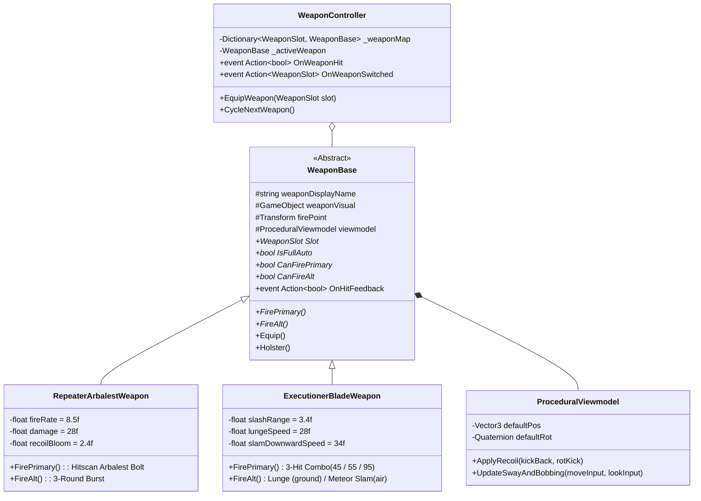

# WeaponArsenalArchitecture (Silah Cephaneliği ve Viewmodel Mimarisi)

> [!abstract] DUAL-LOADOUT VE PROCEDURAL VİEWMODEL SİSTEMİ
> Hızlı geçişli ana silahlar (Menzilli ve Yakın Dövüş) ile fiziksel hissiyatı artıran prosedürel yaylanma (sway), adım sekmesi (bobbing) ve dinamik geri tepme (recoil) motoru.

---

## 1. SİLAH MİMARİSİ VE SINIF HİYERARŞİSİ



---

## 2. KİLİT MEKANİKLER VE DETAYLAR

### 1. `WeaponSlot` Enum
```csharp
namespace RetroFPS
{
    public enum WeaponSlot
    {
        RepeaterArbalest = 0, // Slot 1: Hızlı Seri Menzilli Arbalest / Çivi Silahı
        ExecutionerBlade = 1, // Slot 2: Ağır Yakın Dövüş Cellat Kılıcı
        GothicShotgun = 2     // Slot 3: Gotik Çift Namlulu Pompalı & Meat Hook
    }
}
```

### 2. `GothicShotgunWeapon.cs` (Gotik Çift Namlulu Pompalı & Meat Hook)
- **Sol Tık (Birincil Saldırı):** Ağır çift namlu saçma patlaması (`pelletCount = 18`, `damagePerPellet = 18f`, `range = 42m`, `spreadAngle = 5.8°`).
  * Tek atışta 2 adet Pompalı Fişeği (`Shells`) tüketir. Nokta atışı temasında ~320+ hasar ile elit olmayan yaratıkları anında parçalar (Gibs).
  * **Havadayken Geri Tepme (Airborne Knockback):** Havada ateş edildiğinde Quake/TF2 roket zıplamasına benzer şekilde oyuncuyu hafifçe geriye fırlatır.
- **Sağ Tık (İkincil Saldırı - Meat Hook / Grapple):** Namlu altından fırlayan zincirli gotik et kancası (`hookRange = 32m`, `hookPullSpeed = 29m/s`).
  * **Yalnızca Düşmanlara Saplanma (Enemy-Only Lock):** Harita geometrisi, duvar veya zeminlere saplanması engellenmiştir. Yalnızca `IDamageable`, `IStunnable` veya `IEncounterEnemy` sözleşmesine sahip düşman varlıklarına kilitlenir; düşmanı `IStunnable.Stun(1.5f, Vector3.zero)` ile sersemletip yerine çiviler ve oyuncuyu hedefin göğsüne doğru hızla çeker (point-blank çifte darbesi için ideal pozisyon).
  * **Hedef Takip Ofseti:** Düşmanın taban pivotu (Y=0) yerine kancanın vurduğu uzuv/gövde noktasını dinamik ofsetle takip eder.
  * **Sapan Zıplaması (Slingshot Jump):** Kanca ile çekilme esnasında `SPACE` tuşuna basıldığında kanca serbest bırakılır ve biriken kinetik hızla oyuncu gökyüzüne doğru fırlar.
  * **Görsel Zincir:** Namlu altı ile hedef arasına anlık gerilen ve hedef hareket ettikçe güncellenen dinamik `LineRenderer` zincir efekti.

### 3. Cephane Sistemi (`PlayerAmmoInventory` & `AmmoPickup`)
- **Cephane Türleri (`AmmoType`):** `Bolts` (Arbalest, Max 120, Başlangıç 60) ve `Shells` (Pompalı, Max 32, Başlangıç 16).
- **Kuru Tetik (Dry Fire):** Cephane tükendiğinde silah ateş etmez; boş tetik düşme sesi (`CombatAudio.PlayDryFire`) çalar.
- **Dinamik Düşüş Döngüsü (`EnemyAmmoDropper`):** DOOM Eternal esintili kaynak mekaniği; kritik veya yakın dövüşle öldürülen düşmanlar daha bol cephane düşürür. Oyuncunun hangi cephanesi azsa düşüş algoritması o türe öncelik tanır.
- **Arayüz (`AmmoHUD`):** Ekranın sağ alt köşesinde aktif silahın cephane sayısını, parlayan retro renk paletini ve doluluk barını sıfır GC tahsisiyle sunar.

### 4. `ExecutionerBladeWeapon.cs` (Cellat Kılıcı 2.0 - Overhaul)
- **Sol Tık (3'lü Akıcı Kombo Sistemi):**
  * **Hit 1 (Yatay Kesik - Slash):** Hızlı sağdan sola kesik (`damage = 45f`, `range = 3.4m`).
  * **Hit 2 (Ters Açı Kesik - Backhand):** Hızlı soldan sağa geri savurma (`damage = 55f`, `range = 3.4m`).
  * **Hit 3 (Ağır İndirme - Finisher):** Yukarıdan aşağı yıkıcı cellat darbesi (`damage = 95f`, `range = 3.4m`, `knockback = 12m/s`). İsabet eden düşmanı `IStunnable.Stun(1.2f, knockback)` ile sersemletir ve mikro hitstop tetikler.
  * **Kombo Zamanlayıcısı:** Vuruşlar arasında 0.70 saniyelik kombo hafıza penceresi bulunur. Süre aşılırsa zincir başa döner.
- **Mermi Dilimleme (Projectile Slicing):**
  * Kılıç savrulurken oyuncunun ön konisinde bulunan düşman mermilerini (`EnemyProjectile.ActiveProjectiles`) tespit eder; mermileri ikiye bölerek hedefe geri saptırır (`Deflect`). Menzilli saldırılara karşı yakın dövüş kalkanı vazifesi görür.
- **Sağ Tık (Dinamik İkincil Saldırı Modları):**
  * **Zeminde / Yatay Bakışta: Cellat Hücumu (Executioner's Lunge):**
    - 8-10 metre ileriye şimşek hızında atılma (`PlayerMovement.StartLunge`, `damage = 95f`).
    - **Blood Harvest (Kan Hasadı):** Hücum sırasında sersemlemiş (`IStunnable`) bir düşmana çarpılırsa veya darbeyle düşman ölürse parçalama (gibs) tetiklenir, oyuncuya **+25 HP Can Çalma (Vampiric Leech)** ve 1.5 saniye boyunca **+%35 Adrenalin Hız Bonusu** kazandırır.
  * **Havada ve Aşağıya Bakarken: Meteor Çakılması (Meteor Slam):**
    - Oyuncu havadayken aşağı yöne (Zemin açısı < -30°) bakarak sağ tık yaptığında yere doğru sonic hızla dalar (`PlayerMovement.StartMeteorSlam`, `slamDownwardSpeed = 34m/s`).
    - Yere çarptığı anda 5.5 metre çapında şok dalgası (`80 damage`) oluşturur, çevredeki tüm düşmanları sarsarak 2.2 saniye sersemletir (`IStunnable.Stun`).
- **Görsel ve İşitsel Sunum:**
  * Prosedürel viewmodel animasyonları (`ProceduralViewmodel.TriggerMeleeSlash`, `TriggerMeleeBackhand`, `TriggerMeleeOverhead`, `TriggerMeleeLunge`, `TriggerMeleeSlam`) ile her vuruşa özel fiziksel savurma ve geri toparlanma eğrileri.
  * `CombatAudio` üzerinden dinamik ses tonlamaları (vuruş sırasına göre artan pitch, finisher çan sesi, lunge rüzgarı ve meteor şok patlaması).

### 5. `RepeaterArbalestWeapon.cs` (Seri Arbalest)
- **Hitscan Mermi Fiziği:** Hızlı delici cıvata atışları (Atış başı 1 Ok tüketir).
- **Recoil Bloom (Nişangah Yaylanması):** Seri atış yaptıkça mermi dağılım açısı artar; ateş kesildiğinde toparlanır.
- **Görsel Fişek:** Arbalest bolt mermisi tracer çizgisi ve darbe noktasında kıvılcım/kan patlaması.

### 6. `ProceduralViewmodel.cs` (Prosedürel Görünüm)
- **Sway (Dönüş Yaylanması):** Fare hareketine göre silahın yumuşak gecikmeli takibi (Lag & Tilt).
- **Bobbing (Yürüme/Kayma Sallantısı):** Koşarken, kayarken ve zıplarken sinüs dalgasıyla doğal silah adımlaması.
- **Recoil Spring (Dinamik Yay):** Ateş edildiğinde silah geriye teper ve yay katsayısıyla orijinal pozisyonuna döner.

---

## 3. YENİ BİR SİLAH EKLEME REÇETESİ (BAŞKA BİR AI İÇİN)
Asla `WeaponController.cs` içine silahın kendi atış mantığını yazmayın. Şu adımları izleyin:
1. `Assets/_Project/Scripts/Weapons/` altına `YeniSilahWeapon.cs` oluşturun.
2. `public class YeniSilahWeapon : WeaponBase` şeklinde türetin.
3. `Slot`, `CanFirePrimary`, `CanFireAlt`, `FirePrimary()`, `FireAlt()` gövdelerini doldurun.
4. Hedefi vururken:
   ```csharp
   if (hit.collider.TryGetComponent<Hitbox>(out var hitbox))
   {
       hitbox.TakeDamage(damage, hit.point, hit.normal);
   }
   else if (hit.collider.TryGetComponent<IDamageable>(out var damageable))
   {
       damageable.TakeDamage(damage, hit.point, hit.normal);
   }
   ```
5. `OnHitFeedback?.Invoke(isCrit);` olayını tetikleyin. Bu sayede nişangah hitmarker (`CrosshairHUD`) ve sesler otomatik çalışır.

---

## İlişkiler (Sinaptik Ağ Bağlantıları)
- [[CodebaseDependencyGraph]] ➔ `implements_weapons`
- [[CombatAndDamageInterfaces]] ➔ `damages_via_interfaces`
- [[HitstopAndAudioFeedback]] ➔ `triggers_audio_and_hitstop`
- [[CombatVFXAndDecalSystem]] ➔ `spawns_combat_vfx`
- ⬅️ [[START_HERE_AI_CONSTITUTION]] ➔ `mandated_by_constitution` *(gelen)*
- ⬅️ [[DualLoadoutAndWeapons]] ➔ `expands_combat_design` *(gelen)*
