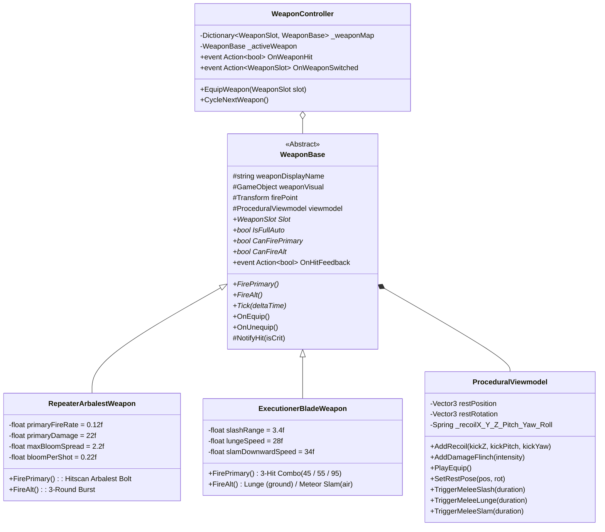

# WeaponArsenalArchitecture (Silah Cephaneliği ve Viewmodel Mimarisi)

> [!abstract] DUAL-LOADOUT VE PROCEDURAL VİEWMODEL SİSTEMİ
> Hızlı geçişli ana silahlar (Menzilli ve Yakın Dövüş) ile fiziksel hissiyatı artıran prosedürel yaylanma (sway), adım sekmesi (bobbing) ve dinamik geri tepme (recoil) motoru.

---

## 1. SİLAH MİMARİSİ VE SINIF HİYERARŞİSİ



- **`WeaponController.TryPlayQuickBlade()` (Karşı Hüküm):** Aktif silah Executioner Blade değilse görselini gizler, kılıç görselini 0.25 saniye (`quickBladeDuration`) gösterir ve `ExecutionerBladeWeapon.QuickSwipe()` çağırır. Bu süre boyunca ateş ve silah değişimi girdileri yok sayılır; aktif silah tick almaya devam eder. Duraklatma ve devre dışı kalmada görseller geri yüklenir. Durum `IsQuickBladeActive` ile okunur.

---

## 2. KİLİT MEKANİKLER VE DETAYLAR

### 1. `WeaponSlot` Enum
```csharp
namespace RetroFPS
{
    public enum WeaponSlot
    {
        RepeaterArbalest = 0, // Slot 1: Hızlı Seri Menzilli Arbalest / Çivi Silahı
        ExecutionerBlade = 1, // Slot 2: Ağır Yakın Dövüş Cellat Kılıcı
        GothicShotgun = 2     // Slot 3: Gotik Çift Namlulu Pompalı & Meat Hook
    }
}
```

### 2. `GothicShotgunWeapon.cs` (Gotik Çift Namlulu Pompalı & Meat Hook)
- **Sol Tık (Birincil Saldırı):** Ağır çift namlu saçma patlaması (`pelletCount = 18`, `damagePerPellet = 18f`, `range = 42m`, `spreadAngle = 5.8°`).
  * Tek atışta 2 adet Pompalı Fişeği (`Shells`) tüketir. Nokta atışı temasında ~320+ hasar ile elit olmayan yaratıkları anında parçalar (Gibs).
  * **Atış Başı Toplama:** Tüm saçmalar önce çözülür, hedef (`IDamageable`/Hitbox) başına **tek** `TakeDamage` ve tek hasar sayısı uygulanır (kapasite 12 hedef); atış başına tek `NotifyHit`. Et VFX/sesi hedefin kendisi üretir ([[GameFeelArchitecture]]).
  * **Havadayken Geri Tepme (Airborne Knockback):** Havada ateş edildiğinde varsa kanca bırakılır ve `PlayerMovement.AddImpulse(-camForward × airborneKnockback)` (`airborneKnockback = 6.5f`) ile oyuncu geriye itilir.
- **Sağ Tık (İkincil Saldırı - Meat Hook / Grapple):** Namlu altından fırlayan zincirli gotik et kancası (`hookRange = 32m`, `hookPullSpeed = 29m/s`).
  * **Yalnızca Düşmanlara Saplanma (Enemy-Only Lock):** Harita geometrisi, duvar veya zeminlere saplanması engellenmiştir. Yalnızca `IDamageable`, `IStunnable` veya `IEncounterEnemy` sözleşmesine sahip düşman varlıklarına kilitlenir; düşmanı `IStunnable.Stun(1.5f, Vector3.zero)` ile sersemletip yerine çiviler ve oyuncuyu hedefin göğsüne doğru hızla çeker (point-blank çifte darbesi için ideal pozisyon).
  * **Hedef Takip Ofseti:** Düşmanın taban pivotu (Y=0) yerine kancanın vurduğu uzuv/gövde noktasını dinamik ofsetle takip eder.
  * **Sapan Zıplaması (Slingshot Jump):** Kanca ile çekilme esnasında `SPACE` tuşuna basıldığında kanca serbest bırakılır ve biriken kinetik hızla oyuncu gökyüzüne doğru fırlar.
  * **Görsel Zincir:** Namlu altı ile hedef arasına anlık gerilen ve hedef hareket ettikçe güncellenen dinamik `LineRenderer` zincir efekti.

### 3. Cephane Sistemi (`PlayerAmmoInventory` & `AmmoPickup`)
- **Cephane Türleri (`AmmoType`):** `Bolts` (Arbalest, Max 120, Başlangıç 60) ve `Shells` (Pompalı, Max 32, Başlangıç 16).
- **Kuru Tetik (Dry Fire):** Cephane tükendiğinde silah ateş etmez; boş tetik düşme sesi (`CombatAudio.PlayDryFire`) çalar.
- **Dinamik Düşüş Döngüsü (`EnemyAmmoDropper`):** DOOM Eternal esintili kaynak mekaniği; kritik veya yakın dövüşle öldürülen düşmanlar daha bol cephane düşürür. Oyuncunun hangi cephanesi azsa düşüş algoritması o türe öncelik tanır.
- **Arayüz (`AmmoHUD`):** Ekranın sağ alt köşesinde aktif silahın cephane sayısını, parlayan retro renk paletini ve doluluk barını sıfır GC tahsisiyle sunar.

### 4. `ExecutionerBladeWeapon.cs` (Cellat Kılıcı - Slot 2)
Tempo ve infaz odaklı yakın dövüş silahıdır; ücretsiz DPS, dokunulmazlık, ücretsiz iyileşme döngüsü veya kalıcı sersemletme sunmaz. Hareket hızı, ateşli silahlarla hedef yumuşatma ve yükseklik üzerinden ödüllendirir. İç durumu `BladeComboState`, `BladeSpeedEdge`, `SlamImpactScaling` ve `BloodHarvestTracker` POCO sınıflarında tutulur.

- **Sol Tık (3'lü Kombo — her savurma için yeni basış, 0.15 s girdi tamponu, otomatik tekrar yok):**
  * **Adım 1 (Slash):** `34` hasar, `0.22 s` bekleme süresi.
  * **Adım 2 (Backhand):** `42` hasar, `0.22 s` bekleme süresi.
  * **Adım 3 (Finisher):** `71.11 × 1.35` garantili kritik = `96` hasar, vuruş çözülmeden önce `0.10 s` kurma (wind-up), `0.44 s` bekleme süresi, `1.0 s` sersemletme (`IStunnable.Stun`). Hayatta kalan her hasar almış hedefe **Sunder (Yarık)** uygular.
  * **Zamanlayıcı ve Menzil:** `0.70 s` hareketsizlikte kombo sıfırlanır (sabit ortalama ~195 DPS). Menzil/koni: `3.4 m / 85°` (finisher `3.91 m / 63.75°`); konideki tüm düşmanları biçer.
  * **Vuruş Geri Bildirimi:** Adım 1/2'de `0.035 s`, finisher'da `0.10 s` hitstop (yalnızca bir `IEncounterEnemy` hasar aldığında; boşa savurmada yok); hedef başına kesik darbe VFX'i; `1.6 m`'den uzaktaki en yakın vurulan düşmana doğru `2.5 m/s` adım itkisi (yalnızca yerdeyken).
  * **Hız Keskinliği (`BladeSpeedEdge`):** Yatay hız `≤8 m/s` iken kombo hasarı `×1.00`, `≥13 m/s` değerine doğrusal olarak `×1.35` ölçeklenir. `QuickSwipe`, Lunge ve Slam'e uygulanmaz.
  * **Kalkan Sekmesi (Guard Bounce):** Savurma yalnızca savunma yapan bir hedefle (`IMeleeGuard.BlocksMeleeFrom`) karşılaşırsa `0` hasar verir, vuruş işareti/sayısı yerine kıvılcım gösterir, komboyu 1. adıma sıfırlar ve `+0.30 s` bekleme süresi ekler.
  * **Mermi Kesme:** Savurmalar ön konideki düşman mermilerini (`2.8 m`, `±75°`) **keser** (`EnemyProjectile.Cut()`); mermi yok edilir, yansıtılmaz. Yansıtma yalnızca Counter-Verdict ([[PlayerParryController]] / Q) ile yapılır.
- **`QuickSwipe()` (Karşı Hüküm Hızlı Savurma):** Kombo, cooldown ve Blood Harvest durumunu değiştirmeden tek bir geri savurma vuruşu oynatır. Viewmodel geri savurma animasyonu (`TriggerMeleeBackhand`), kılıç sesi ve kılıç konisine `quickSwipeDamage = 25` hasar uygular. Mermi kesmez. Çağıran: `WeaponController.TryPlayQuickBlade()`, tetik: `PlayerParryController` (Q / MMB).
- **Sağ Tık (Dinamik İkincil Saldırı Modları):**
  * **Zeminde / Yatay Bakışta — Cellat Hücumu (Executioner's Lunge):**
    - `95` hasar, `28 m/s` hızla `0.22 s` (`≈6.2 m`) atılma (`PlayerMovement.StartLunge(..., invulnerable: false)`). **Dokunulmazlık (i-frame) yoktur.** Aktifken yolundaki mermileri (`1.8 m`, `±90°`) her karede keser.
    - Bekleme süresi `2.2 s`. Hücum en az bir düşmanı öldürürse bekleme süresi `0.10 s` olur (**infaz zinciri / chain reset**) ve ek hitstop + FOV tepmesi tetiklenir.
    - Tarama dünya geometrisiyle kırpılır (duvar arkasından vurmaz); sıfır mesafedeki (point-blank) hedefler vurulur.
    - **Blood Harvest (Kan Hasadı - `BloodHarvestTracker`):** Yalnızca **halihazırda sersemlemiş** bir düşmana hücum edildiğinde `+20 HP` (`HarvestHeal` ve `HealReceived` statları üzerinden; overheal sınırına kadar taşabilir) + `1.5 s` boyunca `×1.35` hız kazandırır. Sersemleme sekansı başına bir kez, hücum başına bir ödül verilir; düz hücum öldürmesi artık iyileştirmez.
  * **Havada ve Aşağıya Bakarken — Meteor Çakılması (Meteor Slam):**
    - Düşme yüksekliği `h` (`başlangıç Y - iniş Y`, `t = InverseLerp(1 m, 6 m, h)`, `SlamImpactScaling`) ile ölçeklenir: hasar `45 → 120`, yarıçap `3.0 → 5.5 m`, sersemletme `0.5 → 1.8 s`.
    - İniş noktasından görüş hattı gerektirir (duvar arkasından vurmaz). `h ≥ 3.5 m` ise hasardan önce `IGuardBreakable.BreakGuard(2 s)` çağırarak Penitent kalkanını açar.
    - **Lunge → Slam kombosu:** Lunge ve Slam ayrı bekleme sayaçları kullanır (`BladeAltState`); biri beklemedeyken diğeri atılabilir. Yukarı Lunge'ın ardından (veya Lunge sürerken, Lunge'ı iptal ederek) havada aşağı bakıp Slam atılabilir. Aynı havada kalışta Lunge kullanıldıysa Slam'in yükseklik kredisi `lungeSlamMaxHeight = 4 m` ile sınırlanır (`90` hasar, `4.5 m`, `1.28 s` sersemletme; guard break geçerli). Lunge'sız düşüşler sınırsızdır; bayrak yere basınca temizlenir.
    - İnişten sonra `1.0 s` bekleme süresi. Çakılma ortasında silah değiştirmek darbeyi iptal etmez (kasıtlı); çakılma ortasında et kancası (meat hook) fırlatmak çakılmayı iptal eder. Dash → Slam geçişi artık oyuncuyu dokunulmaz bırakmaz.
- **Sunder / Yarık (`SunderTracker`, `SunderMarks`, `SunderMarkView`):**
  * Finisher'ın hasar verdiği hayatta kalan hedefler 4 saniyeliğine işaretlenir (kapasite 32; `SunderMarkView` havuzlu nokta ışık yer tutucusudur).
  * İşaretli hedef yalnızca **ateşli silahlardan** `×1.25` hasar alır (arbalest birincil `22 → 27.5`, alt cıvata `25 → 31.25`, pompalı saçması `18 → 22.5`, kanca `10 → 12.5`); kılıç hasarı artmaz. Düşman ölünce işaret kalkar; finisher öldürmesi işaret uygulamaz.
- **Kılıf (Holster):** `WeaponController`, aktif olmayan silahlar için `WeaponBase.TickHolstered(dt)` çağırır; kılıç kılıftayken de bekleme sürelerini çalıştırmaya devam eder. Controller devre dışı kaldığında (ölüm) `WeaponBase.CancelPendingActions()` çağrılır.
- **Eşleşmeler (Matchups):**
  * **Ghoul (150 HP):** Tam sabit kombo 3. vuruşta öldürür (`~0.54 s`); ya da Adım 1 + Adım 2 + Lunge öldürüp hücumu sıfırlar.
  * **Nişancı / Flying Eye (90 HP):** Yukarı doğru tek Lunge öldürür ve sıfırlar → havada zincirleme; i-frame olmadığı için hücumun mermilerini kesmesi gerekir.
  * **Kefaretçi / Penitent (320 HP):** Önden kılıç saldırıları seker. Çözüm: çakılmasını parry'lemek (`2.2 s` sersemleme → iki temiz kombo `≈344` hasar) veya `h ≥ 3.5 m` yükseklikten Slam (`2 s` guard break).
  * **Judge:** Kılıç sersemletmesi reddedilir; rotasyon = finisher → Sunder → pompalı (`405` tam isabet hasarı).
  * **Kartlar:** `starving_steel` Harvest iyileşmesini ikiye katlar (`20 → 40`) ve yakın dövüş hasarını `×1.5` yapar; `FireRate` kılıcı etkilemez.
- **Bilinen Açık Noktalar:**
  * Kılıç ses klipleri hâlâ atanmamıştır (synth yedekleri kullanılır); Sunder işareti yalnızca geçici bir ışıktır.
  * Gib rigidbody'leri `CharacterController`'ı engellediği için gib üzerine inmek ölçülen slam düşüşünü kısaltabilir (önceden var olan durum).
  * `CombatVFXManager` / `DamageNumberSystem` vuruş yolları vuruş başına ~30 B tahsis yapar (kılıç kodu dışı, önceden var olan durum).
  * Gerçek fare/klavye girdisi ve elle oynanış hissi ile henüz doğrulanmamıştır.
- **Görsel ve İşitsel Sunum:**
  * Prosedürel viewmodel animasyonları (`ProceduralViewmodel.TriggerMeleeSlash`, `TriggerMeleeBackhand`, `TriggerMeleeOverhead`, `TriggerMeleeLunge`, `TriggerMeleeSlam`) ile her vuruşa özel fiziksel savurma ve geri toparlanma eğrileri.
  * `CombatAudio` üzerinden dinamik ses tonlamaları (vuruş sırasına göre artan pitch, finisher çan sesi, lunge rüzgarı ve meteor şok patlaması).

### 5. `RepeaterArbalestWeapon.cs` (Seri Arbalest)
- **Hitscan Mermi Fiziği:** Hızlı delici cıvata atışları (Atış başı 1 Ok tüketir).
- **Recoil Bloom (Nişangah Yaylanması):** Her atış dağılıma `bloomPerShot = 0.22` ekler (en fazla `maxBloomSpread = 2.2`); atış aralığı dolduktan sonra `bloomRecovery = 4.5`/s ile toparlanır.
- **Görsel Fişek:** Arbalest bolt mermisi tracer çizgisi ve darbe noktasında kıvılcım/kan patlaması.

### 6. `ProceduralViewmodel.cs` (Prosedürel Görünüm)
- **Sway (Dönüş Yaylanması):** Fare hareketine göre silahın yumuşak gecikmeli takibi (Lag & Tilt).
- **Bobbing (Yürüme/Kayma Sallantısı):** Koşarken, kayarken ve zıplarken sinüs dalgasıyla doğal silah adımlaması.
- **Recoil Spring (Dinamik Yay):** `AddRecoil` / `AddDamageFlinch` altı `Spring`'in yer değiştirmesini ekler; yaylar `recoilFrequency = 9 Hz`, `recoilDamping = 0.5` ile hafif overshoot yaparak döner.
- **Dikey Atalet, İniş ve Equip:** Havadaki dikey hıza göre ofset, `OnLanded`/`OnJumped` ile çökme, `OnEquip` → `PlayEquip()` ile 0.16s'lik aşağıdan kalkış animasyonu. Tüm ofsetler `ComposePose()` içinde tek seferde transform'a yazılır. Ayrıntı: [[GameFeelArchitecture]].

---

## 3. YENİ BİR SİLAH EKLEME REÇETESİ (BAŞKA BİR AI İÇİN)
Asla `WeaponController.cs` içine silahın kendi atış mantığını yazmayın. Şu adımları izleyin:
1. `Assets/_Project/Scripts/Weapons/` altına `YeniSilahWeapon.cs` oluşturun.
2. `public class YeniSilahWeapon : WeaponBase` şeklinde türetin.
3. `Slot`, `CanFirePrimary`, `CanFireAlt`, `FirePrimary()`, `FireAlt()` gövdelerini doldurun.
4. Hedefi vururken (sıfır GC, önbellekli çözümleme):
   ```csharp
   if (CombatRaycast.Nearest(origin, dir, range, GameLayers.PlayerAttackMask, _rayHits, out RaycastHit hit))
   {
       CombatTargetLookup.Binding binding = CombatTargetLookup.Get(hit.collider);
       IDamageable target = binding.Damageable; // Hitbox varsa Hitbox (çarpanı kendisi uygular)
       if (target != null) target.TakeDamage(damage, hit.point, hit.normal, false);
   }
   ```
   Et VFX/sesini silahta **çağırmayın**; hedef kendi `TakeDamage`'inde üretir. Silah yalnızca hasar sayısı, duvar efekti (`isFlesh: false`) ve kendi tepkisini (`Viewmodel.AddRecoil`, `_look.AddViewPunch`, `_look.AddTrauma`) üretir ([[GameFeelArchitecture]]).
5. `NotifyHit(isCrit);` çağırın (`OnHitFeedback` olayını tetikler). Bu sayede nişangah hitmarker (`CrosshairHUD`) ve sesler otomatik çalışır.

---

## İlişkiler (Sinaptik Ağ Bağlantıları)
- [[CodebaseDependencyGraph]] ➔ `implements_weapons`
- [[CombatAndDamageInterfaces]] ➔ `damages_via_interfaces`
- [[HitstopAndAudioFeedback]] ➔ `triggers_audio_and_hitstop`
- [[CombatVFXAndDecalSystem]] ➔ `spawns_combat_vfx`
- [[GameFeelArchitecture]] ➔ `follows_feel_and_feedback_rules`
- ⬅️ [[START_HERE_AI_CONSTITUTION]] ➔ `mandated_by_constitution` *(gelen)*
- ⬅️ [[DualLoadoutAndWeapons]] ➔ `expands_combat_design` *(gelen)*
