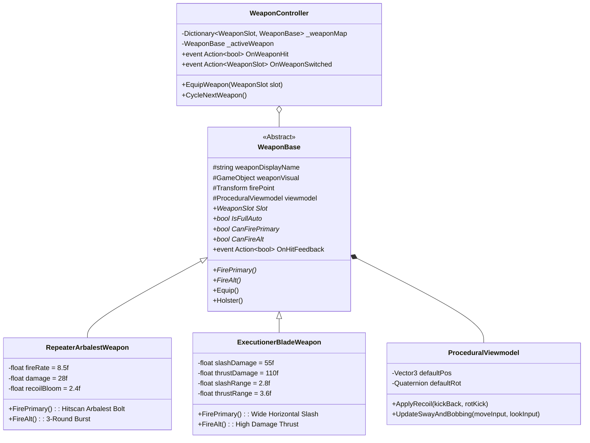

# WeaponArsenalArchitecture (Silah Cephaneliği ve Viewmodel Mimarisi)

> [!abstract] DUAL-LOADOUT VE PROCEDURAL VİEWMODEL SİSTEMİ
> Hızlı geçişli ana silahlar (Menzilli ve Yakın Dövüş) ile fiziksel hissiyatı artıran prosedürel yaylanma (sway), adım sekmesi (bobbing) ve dinamik geri tepme (recoil) motoru.

---

## 1. SİLAH MİMARİSİ VE SINIF HİYERARŞİSİ



---

## 2. KİLİT MEKANİKLER VE DETAYLAR

### 1. `WeaponSlot` Enum
```csharp
namespace RetroFPS
{
    public enum WeaponSlot
    {
        RepeaterArbalest = 0, // Slot 1: Hızlı Seri Menzilli Arbalest / Çivi Silahı
        ExecutionerBlade = 1  // Slot 2: Ağır Yakın Dövüş Cellat Kılıcı
    }
}
```

### 2. `ExecutionerBladeWeapon.cs` (Cellat Kılıcı)
- **Sol Tık (Birincil Saldırı):** Yatay geniş savurma (`slashRange = 2.8m`, `angle = 110°`, `damage = 55f`).
  * `Physics.OverlapSphereNonAlloc` kullanarak ön konideki birden fazla düşmanı biçer.
  * **Multi-Hitbox Tamponu (Anti-Duplicate):** Tek bir savurmada aynı düşmanın kafa ve gövde collider'larına ayrı ayrı çarpıp çift hasar vurmasını engelleyen `HashSet<IDamageable>` tamponu içerir.
- **Sağ Tık (İkincil Saldırı):** Dar sivri saplama darbesi (`thrustRange = 3.6m`, `damage = 110f`).
  * Tekil hedefe odaklı yüksek zırh delici darbe.
  * İsabet anında `HitstopManager.TriggerHitstop(0.08f)` mikro dondurması ile ağır tokluk hissi.
- **Görsel Sunum ve Kinematik:** Savurmalar yapay ekran şeritleri yerine doğrudan viewmodel model animasyonu, kamera ileri atılma sarsıntısı ve et kesme yönlü partikülleriyle sunulur.

### 3. `RepeaterArbalestWeapon.cs` (Seri Arbalest)
- **Hitscan Mermi Fiziği:** Hızlı delici cıvata atışları.
- **Recoil Bloom (Nişangah Yaylanması):** Seri atış yaptıkça mermi dağılım açısı artar; ateş kesildiğinde toparlanır.
- **Görsel Fişek:** Arbalest bolt mermisi tracer çizgisi ve darbe noktasında kıvılcım/kan patlaması.

### 4. `ProceduralViewmodel.cs` (Prosedürel Görünüm)
- **Sway (Dönüş Yaylanması):** Fare hareketine göre silahın yumuşak gecikmeli takibi (Lag & Tilt).
- **Bobbing (Yürüme/Kayma Sallantısı):** Koşarken, kayarken ve zıplarken sinüs dalgasıyla doğal silah adımlaması.
- **Recoil Spring (Dinamik Yay):** Ateş edildiğinde silah geriye teper ve yay katsayısıyla orijinal pozisyonuna döner.

---

## 3. YENİ BİR SİLAH EKLEME REÇETESİ (BAŞKA BİR AI İÇİN)
Asla `WeaponController.cs` içine silahın kendi atış mantığını yazmayın. Şu adımları izleyin:
1. `Assets/_Project/Scripts/Weapons/` altına `YeniSilahWeapon.cs` oluşturun.
2. `public class YeniSilahWeapon : WeaponBase` şeklinde türetin.
3. `Slot`, `CanFirePrimary`, `CanFireAlt`, `FirePrimary()`, `FireAlt()` gövdelerini doldurun.
4. Hedefi vururken:
   ```csharp
   if (hit.collider.TryGetComponent<Hitbox>(out var hitbox))
   {
       hitbox.TakeDamage(damage, hit.point, hit.normal);
   }
   else if (hit.collider.TryGetComponent<IDamageable>(out var damageable))
   {
       damageable.TakeDamage(damage, hit.point, hit.normal);
   }
   ```
5. `OnHitFeedback?.Invoke(isCrit);` olayını tetikleyin. Bu sayede nişangah hitmarker (`CrosshairHUD`) ve sesler otomatik çalışır.

---

## İlişkiler (Sinaptik Ağ Bağlantıları)
- [[CodebaseDependencyGraph]] ➔ `implements_weapons`
- [[CombatAndDamageInterfaces]] ➔ `damages_via_interfaces`
- [[HitstopAndAudioFeedback]] ➔ `triggers_audio_and_hitstop`
- [[CombatVFXAndDecalSystem]] ➔ `spawns_combat_vfx`
- ⬅️ [[START_HERE_AI_CONSTITUTION]] ➔ `mandated_by_constitution` *(gelen)*
- ⬅️ [[DualLoadoutAndWeapons]] ➔ `expands_combat_design` *(gelen)*
